# PX4 v1.18.0-rc1 飞控数据链代码级整理

> **源码基线**：`~/PX4-1.18`，`git describe --tags` = `v1.18.0-rc1`，commit `fca3df865a`。  
> **实验基线**：`make px4_sitl gz_netdrone` + `MicroXRCEAgent udp4 -p 8888` + `QGroundControl-x86_64.AppImage` + `ros2 run ax_circular_flight ax_circular_flight`。  
> **本文目标**：把“无人机为什么能飞起来”拆成可核对的数据链：每个进程、每个 socket、每个 uORB 话题、每个函数入口，以及关键参数。  
> **阅读顺序**：先看第 0 章的结论和总图，再看第 1 章复现；主链路是第 2→3→4→7→8 章（启动 → 传感器 → GPS/状态估计 → ROS 2 → 控制闭环），第 5 章 RC 与第 6 章 MAVLink 是辅助链路、可先跳过；第 9 章是本次实验的时序；第 10～12 章是排障和代码索引。

---

## 0. 结论速览

### 0.1 总体链路图

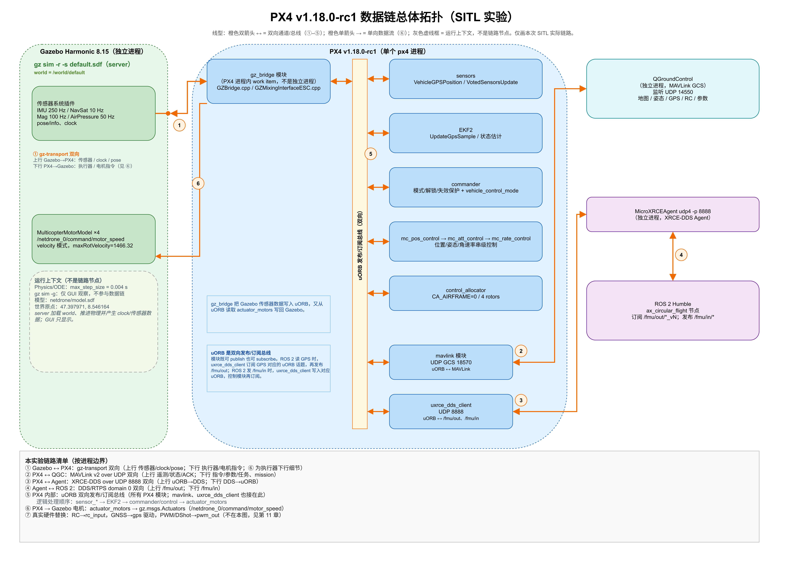

> drawio 源文件：[PX4_1.18_数据链路图.drawio](diagrams/PX4_1.18_数据链路图.drawio)（共 7 页，含启动、GPS、RC、MAVLink、ROS 2、控制闭环）。  
> 图中编号 ①～⑦ 与 0.2 节的链路表一一对应。

### 0.2 这次实验到底用了哪些链路

| 编号 | 链路 | 进程/端点 | 传输与协议 | 本次实验是否必需 | 主要代码入口 |
|---|---|---|---|---|---|
| ① | Gazebo 传感器 → PX4 | `gz sim` ↔ `px4` 内的 `gz_bridge` | gz-transport，Protobuf（`gz.msgs.*`） | **必需** | `GZBridge.cpp:668`、`:754` |
| ② | PX4 ↔ QGC | `mavlink` ↔ QGC | MAVLink v2 over UDP，PX4 18570 / QGC 14550 | 监视/地面操作需要；**飞行控制不依赖** | 启动与端口：`px4-rc.mavlink:20`、`mavlink_main.cpp:1136-1144`（`init_udp()` 建 socket、`sin_port`）；收包与源地址学习：`mavlink_receiver.cpp:3799-3825` |
| ③ | PX4 ↔ MicroXRCEAgent | `uxrce_dds_client` ↔ Agent | XRCE-DDS over UDP 8888 | **必需** | `uxrce_dds_client.cpp:175`、`:218` |
| ④ | Agent ↔ ROS 2 | Agent ↔ `ax_circular_flight` | DDS/RTPS（Fast DDS），domain 0 | **必需** | `utilities.hpp:27`、`dds_topics.yaml` |
| ⑤ | PX4 内部 | 所有模块 | uORB 发布/订阅 | **必需** | `msg/*.msg`、`uORB::Publication/Subscription` |
| ⑥ | PX4 → Gazebo 电机 | `gz_bridge` ↔ `gz sim` | gz-transport，`gz.msgs.Actuators` | **必需** | `GZMixingInterfaceESC.cpp:65`、`:90` |
| ⑦ | 真实硬件替换 | RC/GNSS/PWM | 串口/PPM/CAN/PWM | SITL 不用；真机必需 | `RCInput.cpp`、`gps.cpp`、`pwm_out` |

**一句话结论**：本次实验的最小闭环是 **Gazebo 传感器 → gz_bridge → uORB → EKF2 → ROS 2 Offboard 设定点 → mc_pos/att/rate → control_allocator → actuator_motors → gz_bridge → Gazebo 电机**；QGC 的 MAVLink 链路是并行的监视/地面操作链路，不是飞行动力的必经环节。

### 0.3 信息流的 10 个关键步骤

1. `make px4_sitl gz_netdrone` 构建并启动 `px4`，`PX4_SIM_MODEL=gz_netdrone`。
2. `rcS` 按模型名找到 `4050_gz_netdrone`，设置 `VEHICLE_TYPE=mc`、`SIM_GZ_EN=1`、`CA_*` 几何、`SIM_GZ_EC_*` 输出。
3. `px4-rc.gzsim` 启动 `gz sim -r -s default.sdf` 和 GUI，调用 `gz service .../create` 生成 `netdrone_0`，再执行 `gz_bridge start -w default -n netdrone_0`。
4. `gz_bridge` 等 `/world/default/clock`，订阅 `/world/default/pose/info` 与 IMU/NavSat/Mag/Baro 主题；初始化 ESC mixing 输出。
5. IMU/NavSat/Mag/Baro 被写成 `sensor_accel/sensor_gyro/sensor_gps/sensor_mag/sensor_baro`；`sensors` 模块的 `VotedSensorsUpdate` 只把 IMU 的加速度/角速度（`sensor_accel`/`sensor_gyro`）合成 `sensor_combined`；磁力计走 `vehicle_magnetometer`、气压计走 `vehicle_air_data`，`VehicleGPSPosition` 处理后发布 `vehicle_gps_position`；EKF2 融合出 `vehicle_local_position` / `vehicle_global_position`。Gazebo 的 NavSat 真值另走 `vehicle_global_position_groundtruth`，不参与控制。
6. `commander` 发布 `vehicle_status`；`uxrce_dds_client` 把 `vehicle_status`、`vehicle_local_position` 等按 `MESSAGE_VERSION` 加后缀发布到 `/fmu/out/*`。
7. `MicroXRCEAgent` 把 XRCE 实体映射成 DDS 实体；ROS 2 节点收到 `/fmu/out/vehicle_status_v4`、`/fmu/out/vehicle_local_position_v1`。
8. 节点以 50 Hz 发布 `/fmu/in/offboard_control_mode` 和 `/fmu/in/trajectory_setpoint`；然后发 `VEHICLE_CMD_COMPONENT_ARM_DISARM`，再发 `VEHICLE_CMD_DO_SET_MODE`（OFFBOARD）。
9. `commander` 置 `nav_state=OFFBOARD`，`vehicle_control_mode` 打开 offboard/position 等标志；`mc_pos_control` 消费 `trajectory_setpoint`，依次产出姿态、角速率、推力/力矩。
10. `control_allocator` 产出 `actuator_motors[0..3]`；`FunctionMotors` 做推力模型修正和 [0,1]→[-1,1] 映射，`MixingOutput` 再按 `SIM_GZ_EC_MIN1..4/MAX1..4` 缩放并做 armed、lockdown/kill、termination 门控（`ramp_up=false`，**没有** 500 ms 爬升）；`GZMixingInterfaceESC` 发布 `gz.msgs.Actuators`；Gazebo 的 `MulticopterMotorModel` 产生推力/反扭矩，机体运动，传感器再反馈回第 5 步。

### 0.4 五个不直观的结论

如果只读参数表和话题名，下面五件事都会推错；它们也是后面章节要逐段展开的主线：

1. **GPS 没进双接收机融合，不是因为融合参数关着**。`SENS_GPS_MASK` 本次是 **7**（tag 默认也是 7），退化的真实原因是只有一台接收机在发布 `sensor_gps`，`_np_gps_suitable_for_blending=1<2`（§4.1）。
2. **`COM_OBL_RC_ACT` 只决定“初始动作”**。本次它给出 `FallbackPosCtrl`，最终执行的却是 RTL——先被 RC 丢失标志改写，再经七阶段聚合/延迟/可运行性选出（§8.7.4、§8.7.5）。
3. **`Action::None` 也会启动 5 s 全局延迟**。它不参与动作聚合，却能把 `_current_delay` 置正；随后到来的 RTL 会先被改写成 Hold（§8.7.6）。
4. **`Always` 不等于豁免 Hold**。Hold 的条件是聚合后的 `allow_user_takeover <= AlwaysModeSwitchOnly`，`Always=0` 恰好满足；能挡住的是 `Never=3`（§8.7.6）。
5. **同一 `caller_id` 降级只改 action**。`takeover` 与 `can_be_deferred` 保留首次入队值，所以一个已经变成 `Warn` 的条目仍能否决整组 defer（§8.7.5、C.8）。

---

## 1. 实验复现与观测方法


### 1.1 本机软件基线

| 项目 | 版本/位置 |
|---|---|
| 操作系统 | Ubuntu 22.04.5 LTS（Jammy），kernel 6.8.0-138-generic，x86_64 |
| PX4 | v1.18.0-rc1，`~/PX4-1.18`，commit `fca3df865a` |
| Gazebo | gz-sim 8.15.0（Harmonic），另装 Fortress 6.18.0 |
| ROS 2 | Humble Hawksbill，`/opt/ros/humble`，`rmw_fastrtps_cpp` |
| Fast DDS | 2.6.12（`ros-humble-fastrtps`） |
| uXRCE-DDS Client | 2.4.0（编入 PX4，Kconfig 变量 `UXRCE_DDS_CLIENT_USE_DDS_V3` 未启用） |
| MicroXRCEAgent | 2.4.2（`~/桌面/Micro-XRCE-DDS-Agent/build/`，已在 PATH） |
| px4_msgs | `release/1.18`，`0be57f2`，260 msg + 1 srv |
| px4_ros2_cpp | `release/1.18`，`c3e410f`，含 14 个示例包 |
| 工具链 | Python 3.10.12 / CMake 3.22.1 / GCC 11.4.0 |

> 该表来自 `~/latex/px4_software_table.pdf`，与本次源码/运行环境一致。
>
> **基线补充（行号口径）**：
>
> - `4050_gz_netdrone` 与 `Tools/simulation/gz/models/netdrone/model.sdf` 是**本机工作区文件**，不在 tag `fca3df865a` 的提交里；本文引用它们的行号只对当前工作区成立。
> - 本机 `ROMFS/px4fmu_common/init.d-posix/rcS` 在 tag 第 170 行之后插入了 3 行（`SDLOG_BACKEND=0`）。因此 tag ≤170 的引用与 tag 一致；tag ≥171 的引用是“工作区行号 = tag 行号 + 3”。本文其余 rcS 引用统一按 tag 行号。例如 `COM_LOW_BAT_ACT` 在 tag 是 `:182`，本机工作区是 `:185`。
> - 工作区还有**第二处**本地改动：`src/modules/logger/module.yaml` 把 `SDLOG_BACKEND` 的 `default` 从 **3** 改成 **0**（`git diff src/modules/logger/module.yaml`），与 rcS 里那行 `param set SDLOG_BACKEND 0` 是同一个目的。因此“其余源码与 tag 一致”只对除这两个文件以外的路径成立。
- 其余 PX4 源码文件与 tag 一致；`GZBridge.cpp` 991 行、`GZMixingInterfaceESC.cpp` 139 行。

### 1.2 四条命令与进程关系

> **复现前置**：`gz_netdrone` 这个 target 是 `cmake` 用 `file(GLOB gz_airframes .../*_gz_*)` 扫出来的（`gz_bridge/CMakeLists.txt:48-49`），airframe 文件不在 tag 里就不存在这个 target；`netdrone/model.sdf` 与 `ax_circular_flight` 同理。所以在干净检出上照抄下面四条命令，会在第 1 步报 `unknown target 'gz_netdrone'`、第 4 步报 `Package 'ax_circular_flight' not found`。本文不提供这两个本地产物的获取脚本，只声明它们属于本机工作区（行号按工作区）。

```bash
# 终端 A：PX4 SITL + Gazebo
cd ~/PX4-1.18
make px4_sitl gz_netdrone

# 终端 B：XRCE-DDS Agent
MicroXRCEAgent udp4 -p 8888

# 终端 C：QGC（AppImage）
~/下载/QGroundControl-x86_64.AppImage

# 终端 D：ROS 2 Offboard 节点
source /opt/ros/humble/setup.bash
source ~/ros2_ws/install/setup.bash
ros2 run ax_circular_flight ax_circular_flight
```

实际进程关系（用 `ps -ef | grep -E 'px4|gz sim|MicroXRCE|QGround|ax_circular'` 可核对）：

| 进程 | 作用 | 关键点 |
|---|---|---|
| `px4` | 飞控主进程 | `gz_bridge`、`sensors`、`ekf2`、`commander`、`mavlink`、`uxrce_dds_client` 都是它内部的模块/线程，**不是独立进程** |
| `gz sim -r -s ...` | Gazebo server | 物理、传感器、电机模型 |
| `gz sim -g` | Gazebo GUI | 可选，`HEADLESS` 为空时启动 |
| `QGroundControl` | MAVLink 地面站 | 监听 14550，向 PX4 18570 发包 |
| `MicroXRCEAgent` | XRCE-DDS Agent | 监听 8888，桥接 XRCE 与 DDS |
| `ax_circular_flight` | ROS 2 节点 | 发布 `/fmu/in/*`，订阅 `/fmu/out/*` |

### 1.3 端口与地址

| 端口 | 谁监听/绑定 | 用途 | 代码/脚本 |
|---|---|---|---|
| `18570` | PX4 `mavlink` | GCS 链路（QGC） | `px4-rc.mavlink:11,20` |
| `14550` | QGC | QGC 的 UDP 监听端口 | QGC 默认链路 |
| `14580` | PX4 `mavlink` | MAVLink Onboard/API 伴飞链路本地端口（**本次 ROS 2 Offboard 未使用**） | `px4-rc.mavlink:4`（变量）、`:32`（`-u`） |
| `14540` | 机载/伴飞计算机 | MAVLink Onboard/API 远端端口（本次未使用；控制走 8888/XRCE） | `px4-rc.mavlink:5`（变量）、`:32`（`-o`） |
| `8888` | `MicroXRCEAgent` | XRCE-DDS | `rcS:319-326` |
| `14280/14030` | PX4/相机 | Onboard payload 链路 | `px4-rc.mavlink:7-8,35` |
| `13030/13280` | PX4/云台 | Gimbal 链路 | `px4-rc.mavlink:9-10,38` |

> PX4 的 GCS 链路是 `mavlink start -x -u 18570 -r 4000000 -f`：`-u` 是 PX4 本地 UDP 端口，`-f` 打开转发，`-x` 打开 FTP。QGC 的首个 UDP 包到达后，PX4 在 `mavlink_receiver.cpp:3799-3825` 里学习源 IP/端口，之后 `send_finish()` 用该地址回发。

### 1.4 现场自检命令

```bash
# 1) 看 Gazebo 是否真的发布了 netdrone 的传感器/电机主题
gz topic -l | grep -E 'netdrone_0|world/default/clock'

# 2) 看 PX4 与 QGC、Agent 的 UDP 绑定
ss -lunp | grep -E '18570|14550|8888'

# 3) 看 ROS 2 是否收到 PX4 话题（注意 _v4/_v1 后缀）
ros2 topic list | grep fmu
ros2 topic echo /fmu/out/vehicle_status_v4 --qos-reliability best_effort --once
ros2 topic hz /fmu/out/vehicle_local_position_v1   # hz 没有 --qos-reliability 参数，内部已按 sensor_data/BEST_EFFORT 订阅

# 4) 看节点是否在发 offboard 设定点
ros2 topic hz /fmu/in/trajectory_setpoint
ros2 topic echo /fmu/in/offboard_control_mode --once

# 5) 看 QGC 链路（PX4 控制台）
mavlink status
```

如果 `ros2 topic list` 里只有 `/fmu/out/vehicle_status` 而没有 `_v4`，说明你看的不是 v1.18 的 `px4_msgs`，或者 Agent/命名空间不对；v1.18 的 `VehicleStatus.MESSAGE_VERSION=4`，DDS 话题名会变成 `vehicle_status_v4`。

---

## 2. 启动链路：从 make 到 gz_bridge

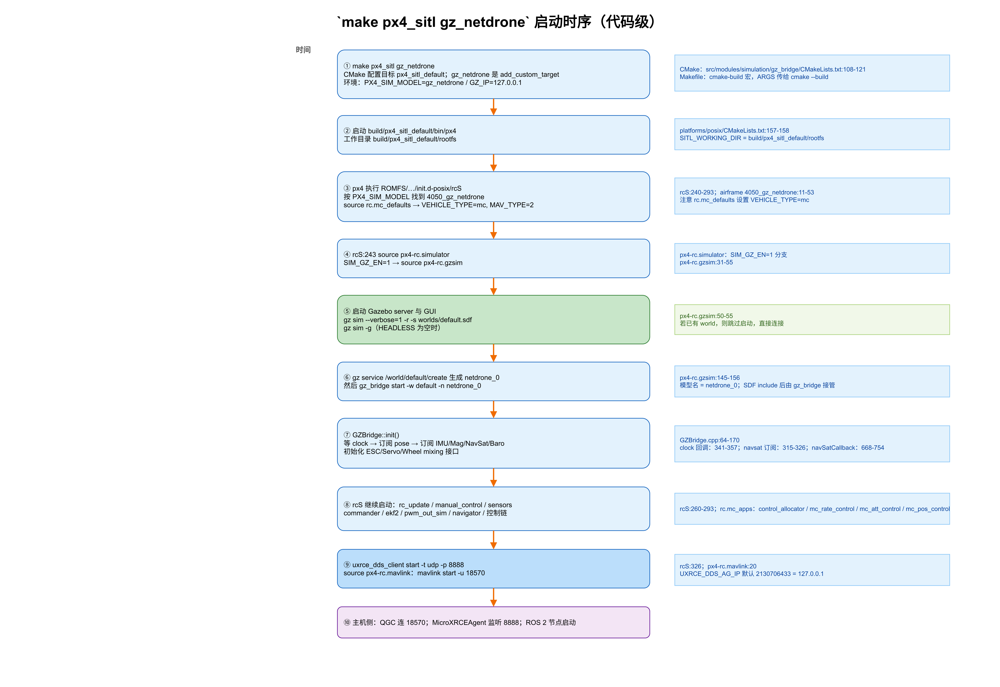

### 2.1 `make px4_sitl gz_netdrone` 到底做了什么

`Makefile` 把第一个目标 `px4_sitl` 当作配置目标，把后续参数 `gz_netdrone` 传给 CMake/Ninja：

```make
# Makefile（简化）
FIRST_ARG := $(firstword $(MAKECMDGOALS))
ARGS := $(wordlist 2,$(words $(MAKECMDGOALS)),$(MAKECMDGOALS))
...
@cmake --build $(BUILD_DIR) -- $(PX4_MAKE_ARGS) $(ARGS)
```

`gz_netdrone` 不是手写的 Make 目标，而是 `src/modules/simulation/gz_bridge/CMakeLists.txt` 根据 airframe 文件名自动生成的：

```cmake
# src/modules/simulation/gz_bridge/CMakeLists.txt:108-121
foreach(gz_airframe IN LISTS gz_airframes)          # ROMFS/.../airframes/*_gz_*
  string(REGEX REPLACE ".*_gz_" "" model_name ${gz_airframe})  # 4050_gz_netdrone -> netdrone
  if(world_name STREQUAL "default")
    add_custom_target(gz_${model_name}
      COMMAND ${CMAKE_COMMAND} -E env
              PX4_SIM_MODEL=gz_${model_name} GZ_IP=127.0.0.1
              $<TARGET_FILE:px4>
      WORKING_DIRECTORY ${SITL_WORKING_DIR}          # build/px4_sitl_default/rootfs
      DEPENDS px4 px4_gz_plugins)
```

所以 `gz_netdrone` 的本质是：**在 `build/px4_sitl_default/rootfs` 目录下，以 `PX4_SIM_MODEL=gz_netdrone` 环境变量运行 `px4` 可执行文件**。`SITL_WORKING_DIR` 定义在 `platforms/posix/CMakeLists.txt:157-158`。

### 2.2 `rcS`：按模型名找 airframe

`px4` 启动后执行 `ROMFS/px4fmu_common/init.d-posix/rcS`。关键逻辑：

```sh
# rcS:240-293、326、362（简化）
if ! replay tryapplyparams
then
    . px4-rc.simulator
fi
...
rc_update start
manual_control start
sensors start
commander start
ekf2 start &
pwm_out_sim start -m sim
. ${R}etc/init.d/rc.vehicle_setup
navigator start
...
uxrce_dds_client start -t udp -p 8888
...
. px4-rc.mavlink
```

其中 `PX4_SIM_MODEL=gz_netdrone` 会让 `rcS` 在 `etc/init.d-posix/airframes` 里找到 `4050_gz_netdrone`：

```sh
# rcS:55-63
REQUESTED_AUTOSTART=$(ls "${R}etc/init.d-posix/airframes" | sed -n 's/^\([0-9][0-9]*\)_'${PX4_SIM_MODEL}'$/\1/p')
SYS_AUTOSTART=$REQUESTED_AUTOSTART
```

`4050_gz_netdrone` 的第一行是 `. ${R}etc/init.d/rc.mc_defaults`，所以 `VEHICLE_TYPE=mc`、`MAV_TYPE=2`：

```sh
# ROMFS/px4fmu_common/init.d-posix/airframes/4050_gz_netdrone:11-53
. ${R}etc/init.d/rc.mc_defaults
PX4_SIMULATOR=${PX4_SIMULATOR:=gz}
PX4_GZ_WORLD=${PX4_GZ_WORLD:=default}
PX4_SIM_MODEL=${PX4_SIM_MODEL:=netdrone}
param set-default SIM_GZ_EN 1
param set SYS_HAS_NUM_ASPD 0
param set CA_AIRFRAME 0
param set CA_ROTOR_COUNT 4
param set CA_ROTOR0_PX 0.1740
...
param set-default SIM_GZ_EC_FUNC1 101
...
param set SIM_GZ_EC_MAX1 1466
param set MPC_THR_HOVER 0.32
```

> **易错点**：几何参数用的是 `param set` 而不是 `set-default`。如果 `parameters.bson` 里残留旧几何，`set-default` 不会覆盖，`control_allocator` 的混控几何就会和 SDF 不一致，表现为“起飞即翻”。

### 2.3 `px4-rc.simulator` → `px4-rc.gzsim`

`SIM_GZ_EN=1` 时走 Gazebo 分支：

```sh
# ROMFS/.../px4-rc.simulator
elif [ "$PX4_SIMULATOR" = "gz" ] || [ "$(param show -q SIM_GZ_EN)" = "1" ]; then
    . px4-rc.gzsim
```

`px4-rc.gzsim` 做四件事：

1. 检查 `gz sim --versions` 至少 8.0.0；
2. 若没有已运行的 world，启动 `gz sim --verbose=1 -r -s worlds/default.sdf` 和 `gz sim -g`；
3. 等待 `/world/default/scene/info` 服务就绪；
4. 用 `gz service /world/default/create` 生成模型，再执行 `gz_bridge start -w default -n netdrone_0`。

```sh
# px4-rc.gzsim:50-55
${gz_command} ${gz_sub_command} --verbose=${GZ_VERBOSE:=1} -r -s "${PX4_GZ_WORLDS}/${PX4_GZ_WORLD}.sdf" &
if [ -z "${HEADLESS}" ]; then
    ${gz_command} ${gz_sub_command} -g > /dev/null 2>&1 &
fi

# px4-rc.gzsim:145-153
${gz_command} service -s "/world/${PX4_GZ_WORLD}/create" \
    --reqtype gz.msgs.EntityFactory --reptype gz.msgs.Boolean --timeout 5000 \
    --req "name: \"${MODEL_NAME_INSTANCE}\", allow_renaming: false, sdf: '${sdf_str}'"
...
gz_bridge start -w "${PX4_GZ_WORLD}" -n "${MODEL_NAME_INSTANCE}"
```

模型实例名是 `netdrone_0`（`MODEL_NAME_INSTANCE="${MODEL_NAME}_${px4_instance}"`）。这个名称后面决定所有 gz topic 的前缀，例如：

```text
/world/default/model/netdrone_0/link/base_link/sensor/navsat_sensor/navsat
/netdrone_0/command/motor_speed
```

### 2.4 `GZBridge::init()`：先等时钟，再订阅

`GZBridge` 是 PX4 进程内的 `ModuleBase + ScheduledWorkItem`，不是独立进程。`init()` 的顺序非常关键：

```cpp
// src/modules/simulation/gz_bridge/GZBridge.cpp:64-171（简化）
int GZBridge::init()
{
    if (!subscribeClock(true)) return PX4_ERROR;          // /world/default/clock
    while (1) { px4_usleep(25000); if (_realtime_clock_set) break; }

    if (!subscribePoseInfo(true)) return PX4_ERROR;       // /world/default/pose/info

    if (_sim_gz_en_imu.get())  subscribeImu(false);
    if (_sim_gz_en_mag.get())  subscribeMag(false);
    if (_sim_gz_en_gps.get())  subscribeNavsat(false);
    if (_sim_gz_en_baro.get()) subscribeAirPressure(false);
    ...
    if (!_mixing_interface_esc.init(_model_name)) return PX4_ERROR;
    if (!_mixing_interface_servo.init(_model_name)) return PX4_ERROR;
    if (!_mixing_interface_wheel.init(_model_name)) return PX4_ERROR;
    ScheduleNow();
    return OK;
}
```

**为什么要先等 clock**：`clockCallback` 首次用 Gazebo 的仿真时间建立 PX4 的 `CLOCK_REALTIME` 基准，之后每个 clock 回调同步 `CLOCK_MONOTONIC`。如果 PX4 在 clock 之前就发布 0 时间戳的传感器数据，会造成时间戳异常，影响 EKF 融合、数据有效性判断和 MAVLink/uXRCE 的时间同步；这里说“直接崩掉”证据不足。代码在 `GZBridge.cpp:341-357`。

### 2.5 启动完成后的模块状态

| 阶段 | 已启动的东西 | 证据 |
|---|---|---|
| `rcS` 前半 | `dataman` | `rcS:238` |
| 仿真就绪**之后** | `load_mon`、`failure_injection_manager`、`battery_simulator`、`system_power_simulator` | `rcS:246-258`（都在 `:243` 的 `. px4-rc.simulator` 之后） |
| 仿真 | `gz sim`、模型 `netdrone_0`、`gz_bridge` | `px4-rc.gzsim:50,145,153` |
| 基础服务 | `tone_alarm`、`rc_update`、`manual_control`、`sensors`、`commander` | `rcS:260-264` |
| 估计/控制 | `ekf2`、`control_allocator`、`mc_rate_control`、`mc_att_control`、`mc_pos_control` | `rcS:268-291`、`rc.mc_apps:11-42` |
| 并行输出分支 | `pwm_out_sim`：SITL 端参数前缀是 `PWM_MAIN`（`PWMSim.hpp:47-51`），不是 `PWM_SIM_*`（那四个是编译期常量）。本 airframe 未设 `PWM_MAIN_FUNC*`（默认 0 = Disabled），**本次无输出**；实际电机输出走 `SIM_GZ_EC_*` | `rcS:283`、`PWMSim.hpp:47-51` |
| 通信 | `navigator`、`uxrce_dds_client`、`mavlink`（GCS/Offboard/Payload/Gimbal） | `rcS:293-326,362`、`px4-rc.mavlink:20-38` |

---

## 3. 仿真链路：Gazebo ↔ PX4

### 3.1 gz-transport 主题清单（本次模型）

`GZBridge` 订阅/发布的主题名有**三种**拼接方式，不能一律当“world + model”：传感器是 `/world/<world>/model/<model>/link/<link>/sensor/<sensor>/<suffix>`；`clock` 与 `pose/info` 只带 world（`GZBridge.cpp:203`、`:216`）；ESC 与 odometry 只带 model（`GZMixingInterfaceESC.cpp:40-49` 的 `/<model>/command/motor_speed`、`GZBridge.cpp:254` 的 `/model/<model>/odometry_with_covariance`）。`netdrone_0` 场景下：

| 方向 | gz 主题 | 消息类型 | 频率/说明 | 代码 |
|---|---|---|---|---|
| Gazebo → PX4 | `/world/default/clock` | `gz.msgs.Clock` | 每个仿真步 | `GZBridge.cpp:202-212` |
| Gazebo → PX4 | `/world/default/pose/info` | `gz.msgs.Pose_V` | 位姿真值 | `GZBridge.cpp:214-224` |
| Gazebo → PX4 | `/world/default/model/netdrone_0/link/base_link/sensor/imu_sensor/imu` | `gz.msgs.IMU` | 250 Hz | `GZBridge.cpp:226-236` |
| Gazebo → PX4 | `.../sensor/magnetometer_sensor/magnetometer` | `gz.msgs.Magnetometer` | 100 Hz | `GZBridge.cpp:238-249` |
| Gazebo → PX4 | `.../sensor/navsat_sensor/navsat` | `gz.msgs.NavSat` | 10 Hz | `GZBridge.cpp:315-326` |
| Gazebo → PX4 | `.../sensor/air_pressure_sensor/air_pressure` | `gz.msgs.FluidPressure` | 50 Hz | `GZBridge.cpp:302-313` |
| PX4 → Gazebo | `/netdrone_0/command/motor_speed` | `gz.msgs.Actuators` | 电机转速指令 | `GZMixingInterfaceESC.cpp:40-49,79-90` |

> 表里的 250/100/10/50 Hz 取自**本地**未跟踪的 `Tools/simulation/gz/models/netdrone/model.sdf`（第 44/51/67/76 行），不是 tag 内的事实——`Tools/simulation/gz` 在 tag 里是 gitlink，`models/netdrone/` 属于工作区新增。换模型或改 SDF 的 `<update_rate>` 后，这张表要重算。
| PX4 → PX4（同一 gz topic 自订阅） | `/netdrone_0/command/motor_speed` | `gz.msgs.Actuators` | 回读自己发出的命令来构造 `esc_status`；Gazebo 电机插件不发布实测值 | `GZMixingInterfaceESC.cpp:105-139` |

> **ESC 反馈的边界**：`GZMixingInterfaceESC` 确实在同一 topic 上同时 `Subscribe` 和 `Advertise`，但 Gazebo Harmonic 的 `MulticopterMotorModel` 只订阅电机命令，不在该 topic 上发布实测转速（`gz topic -i` 只见 PX4 一个 publisher，4 个 Gazebo 电机插件是 subscriber）。因此 `motorSpeedCallback()` 收到的是 PX4 自己发出的命令回读：`esc_rpm = velocity`（未做 rad/s→RPM 换算），`esc_temperature` 固定写 `50.f`。`esc_status` 不是 Gazebo 物理模型测得的真实转速遥测，不能拿它证明“Gazebo 已回写实际转速”。

### 3.2 传感器上行：从 gz.msgs 到 uORB

#### IMU

```cpp
// GZBridge.cpp:432-452（简化）
void GZBridge::imuCallback(const gz::msgs::IMU &msg)
{
    const uint64_t timestamp = hrt_absolute_time();
    static const auto q_FLU_to_FRD = gz::math::Quaterniond(0, 1, 0, 0);

    gz::math::Vector3d accel_b = q_FLU_to_FRD.RotateVector({msg.linear_acceleration().x(), ...});
    _px4_accel.update(timestamp, accel_b.X(), accel_b.Y(), accel_b.Z());

    gz::math::Vector3d gyro_b = q_FLU_to_FRD.RotateVector({msg.angular_velocity().x(), ...});
    _px4_gyro.update(timestamp, gyro_b.X(), gyro_b.Y(), gyro_b.Z());
}
```

- Gazebo 的 IMU 是 **FLU**（X 前、Y 左、Z 上）；PX4 机体坐标是 **FRD**（X 前、Y 右、Z 下）。
- 代码用 `q_FLU_to_FRD = (0,1,0,0)` 绕 X 轴 180° 旋转，把 Y/Z 取反。
- `_px4_accel` / `_px4_gyro` 是 PX4 的 `PX4Accelerometer` / `PX4Gyroscope` 封装，最终发布 `sensor_accel` / `sensor_gyro`。
- `sensors` 模块的 `VotedSensorsUpdate` 做多 IMU 投票、温补、滤波，发布 `sensor_combined`；EKF2 订阅 `sensor_combined`。

#### 磁力计

```cpp
// GZBridge.cpp:393-403（简化）
_px4_mag.update(timestamp, -msg.field_tesla().y(), -msg.field_tesla().x(), msg.field_tesla().z());
```

上游在 `GZBridge.cpp:396-398` 留了一条 FIXME：这个磁力计插件按**高斯**发布（不是消息字段名里的 tesla），且处在“奇怪的左手系”（gz-sim PR #2460）。所以代码做的是 `(-Y, -X, +Z)`——X/Y 取反再交换，变换矩阵行列式为 −1，确实不是纯旋转。本机 SDF 只配了噪声、没有额外 `<pose>`（`netdrone/model.sdf:65-73`），因此这条变换就是全部坐标处理；“高斯 + 左手系”是上游注释的结论，不是从 SDF 反推的。最终 `sensors` 发布 `vehicle_magnetometer`，EKF2 用于航向观测。

#### 气压计

`GZBridge.cpp:405-409` 把 `gz.msgs.FluidPressure` 的 `pressure()` 交给 `_px4_baro.update()`，发布 `sensor_baro`，`sensors` 汇总为 `vehicle_air_data`。

#### GPS/NavSat：本文重点

```cpp
// GZBridge.cpp:668-755（简化）
void GZBridge::navSatCallback(const gz::msgs::NavSat &msg)
{
    const uint64_t timestamp = hrt_absolute_time();

    if (!_pos_ref.isInitialized()) {
        _pos_ref.initReference(msg.latitude_deg(), msg.longitude_deg(), timestamp);
        _alt_ref = msg.altitude();
        return;                                  // 第一次只建立参考点，不发布
    }

    double latitude = msg.latitude_deg();
    double longitude = msg.longitude_deg();
    double altitude = msg.altitude();
    float vel_north = msg.velocity_north();
    float vel_east = msg.velocity_east();
    float vel_down = -msg.velocity_up();

    vehicle_global_position_s gps_truth{};        // 发布到 vehicle_global_position_groundtruth
    ...
    _gpos_ground_truth_pub.publish(gps_truth);    // 仿真真值，不参与控制
    addGpsNoise(latitude, longitude, altitude, vel_north, vel_east, vel_down);

    sensor_gps_s sensor_gps{};
    sensor_gps.fix_type = (_sim_gps_used.get() >= 4) ? 3 : 0;
    sensor_gps.latitude_deg = latitude;
    sensor_gps.longitude_deg = longitude;
    sensor_gps.altitude_msl_m = altitude;
    sensor_gps.vel_n_m_s = vel_north;
    ...
    _sensor_gps_pub.publish(sensor_gps);
}
```

关键点：

- **第一次 NavSat 只建立投影参考点**（`_pos_ref`、`_alt_ref`），不发布 `sensor_gps`；所以刚启动时 EKF 会短暂没有 GPS。
- 之后每帧先发布 `vehicle_global_position_groundtruth` 真值（`_gpos_ground_truth_pub`），再加噪声发布 `sensor_gps`。两者是**不同消息类型**的两个 topic（真值是 `vehicle_global_position_s`，估计器输入是 `sensor_gps_s`，字段布局也不同）：真值只给日志/对比，`sensor_gps` 才进入估计器。
- 噪声模型按 u-blox F9P 量级：位置随机游走 + 速度噪声，代码在 `GZBridge.cpp:635-666`。
- `SIM_GPS_USED` 默认 10；`>=4` 才给 `fix_type=3`（3D fix），否则 `fix_type=0`。
- `SensorGps.msg` 末尾的 `# TOPICS sensor_gps vehicle_gps_position` 会生成两个**独立的 uORB topic**，不是 alias：`sensor_gps` 是驱动/仿真写出的原始测量，`vehicle_gps_position` 由 `VehicleGPSPosition` 模块发布（选主、天线偏移、延迟/PPS 校正之后）。两者消息类型相同，但数据源和语义不同。

### 3.3 执行器下行：从 actuator_motors 到 Gazebo 电机

```cpp
// GZMixingInterfaceESC.cpp:36-63（初始化）
bool GZMixingInterfaceESC::init(const std::string &model_name)
{
    std::string motor_speed_topic = "/" + model_name + "/command/motor_speed";
    _node.Subscribe(motor_speed_topic, &GZMixingInterfaceESC::motorSpeedCallback, this);
    _actuators_pub = _node.Advertise<gz::msgs::Actuators>(motor_speed_topic);
    _esc_status_pub.advertise();
    ScheduleNow();
}

// GZMixingInterfaceESC.cpp:65-95（输出）
bool GZMixingInterfaceESC::updateOutputs(float outputs[MAX_ACTUATORS], unsigned num_outputs, ...)
{
    gz::msgs::Actuators rotor_velocity_message;
    auto *vel = rotor_velocity_message.mutable_velocity();
    for (unsigned i = 0; i < active_output_count; ++i) {
        vel->Add(static_cast<double>(outputs[i]));
    }
    return _actuators_pub.Publish(rotor_velocity_message);
}
```

`outputs[i]` 已经是 `MixingOutput` 按 `SIM_GZ_EC_MINn/MAXn` 缩放后的值。`FunctionMotors` 先读 `actuator_motors.control[i] ∈ [0,1]`，可选按 `THR_MDL_FAC` 做推力模型反解，再把非可逆电机从 `[0,1]` 映射到 `[-1,1]`；`MixingOutput` 最后把 `[-1,1]` 线性映射到该通道的 `[MINn, MAXn]`：

```cpp
// src/lib/mixer_module/functions/FunctionMotors.hpp:52-65
_topic(&context.work_item, ORB_ID(actuator_motors))
...
if (_topic.update(&_data)) {
    updateValues(_data.reversible_flags, _thrust_factor, _data.control, actuator_motors_s::NUM_CONTROLS);
}
```

`SIM_GZ_EC_FUNC1=101` 对应 `OutputFunction::Motor1`，`FUNC2=102` 对应 `Motor2`，以此类推。`SIM_GZ_EC_MIN1..4=190`、`SIM_GZ_EC_MAX1..4=1466` 与 SDF 的 `maxRotVelocity=1466.32` 对齐，所以 PX4 输出的是 **rad/s 量级的电机转速指令**，不是 PWM 脉宽。

**这条 Gazebo 电机链没有 500 ms 输出爬升（`ramp_up = false`）。** 通用 `MixingOutput` 默认带一个 500 ms 的 `RAMP` 状态（`mixer_module.cpp:570` `RAMP_TIME_US = 500_ms`）：解锁后从 0 线性爬升到当前输出。但 `GZMixingInterfaceESC` 在构造时把这个开关关掉了：

```cpp
// src/modules/simulation/gz_bridge/GZMixingInterfaceESC.hpp:80
MixingOutput _mixing_output{"SIM_GZ_EC", MAX_ACTUATORS, *this,
                            MixingOutput::SchedulingPolicy::Auto,
                            false,   // support_esc_calibration
                            false};  // ramp_up

// src/lib/mixer_module/mixer_module.hpp:119-121（签名与默认值）
MixingOutput(const char *param_prefix, uint8_t max_num_outputs, OutputModuleInterface &interface,
             SchedulingPolicy scheduling_policy, bool support_esc_calibration,
             bool ramp_up = true, const uint8_t instance_start = 1);
```

状态机因此在 `mixer_module.cpp:576-581` 从 `OFF` 直接进入 `ON`（`if (_output_ramp_up) { ... RAMP ... } else { ... ON ... }`），`:628-642` 的 `RAMP` 分支永不执行。这不是 Gazebo 独有的：`GZMixingInterfaceServo.hpp:86`、`GZMixingInterfaceWheel.hpp:81`、`PWMSim.hpp:85`、`uavcan_main.hpp:148`（UAVCAN ESC，`UAVCAN_EC`）与 `:176`（UAVCAN 伺服，`UAVCAN_SV`）、`Cyphal.hpp:105`、`vertiq_io.hpp:125` 全都显式传 `false`；只有真正的硬件 PWM 输出（`src/drivers/pwm_out/PWMOut.hpp:84`、`linux_pwm_out.hpp:81`、`Roboclaw.hpp:107`，5 参数形式）沿用默认 `ramp_up=true`。

所以“解锁瞬间电机指令从 0 平滑爬到目标值”这个常见说法，在本次 SITL 链路上**完全不成立**：`GZMixingInterfaceESC` 解锁后第一次 `output_limit_calc()` 就给出目标值，只受 `armed` 门控与 `lockdown`/`kill`、`termination` 的 DIS/FAIL 值约束；`pwm_out_sim` 同样没有爬升。想验证“有无爬升”不能看 `actuator_outputs_sim`，要看 `esc_status` 或 Gazebo 侧转速——而这两者在这条链上都不是独立测量（见 3.1 的 ESC 回读说明）。

SDF 里的电机模型：

```xml
<!-- Tools/simulation/gz/models/netdrone/model.sdf:214-229 -->
<plugin filename="gz-sim-multicopter-motor-model-system" name="gz::sim::systems::MulticopterMotorModel">
  <jointName>rotor_0_joint</jointName>
  <turningDirection>ccw</turningDirection>
  <maxRotVelocity>1466.32</maxRotVelocity>
  <motorConstant>2.160520e-05</motorConstant>
  <momentConstant>0.017665</momentConstant>
  <commandSubTopic>command/motor_speed</commandSubTopic>
  <motorNumber>0</motorNumber>
  <rotorDragCoefficient>8.06428e-05</rotorDragCoefficient>
  <rollingMomentCoefficient>1e-06</rollingMomentCoefficient>
  <motorType>velocity</motorType>
</plugin>
```

`motorConstant` 决定“转速 → 推力”，`momentConstant` 决定“转速 → 反扭矩”，`turningDirection` 决定正反桨。四个电机插件分别对应 `rotor_0..3`，其中 `rotor_0/1` 为 CCW，`rotor_2/3` 为 CW。

**`pwm_out_sim` 不在 Gazebo 电机命令链上。** 它跑自己的 `MixingOutput`，按 `PWM_SIM_*` 参数把 `actuator_motors` 再缩放成 `actuator_outputs_sim`（`PWMSim.cpp:67-94`），用于模拟 PWM 输出；Gazebo 的 `GZMixingInterfaceESC` 则按 `SIM_GZ_EC_*` 直接生成 `gz.msgs.Actuators`。两者是**并行分支**，不是前后级串联。本次飞行真正驱动 Gazebo 电机的是后者；`pwm_out_sim` 的 `actuator_outputs_sim` 不进入 Gazebo 电机模型。

### 3.4 坐标系与时间

| 项目 | Gazebo | PX4 | 转换代码 |
|---|---|---|---|
| 位置 | ENU（X 东、Y 北、Z 上） | NED（X 北、Y 东、Z 下） | `position{pose.y, pose.x, -pose.z}`，`GZBridge.cpp:454-545` |
| 姿态 | body FLU → ENU | body FRD → NED | `q_ENU_to_NED * q_FLU_to_ENU * q_FLU_to_FRD.Inverse()`，`GZBridge.cpp:883-899` |
| IMU | FLU | FRD | 绕 X 转 180°，`GZBridge.cpp:432-452` |
| 时间 | sim time | `CLOCK_REALTIME`/`CLOCK_MONOTONIC` | `clockCallback`，`GZBridge.cpp:341-357` |

`clockCallback` 的写法：

```cpp
if (!_realtime_clock_set) {
    px4_clock_settime(CLOCK_REALTIME, &ts);   // 首次：建立仿真时间基准（不是 UTC 校时）
    _realtime_clock_set = true;
} else {
    px4_clock_settime(CLOCK_MONOTONIC, &ts);  // 之后：保持单调时钟与仿真同步
}
```

它把 PX4 的 `CLOCK_MONOTONIC` 基准持续钉在仿真时间上。SITL 默认开 lockstep（`boards/px4/sitl/sitl.cmake:9-12`），此时 `px4_clock_settime(CLOCK_MONOTONIC, …)` 走的是 `lockstep_scheduler.set_absolute_time()`（`platforms/posix/src/px4/common/drv_hrt.cpp:497-506`），受影响的**不只是** `hrt_absolute_time()`：`px4_clock_gettime(CLOCK_MONOTONIC)`、`px4_usleep`、`px4_pthread_cond_timedwait` 全部跟着仿真时钟走（`platforms/posix/src/px4/common/drv_hrt.cpp:469-478`、`:508-538`）。

三条边界必须写清，否则容易读成“时间绝对可靠”：

1. `CLOCK_REALTIME` **只在第一帧设一次**，之后不再校时（`GZBridge.cpp:348-352`）。它给的是仿真起点，不是持续 UTC 同步。
2. `clockCallback()` 只读 `msg.sim()`，不读 `paused`、也不判断仿真时间是否倒退（整个 `gz_bridge/` 目录没有 `paused` 分支）。gz 暂停时它只是不再收到新值，PX4 的 MONOTONIC 随之停住，恢复后继续跟随。所以准确说法是“**跟随**仿真时钟”，不是“保证时间单调、绝不跳变”。
3. 无 lockstep 的构建里 `px4_clock_settime` 退化成 libc `clock_settime`（`platforms/common/include/px4_platform_common/time.h:22-26`），Linux 上 `CLOCK_MONOTONIC` 不可设置，这条分支等于空操作，且返回值没有被检查。

因此 EKF、MAVLink、uXRCE 的时间戳正确性，依赖的是“PX4 时钟跟随仿真时钟”这一前提**再加上各模块自己的转换与同步逻辑**，不能只凭这一个函数断言全链路无跳变。

### 3.5 netdrone 模型与 airframe 的对应关系

| 项目 | airframe `4050_gz_netdrone` | SDF `models/netdrone/model.sdf` |
|---|---|---|
| 机架类型 | `CA_AIRFRAME=0`（Multirotor 分配类型，不是 X 布局本身） | 4 个 `rotor_*` link + revolute joint；X 几何由 `CA_ROTOR_COUNT=4` 与各 `PX/PY/KM` 定义 |
| 电机位置 | `CA_ROTOR0_PX/PY` … `CA_ROTOR3_PX/PY` | 每个 rotor link 的 `<pose>` |
| 反扭矩符号 | `CA_ROTOR*_KM = ±0.02` | `turningDirection` + `momentConstant` |
| 输出通道 | `SIM_GZ_EC_FUNC1..4=101..104` | `motorNumber=0..3` |
| 输出范围 | `SIM_GZ_EC_MIN1..4=190`，`MAX1..4=1466` | `maxRotVelocity=1466.32` |
| 悬停油门 | `MPC_THR_HOVER=0.32` | 质量/推力系数决定 |

上游 `4001_gz_x500` 只能作为**参数结构基线**，不能当作 netdrone 的默认值：

| 参数 | `4001_gz_x500`（上游） | `4050_gz_netdrone`（本机） | 说明 |
|---|---:|---:|---|
| `SIM_GZ_EC_MIN1..4` | 150 | 190 | 自定义输出下限，需与 SDF/悬停推力匹配 |
| `SIM_GZ_EC_MAX1..4` | 1000 | 1466 | 必须与 SDF `maxRotVelocity` 一致 |
| `MPC_THR_HOVER` | 0.6 | 0.32 | 本机质量/推力系数不同，不能照搬 |
| `NAV_DLL_ACT` | 2（Return） | 未设置，实测 0（Disabled） | 4050 不 source 4001，不继承该值 |
| `CA_ROTOR*_PX/PY/KM` | PX = 0.13/-0.13/0.13/-0.13，PY = 0.22/-0.2/-0.22/0.2，KM = +0.05/+0.05/-0.05/-0.05（`4001_gz_x500:19-33`） | 对应 `rotor_0..3` pose `(0.1790, 0.1756)/(-0.1703, -0.1818)/(0.1789, -0.1820)/(-0.1701, 0.1757)`（FLU，y 向左）；必须与 SDF 一致 |

> 这组参数必须成对维护：改 SDF 的电机位置/转向，必须同步改 airframe 的 `CA_ROTOR*`；改 `maxRotVelocity`，必须同步改 `SIM_GZ_EC_MAXn`。否则 `control_allocator` 算出来的力矩方向/大小与 Gazebo 物理不一致，典型现象是起飞翻车或持续偏航。`4050_gz_netdrone` 是 x500 的派生模型，但 airframe 文件是独立的一份，**不会**继承 `4001_gz_x500` 的 `NAV_DLL_ACT`、`SIM_GZ_EC_*`、`MPC_THR_HOVER`。

---

## 4. GPS / GNSS 链路

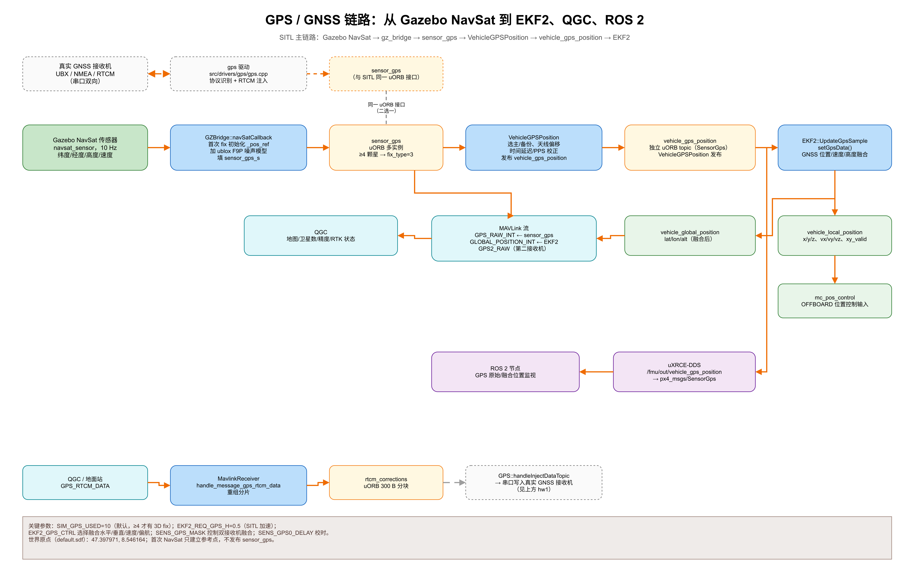

### 4.1 SITL 主链路：Gazebo NavSat → EKF2

```text
Gazebo navsat_sensor (10 Hz)
  → gz.msgs.NavSat
  → /world/default/model/netdrone_0/link/base_link/sensor/navsat_sensor/navsat
  → GZBridge::navSatCallback()
  → uORB sensor_gps
  → sensors/VehicleGPSPosition
  → uORB vehicle_gps_position
  → EKF2::UpdateGpsSample()
  → vehicle_local_position + vehicle_global_position
```

#### 第 1 段：Gazebo 传感器

`model.sdf` 里的 NavSat 传感器：

```xml
<sensor name="navsat_sensor" type="navsat">
  <always_on>1</always_on>
  <update_rate>10</update_rate>
</sensor>
```

Gazebo 的 `NavSat` 系统插件根据 world 的 `spherical_coordinates` 把 ENU 位置转成 WGS84。`default.sdf` 的原点是：

```xml
<spherical_coordinates>
  <surface_model>EARTH_WGS84</surface_model>
  <world_frame_orientation>ENU</world_frame_orientation>
  <latitude_deg>47.397971057728974</latitude_deg>
  <longitude_deg>8.546163739800146</longitude_deg>
  <elevation>0</elevation>
</spherical_coordinates>
```

#### 第 2 段：`GZBridge::navSatCallback`

代码位置：`src/modules/simulation/gz_bridge/GZBridge.cpp:668-755`。

- 首次回调只 `initReference()`，设置 `_pos_ref` / `_alt_ref`，**直接 return**，不发布 `sensor_gps`。这是为了避免 EKF 用未稳定的参考点。
- 之后每帧：
  1. 发布 `vehicle_global_position_groundtruth` 真值（给日志/对比用，不进入 EKF）；
  2. `addGpsNoise()` 加噪声；
  3. 填 `sensor_gps_s`：`fix_type`、`latitude_deg`、`longitude_deg`、`altitude_msl_m`、`altitude_ellipsoid_m`、`vel_n_m_s`、`vel_e_m_s`、`vel_d_m_s`、`cog_rad`、`eph`/`epv`/`hdop`/`vdop`、`satellites_used`；
  4. `_sensor_gps_pub.publish(sensor_gps)`。
- `fix_type` 由 `SIM_GPS_USED` 决定：`>=4` 时 `fix_type=3`，否则 0。默认 `SIM_GPS_USED=10`。
- 噪声参数在 `GZBridge.cpp:635-666`，量级参考 u-blox F9P；位置是 Markov + 随机游走，速度是 Markov 噪声。
- `heading=NAN`，`heading_offset=NAN`，因为仿真 NavSat 不提供双天线航向。

> **不要混淆三个 topic**：
>
> - `vehicle_global_position_groundtruth`：Gazebo NavSat 真值，`GZBridge` 直接发布，只用于日志/评估；它和 `vehicle_global_position` 只是消息类型相同，不是同一个 topic。
> - `sensor_gps`：加了噪声后的“接收机测量”，进入 `VehicleGPSPosition`。
> - `vehicle_global_position`：EKF2 融合后的全局位置估计，QGC 地图和 ROS 2 的 `/fmu/out/vehicle_global_position` 用的是它。

#### 第 3 段：`sensor_gps` → `vehicle_gps_position`

`SensorGps.msg` 末尾：

```text
# TOPICS sensor_gps vehicle_gps_position
```

这意味着同一个消息定义会生成两个**独立的 uORB topic**（不是 alias）。`sensors` 模块里的 `VehicleGPSPosition` 专门负责：

- 订阅 `sensor_gps` 的多个实例（最多 `GPS_MAX_RECEIVERS`）；
- 按 `SENS_GPS0_ID`/`SENS_GPS1_ID` 匹配 device id；
- 应用天线偏移 `SENS_GPS0_OFFX/Y/Z`；
- 应用接收机延迟 `SENS_GPS0_DELAY`（默认 110 ms）；
- 用 PPS 校正时间戳（`pps_capture`）；
- 双接收机融合（`SENS_GPS_MASK`、`SENS_GPS_TAU`、`SENS_GPS_PRIME`）；
- 发布 `vehicle_gps_position`。

关键代码：

```cpp
// src/modules/sensors/vehicle_gps_position/VehicleGPSPosition.cpp:215
_vehicle_gps_position_pub.publish(gps_output);
```

`VehicleGPSPosition` 是 `ScheduledWorkItem`，跑在 `nav_and_controllers` 工作队列；`Run()` 里先处理 PPS，再遍历 GPS 实例，最后 `GpsBlending::update()`，只有 `isNewOutputDataAvailable()` 时才发布。这样 EKF2 看到的是“选主/融合/校时后”的 GPS，而不是原始多路数据。

#### 第 4 段：EKF2 融合

```cpp
// src/modules/ekf2/EKF2.cpp:2617-2685（简化）
void EKF2::UpdateGpsSample(ekf2_timestamps_s &ekf2_timestamps)
{
    sensor_gps_s vehicle_gps_position;
    if (_vehicle_gps_position_sub.update(&vehicle_gps_position)) {
        Vector3f vel_ned;
        if (vehicle_gps_position.vel_ned_valid) {
            vel_ned = Vector3f(vehicle_gps_position.vel_n_m_s,
                               vehicle_gps_position.vel_e_m_s,
                               vehicle_gps_position.vel_d_m_s);
        } else {
            return;
        }

        const float altitude_amsl = vehicle_gps_position.altitude_msl_m;
        const float altitude_ellipsoid = vehicle_gps_position.altitude_ellipsoid_m;

        const bool timestamp_corrected = vehicle_gps_position.timestamp_sample > 0 
                         && vehicle_gps_position.timestamp_sample != vehicle_gps_position.timestamp;

        gnssSample gnss_sample{
            .time_us = timestamp_corrected ? vehicle_gps_position.timestamp_sample : vehicle_gps_position.timestamp,
            .lat = vehicle_gps_position.latitude_deg,
            .lon = vehicle_gps_position.longitude_deg,
            .alt = altitude_amsl,
            .vel = vel_ned,
            .hacc = vehicle_gps_position.eph,
            .vacc = vehicle_gps_position.epv,
            .sacc = vehicle_gps_position.s_variance_m_s,
            .fix_type = vehicle_gps_position.fix_type,
            .nsats = vehicle_gps_position.satellites_used,
            .pdop = sqrtf(hdop*hdop + vdop*vdop),
            .yaw = vehicle_gps_position.heading,
            .yaw_acc = vehicle_gps_position.heading_accuracy,
            .yaw_offset = vehicle_gps_position.heading_offset,
            .spoofed = ...,
            .jammed = ...,
            .pos_body = Vector3f(antenna_offset_x, antenna_offset_y, antenna_offset_z),
        };

        _ekf.setGpsData(gnss_sample);
        ...
    }
}
```

关键点：

- `vel_ned_valid=false` 时直接 `return`，不融合。这是 GPS 刚上电/丢星时常见状态。
- **`timestamp` 和 `timestamp_sample` 在不同路径下来源不同，不能写成一句话**：

  | 路径 | `timestamp` | `timestamp_sample` |
  |---|---|---|
  | **单接收机选用**（本次 SITL） | 直接沿用上游被选中接收机的 `sensor_gps.timestamp`，模块全程不改写（`gps_blending.cpp:84` 选出 `_selected_gps`；`gps_blending.hpp:91-99` 原样返回 `_gps_state[_selected_gps]`） | 入站时若为 0 或等于 `timestamp`，被改写成 `timestamp − SENS_GPSx_DELAY`（`VehicleGPSPosition.cpp:166-171`）；发布前还可能被 PPS 覆盖（`:208-213`） |
  | **双接收机融合** | `Σ timestamp_i × w_i`（`gps_blending.cpp:401`） | `Σ timestamp_sample_i × w_i`（`:402`），之后同样可能被 PPS 覆盖 |

  融合权重按水平/垂直/速度精度逆方差加权、归一化到和=1（`gps_blending.cpp:259-339`），所以融合出来的时间戳是**两台接收机到达时间的加权平均**，任何一台都没有报告过这个值；若某台 `timestamp_sample==0`，它仍以 0 参与求和，会把结果往小拉。`blend_gps_data()` 在可用接收机 <2 台时直接返回 false 退回选用分支（`:183-186`）。本机 `SENS_GPS_MASK` 取默认值 **7**（水平/垂直/速度三项精度都参与加权，`param show` 实测也是 7），两台接收机的回调都会注册（`VehicleGPSPosition.cpp:86-93`）；但只有一台在发布 `sensor_gps`，`_np_gps_suitable_for_blending = 1 < 2`，所以 `blend_gps_data()` 直接返回 false、退回选用分支（`gps_blending.cpp:183-186`）。**不是**把融合参数关掉才退化的。

  因此“`vehicle_gps_position.timestamp` 沿用上游 `sensor_gps.timestamp`”**只对单接收机选用成立**，不能推广到融合模式。两条路径都不把 `hrt_absolute_time()` 当作 `vehicle_gps_position` 的时间戳：`timestamp` 沿用上游 `sensor_gps` 的**到达时刻**（SITL 由 `GZBridge` 打戳、真机由驱动打戳），不是这条 vgp 消息的发布时刻。

- 本次 SITL 的 `gz_bridge` 明确写 `timestamp_sample = timestamp`（`GZBridge.cpp:729-730`），所以必走反推分支：实测 20/20 对 `timestamp − timestamp_sample = 110,000 µs`（`SENS_GPS0_DELAY=110`，`VehicleGPSPosition.cpp:147-169`）。`timestamp_sample != timestamp` 只说明两者不同，**不能**证明做过 PPS 校正。
- EKF 侧的条件是 `const bool timestamp_corrected = timestamp_sample > 0 && timestamp_sample != timestamp`（`EKF2.cpp:2648-2649`，上一行 `:2647` 的注释写明它的含义是 “corrected by the sensors module (per-receiver delay or PPS)”）：成立就用 `timestamp_sample`，否则退回 `timestamp`（`:2652`），进 EKF 前再减去群延迟 `dt_ekf_avg/2`（`estimator_interface.cpp:183-190`）。
  - 变量名容易误读：它说的是“**sensors 模块已经修正过**”，不是“PPS 一定校过”——两者都在修正来源之列，`VehicleGPSPosition.cpp:166-171`（按 `SENS_GPSx_DELAY` 反推）和 `:208-213`（PPS 覆盖）都会让它为真。
  - 反过来，它为 true 也**不**证明驱动给的原始采样时刻准确，只证明“这个字段被动过、且与 `timestamp` 不同”。
- `UpdateGpsSample()` 把 `vehicle_gps_position` 拷进 `gnssSample` 时，用的字段是 `latitude_deg` / `longitude_deg` / `altitude_msl_m`。本 tag 的 `SensorGps`（`sensor_gps` 与 `vehicle_gps_position` 共用同一个 msg）**只有** float64 的 `*_deg` 和 `*_m` 字段，没有 int32 的 `lat`/`lon`（1e7）或毫米 `alt`——那是旧版消息才有的布局，别照着旧文档去找。
- `eph`/`epv` 是水平/垂直位置精度，`s_variance_m_s` 是速度精度，`hdop`/`vdop` 组合成 `pdop`。
- `heading`/`heading_accuracy` 仅双天线/定向 GPS 才有；SITL 为 NaN。
- `pos_body` 是天线在机体系 FRD 的偏移，来自 `SENS_GPS0_OFFX/Y/Z`。
- `EKF2_GPS_CTRL` 决定融合哪些量：水平位置、垂直位置、速度、航向。定义在 `src/modules/ekf2/params_gnss.yaml`，默认 **7**（水平+垂直+速度，不含航向）。
- `EKF2_REQ_GPS_H=0.5` 是 SITL 加速启动用的“GPS 健康时间”要求（`rcS:165`），真机通常更大。

输出：

- `vehicle_local_position`：NED 位置/速度、`xy_valid`/`z_valid`、`heading`、`ref_lat/ref_lon/ref_alt`。
- `vehicle_global_position`：融合后的 lat/lon/alt。
- `estimator_status` / `estimator_gps_status`：GPS 检查、创新、丢星等。

### 4.2 真实 GPS 链路（与 SITL 的替换关系）

```text
GNSS 接收机（u-blox / Septentrio / NMEA / Ashtech / Emlid / Femto）
  → 串口或 SPI
  → src/drivers/gps/gps.cpp（协议识别、配置、解析）
  → uORB sensor_gps
  → 之后与 SITL 完全相同：VehicleGPSPosition → vehicle_gps_position → EKF2
```

`gps.cpp` 的关键点：

- 支持的协议：UBX、MTK、Ashtech、Emlid Reach、Femto、NMEA；代码在 `src/drivers/gps/devices/src/`。
- `GPS::publish()`（`gps.cpp:1418-1433`）最终在 `gps.cpp:1427` 执行 `_sensor_gps_pub.publish(_sensor_gps)`。
- 端口由 `GPS_1_CONFIG` / `GPS_2_CONFIG` 选择，协议由 `GPS_1_PROTOCOL` / `GPS_2_PROTOCOL` 选择（默认 1 = u-blox），波特率由 `SER_GPS1_BAUD` 等参数设置。
- RTCM 注入在 `GPS::handleInjectDataTopic()`（`gps.cpp:671`）：从 `rtcm_corrections` 订阅，重组 RTCM3 帧，检查串口 TX 空间，再写入接收机。

### 4.3 QGC 上看到的 GPS 是哪一路

| QGC 显示         | MAVLink 消息                          | PX4 数据源                                              | 说明                                                      |
| -------------- | ----------------------------------- | ---------------------------------------------------- | ------------------------------------------------------- |
| 地图上的飞机位置       | `GLOBAL_POSITION_INT`               | `vehicle_global_position` + `vehicle_local_position` | **EKF 融合后**的位置/速度/航向，不是原始 GPS                           |
| GPS 卫星数/精度/固定解 | `GPS_RAW_INT`                       | `sensor_gps`                                         | **原始接收机**数据；`fix_type`、`satellites_visible`、`eph`/`epv` |
| 第二 GPS         | `GPS2_RAW`                          | `sensor_gps` instance 1                              | 双接收机时                                                   |
| RTK/差分状态     | `GPS_RAW_INT.fix_type` + `GPS2_RAW` | `sensor_gps.fix_type`                                | 4=DGPS，5=RTK Float，6=RTK Fixed；RTCM 改正是否注入要另看 `GPS_RTCM_DATA`→`rtcm_corrections` |
| RTK 基站数据上传     | `GPS_RTCM_DATA`                     | QGC → PX4 `rtcm_corrections` → GPS 驱动                | 只有真实 GPS 才真正注入接收机                                       |

代码：

- `src/modules/mavlink/streams/GPS_RAW_INT.hpp`：`_sensor_gps_sub{ORB_ID(sensor_gps), 0}`，发送 `GPS_RAW_INT`。
- `src/modules/mavlink/streams/GLOBAL_POSITION_INT.hpp`：订阅 `vehicle_global_position` 和 `vehicle_local_position`，发送 `GLOBAL_POSITION_INT`。
- `src/modules/mavlink/mavlink_receiver.cpp:2903`：`handle_message_gps_rtcm_data()`，分片重组后发布 `rtcm_corrections`。

> **重要区分**：`GPS_RAW_INT` 是原始 GPS；`GLOBAL_POSITION_INT` 是 EKF 融合后的位置。QGC 地图默认用后者，所以地图上的位置会比原始 GPS 平滑；如果 GPS 丢星，地图可能还能靠 EKF 惯性递推一段时间。

### 4.4 ROS 2 上看到的 GPS

`dds_topics.yaml:80-82`：

```yaml
- topic: /fmu/out/vehicle_gps_position
  type: px4_msgs::msg::SensorGps
  rate_limit: 50.
```

- uORB 源是 `vehicle_gps_position`：`VehicleGPSPosition` 处理后的 GNSS 数据，不是原始 `sensor_gps`，也不是 EKF 融合后的 `vehicle_global_position`。
- 话题名是 `/fmu/out/vehicle_gps_position`，但消息类型是 `px4_msgs/msg/SensorGps`。**话题名与消息类型是两回事**：`SensorGps` 这个类型同时被 `sensor_gps` 和 `vehicle_gps_position` 使用，DDS 映射按 topic 名走，所以这里映射到的是处理后的 `vehicle_gps_position`。
- `SensorGps` 没有 `MESSAGE_VERSION`，所以**没有 `_vN` 后缀**
- 如果你要融合后的全局位置，用 `/fmu/out/vehicle_global_position`；要本地位置，用 `/fmu/out/vehicle_local_position_v1`。

### 4.5 GPS 相关参数与排障

| 参数 | 默认/本次值 | 作用 | 症状 |
|---|---|---|---|
| `SIM_GPS_USED` | 10 | 仿真卫星数；`>=4` 才 3D fix | 设 0/3 时 EKF 一直不进入 GPS 融合 |
| `EKF2_REQ_GPS_H` | 0.5（SITL） | GPS 健康时间要求 | 太大时 SITL 启动慢；太小可能未稳定就融合 |
| `EKF2_GPS_CTRL` | 默认 | 选择融合水平/垂直/速度/航向 | 关掉速度会导致 GPS 速度不可用 |
| `SENS_GPS_MASK` | 7 | 双接收机融合权重掩码（bit0 速度 / bit1 水平 / bit2 垂直；0=不融合、总用第一台） | 双 GPS 时先确认两台都在发布 `sensor_gps`，再看融合条件；本次只有一台，掩码不是原因（§4.1） |
| `SENS_GPS_PRIME` | 0 | 主接收机实例（-1 才是“自动、等优先级”） | 双 GPS 时接错口 |
| `SENS_GPS0_DELAY` | 110 ms | 接收机延迟补偿 | 高速飞行时位置滞后 |
| `SENS_GPS0_ID` | 0 | 按 device id 匹配 | 多接收机时匹配错 |
| `GPS_1_CONFIG` / `GPS_1_PROTOCOL` | 板级默认 / 1（u-blox） | 端口与协议是**两个**参数 | 真机不识别/不输出 UBX 要查 `PROTOCOL`，不是端口 |

常见现象：

- **`vehicle_local_position.xy_valid=false`**：EKF 还没完成 GPS 融合，或 `EKF2_GPS_CTRL` 关了水平位置。ROS 2 节点会一直停在 `WaitForFmu`。
- **`fix_type=0` 但 QGC 有位置**：QGC 地图用的是 `GLOBAL_POSITION_INT`（EKF 递推），不是原始 GPS；看 `GPS_RAW_INT` 的 `fix_type`/`satellites_visible` 才准。
- **GPS 位置跳变**：检查 `SENS_GPS_MASK`/`SENS_GPS_PRIME`，以及是否两个接收机都发布了 `sensor_gps`。
- **RTK 不固定**：确认 QGC 的 `GPS_RTCM_DATA` 是否到达 PX4（`rtcm_corrections` 是否有数据），以及 GPS 驱动是否真的把 RTCM 写进接收机。

---

## 5. 遥控 / 手动控制链路

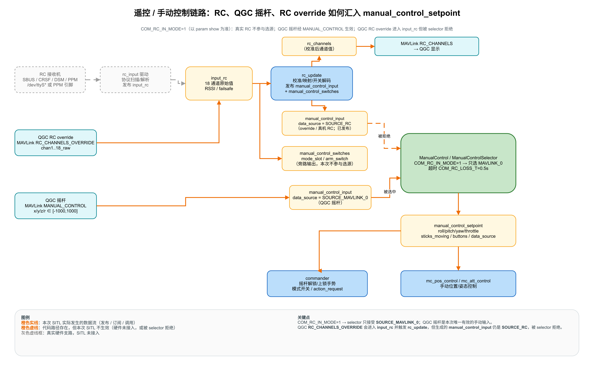

### 5.1 真实 RC：从接收机到 `input_rc`

```text
RC 接收机（SBUS / CRSF / DSM / ST24 / SUMD / PPM / GHST）
  → 串口或 PPM 捕获
  → src/drivers/rc_input/RCInput.cpp
  → uORB input_rc
  → rc_update
```

`RCInput` 的关键行为：

- 启动时默认按 SBUS 配置串口，然后按 `RC_SCAN_*` 状态机轮询协议：SBUS → DSM → ST24 → SUMD → PPM → CRSF → GHST → 回到 SBUS。
- 每种协议解析成功后填 `input_rc_s`：`values[0..17]`、`channel_count`、`rssi`、`rc_failsafe`、`rc_lost`、`input_source`。
- `input_source` 枚举在 `msg/InputRc.msg`，全名带 `RC_INPUT_SOURCE_` 前缀：`RC_INPUT_SOURCE_PX4FMU_SBUS`、`RC_INPUT_SOURCE_PX4FMU_CRSF`、`RC_INPUT_SOURCE_PX4FMU_DSM`、`RC_INPUT_SOURCE_PX4FMU_PPM`、`RC_INPUT_SOURCE_MAVLINK` 等。
- 解析成功后在 `RCInput.cpp:848` 执行 `_input_rc_pub.publish(_input_rc)`。
- 如果 `RC_INPUT_PROTO` 为 auto，锁定协议 3 秒后会写回参数。

### 5.2 `rc_update`：校准、映射、开关

`rc_update` 是独立模块（`rcS:261` 启动），它做四件事：

1. 订阅 `input_rc`；
2. 按 `RC_MAP_*` 把通道映射到功能（roll/pitch/yaw/throttle/arm/mode/return/loiter/offboard/...）；
3. 生成 `rc_channels`（校准后的通道值）和 `manual_control_input`（归一化摇杆）；
4. 生成 `manual_control_switches`（模式槽、解锁开关、按钮）。

关键代码：

```cpp
// rc_update.cpp:363
if (_input_rc_sub.update(&input_rc)) { ... }

// rc_update.cpp:474
_rc_channels_pub.publish(_rc);

// rc_update.cpp:687
_manual_control_input_pub.publish(manual_control_input);

// rc_update.cpp:658
_manual_control_switches_pub.publish(_manual_switches_last_publish);
```

`manual_control_input` 的 `data_source` 是 `manual_control_setpoint_s::SOURCE_RC`。`manual_control_switches` 包含 `mode_slot`、`arm_switch`、`switch_changes` 等，只有当前选中的输入源是 RC 时才被 `ManualControl` 使用。

### 5.3 `ManualControl`：选源与超时

`ManualControl` 模块（`rcS:262` 启动）是手动输入选择器（这个模块至少从 v1.14 就独立存在，不是 1.18 新拆的）。它订阅 `manual_control_input` 的 **0/1/2 三个**实例（`MAX_MANUAL_INPUT_COUNT=3`，`ManualControl.hpp:85`），来源靠报文里的 `data_source`（`SOURCE_RC` / `SOURCE_MAVLINK_0..5`）区分——逻辑来源有 7 个，但被订阅的 ORB 实例只有 3 个，实例号是 `PublicationMulti` 运行时分配的，**不等于**来源号。选出一个后发布 `manual_control_setpoint`。

```cpp
// ManualControl.cpp:114-156（简化）
for (int i = 0; i < MAX_MANUAL_INPUT_COUNT; i++) {
    manual_control_setpoint_s manual_control_input;
    if (_manual_control_input_subs[i].update(&manual_control_input)) {
        _selector.updateWithNewInputSample(now, manual_control_input, i);
    }
}
if (_selector.setpoint().valid) {
    ...
    _manual_control_setpoint_pub.publish(_selector.setpoint());
}
```

选源逻辑在 `ManualControlSelector.cpp:63-105`：

| `COM_RC_IN_MODE` | 行为 |
|---|---|
| 0 | RC only |
| 1 | MAVLink only（**rcS 默认设为 1**；以 `param show` 为准） |
| 2 | 当前源失效后切换 |
| 3 | 锁定第一个有效源直到重启 |
| 4 | 禁用手动控制 |
| 5 | RC 优先，然后 MAVLink（实例号升序） |
| 6 | MAVLink 优先（升序），然后 RC |
| 7 | RC 优先，然后 MAVLink（降序） |
| 8 | MAVLink 优先（降序），然后 RC |

超时由 `COM_RC_LOSS_T` 控制（默认 0.5 s）：`sample_newer_than_timeout = now < input.timestamp_sample + _timeout`。超时后 `manual_control_setpoint.valid=false`，commander 会触发手动控制丢失逻辑。

**v1.18 的飞手接管参数是 `MAN_OVERRIDE_SPD`，不是旧版的 `COM_RC_OVERRIDE`/`COM_RC_STICK_OV`。** 默认 `1.0`（单位：归一化杆量/秒），`-1` 关闭。`ManualControl` 用它对 roll/pitch/yaw/throttle 做差分，连续同号超过阈值就置 `manual_control_setpoint.sticks_moving=true`（`ManualControl.cpp:140-157`）；`Commander` 只在“已解锁 + 多旋翼（含 VTOL MC 模式）+ 当前是 auto/offboard”时，把这个标志解释为“飞手打杆接管”，切到 Position 模式（`Commander.cpp:3126-3143`）。旧参数在 `param_translation.cpp:247-254` 里会迁移成 `MAN_OVERRIDE_SPD`（`COM_RC_OVERRIDE=0` 迁移为 `-1`，即关闭）。

### 5.4 QGC 摇杆与 RC override

这是两条不同的 MAVLink 消息：

| QGC 操作 | MAVLink 消息 | PX4 处理 | 进入哪个 uORB | SITL 是否生效 |
|---|---|---|---|---|
| QGC 虚拟摇杆 | `MANUAL_CONTROL` | `handle_message_manual_control()`（`mavlink_receiver.cpp:2318`） | `manual_control_input`，`data_source=SOURCE_MAVLINK_0` | **生效**（`COM_RC_IN_MODE=1` 接受 MAVLink） |
| QGC RC override | `RC_CHANNELS_OVERRIDE` | `handle_message_rc_channels_override()`（`:2231`） | `input_rc`，`input_source=MAVLINK` | 进入 `input_rc`，但 `rc_update` 生成的 `manual_control_input` 仍是 `SOURCE_RC`，selector 在 mode 1 下拒绝 |

`handle_message_manual_control` 的映射：

```cpp
// mavlink_receiver.cpp:2318-2375（简化）
manual_control_setpoint.pitch = mavlink_manual_control.x / 1000.f;
manual_control_setpoint.roll  = mavlink_manual_control.y / 1000.f;
manual_control_setpoint.throttle = (mavlink_manual_control.z / 500.f) - 1.f;
manual_control_setpoint.yaw   = mavlink_manual_control.r / 1000.f;
manual_control_setpoint.buttons = mavlink_manual_control.buttons;
manual_control_setpoint.data_source = SOURCE_MAVLINK_0 + _mavlink.get_instance_id();
_manual_control_input_pub.publish(manual_control_setpoint);
```

`handle_message_rc_channels_override` 则填 `input_rc_s` 的 18 个通道，`input_source=RC_INPUT_SOURCE_MAVLINK`，然后 `_rc_pub.publish(rc)`。它走的是 RC 校准链，不是直接摇杆链。

### 5.5 commander 如何用 `manual_control_setpoint`

`commander` 不直接读 RC 通道，而是读 `manual_control_setpoint` 和 `manual_control_switches`：

- 摇杆手势解锁/上锁：`ManualControl::processStickArming()` 产生 `action_request`（`ACTION_ARM`/`ACTION_DISARM`）。
- 模式开关：`ManualControl::evaluateModeSlot()` 只发 `action_request`（`ACTION_SWITCH_MODE`，source = `SOURCE_RC_MODE_SLOT`，目标模式由 `COM_FLTMODE1..6` 经 `navStateFromParam()` 映射，`ManualControl.cpp:455-495`）。它**不**发 `VEHICLE_CMD_DO_SET_MODE`，所以这条路径没有 `COMMAND_ACK`；该模块唯一的 `vehicle_command` 是相机三条（`:520-567`）。
- 解锁开关/按钮：`manual_control_switches.arm_switch`，受 `COM_ARM_SWISBTN` 影响。
- `commander` 的 `handle_command()` 处理 `VEHICLE_CMD_COMPONENT_ARM_DISARM`（`Commander.cpp:1089`）和 `VEHICLE_CMD_DO_SET_MODE`（`:925`）。

### 5.6 SITL 的关键结论

`rcS:161-162` 明确写了：

```sh
# Don't require RC calibration and configuration
param set-default COM_RC_IN_MODE 1
```

> 注意：这里是 `param set-default`。如果 `build/px4_sitl_default/rootfs/parameters.bson` 里已经有 `COM_RC_IN_MODE`，默认值不会覆盖；以 `param show COM_RC_IN_MODE` 为准。

所以在本次 SITL 实验中：

- **没有真实 RC 也能起飞**：rcS 默认把 `COM_RC_IN_MODE` 设为 1（只接受 MAVLink 手动输入），并放宽了 RC 相关预检；如果 `parameters.bson` 已覆盖该值，以 `param show COM_RC_IN_MODE` 为准。
- QGC 虚拟摇杆是 SITL 下唯一可用的“手动输入”；但本次飞行不需要它，ROS 2 节点直接发 Offboard。
- QGC 的 `RC_CHANNELS_OVERRIDE` 不会让飞机动，因为 selector 拒绝 `SOURCE_RC`；如果你希望 SITL 接受 RC override，需要把 `COM_RC_IN_MODE` 改成 0/2/5 等，但那时又需要 RC 校准/开关配置。
- **RC 丢失失效保护在本机默认不生效**：没有真实遥控器、也没有虚拟摇杆时，`manual_control_setpoint.valid` 一直是 false，`manual_control_signal_lost` 从启动起就为真；解锁那一刻它被记为 `_manual_control_lost_at_arming`（`failsafe.cpp:716-725`），于是 `rc_loss_ignored=true`（`:559-570`），**独立的** RC-loss 动作（`NAV_RCL_ACT=2` → RTL）不会入队，直到手动输入恢复后再次丢失才会触发。注意这只挡住独立检查：`manual_control_signal_lost` 仍会进入 §8.7 的 mode-fallback，把 `Fallback*` 改写成 `NAV_RCL_ACT` 的动作。要验证这条保护，必须先用 QGC 产生过有效的虚拟摇杆输入。

---

## 6. MAVLink / QGC 链路

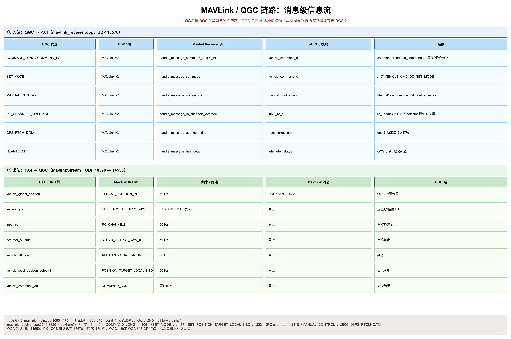

### 6.1 UDP socket 与源地址学习

PX4 的 GCS 链路启动命令：

```sh
# px4-rc.mavlink:20
mavlink start -x -u 18570 -r 4000000 -f
```

- `-u 18570`：PX4 绑定本地 UDP 18570；
- `-r 4000000`：链路数据率上限 4 MB/s；
- `-f`：打开 MAVLink 转发（`_forwarding_on=true`）；
- `-x`：打开 FTP（不是“转发”）。

`Mavlink::init_udp()`（`mavlink_main.cpp:1136`）：

```cpp
_myaddr.sin_family = AF_INET;
_myaddr.sin_addr.s_addr = htonl(INADDR_ANY);
_myaddr.sin_port = htons(_network_port);       // 18570
_socket_fd = socket(AF_INET, SOCK_DGRAM, 0);
bind(_socket_fd, (struct sockaddr *)&_myaddr, sizeof(_myaddr));

if (!_src_addr_initialized) {
    _src_addr.sin_family = AF_INET;
    inet_aton("127.0.0.1", &_src_addr.sin_addr);
}
_src_addr.sin_port = htons(_remote_port);
```

接收线程在 `mavlink_receiver.cpp:3799`：

```cpp
nread = recvfrom(_mavlink.get_socket_fd(), buf, sizeof(buf), 0,
                 (struct sockaddr *)&srcaddr, &addrlen);

struct sockaddr_in &srcaddr_last = _mavlink.get_client_source_address();
if (!_mavlink.get_client_source_initialized()) {
    // 本机 GCS 立即接管；非本机等 3 秒
    if ((stime != 0 && hrt_elapsed_time(&stime) > 3_s) ||
        (srcaddr_last.sin_addr.s_addr == htonl(localhost))) {
        srcaddr_last.sin_addr.s_addr = srcaddr.sin_addr.s_addr;
        srcaddr_last.sin_port = srcaddr.sin_port;
        _mavlink.set_client_source_initialized();
    }
}
```

**这解释了一个常见问题**：QGC 必须至少发一个包到 PX4 的 18570，PX4 才知道往哪回。QGC 的 UDP 链路通常监听 14550，并把目标设为 PX4 的 18570；QGC 的 `HEARTBEAT` 就是第一个“握手包”。

### 6.2 入站消息（QGC → PX4）

`MavlinkReceiver::handle_message()` 的分发表在 `mavlink_receiver.cpp:142-260`。本次实验最相关的：

| MAVLink 消息 | 处理函数 | 产生的 uORB | 后续 |
|---|---|---|---|
| `COMMAND_LONG` / `COMMAND_INT` | `handle_message_command_long/int`（`:494`） | `vehicle_command` | `commander::handle_command()`；解锁、模式、校准、任务 |
| `SET_MODE` | `handle_message_set_mode`（`:1061`） | `vehicle_command`（转成 `DO_SET_MODE`） | commander 切模式 |
| `MANUAL_CONTROL` | `handle_message_manual_control`（`:2318`） | `manual_control_input` | `ManualControl` → `manual_control_setpoint` |
| `RC_CHANNELS_OVERRIDE` | `handle_message_rc_channels_override`（`:2231`） | `input_rc` | `rc_update` → `manual_control_input`（source=RC） |
| `GPS_RTCM_DATA` | `handle_message_gps_rtcm_data`（`:2903`） | `rtcm_corrections` | `gps` 驱动注入接收机 |
| `HEARTBEAT` | `handle_message_heartbeat` | `telemetry_status` | 识别 GCS/链路类型、更新连接状态 |
| `PARAM_REQUEST_LIST` / `PARAM_SET` | `mavlink_parameters.cpp` | 参数服务 | QGC 参数页 |
| `MISSION_*` | `mavlink_mission.cpp` | 任务项 | QGC 航线 |

`COMMAND_LONG` 的核心：把 MAVLink 字段拷进 `vehicle_command_s`，设 `from_external=true`，然后：

```cpp
// mavlink_receiver.cpp:738-741（简化）
} else if (cmd_mavlink.command == MAV_CMD_DO_SET_MODE) {
    _cmd_pub.publish(vehicle_command);
    send_ack = false;        // ACK 由 Commander 发
} else if (cmd_mavlink.command == MAV_CMD_COMPONENT_ARM_DISARM) {
    ...
}
```

`commander` 处理完后发布 `vehicle_command_ack`（`Commander.cpp:2840`），MAVLink 的 `COMMAND_ACK` 流再把它发给 QGC。

### 6.3 出站遥测（PX4 → QGC）

`px4-rc.mavlink:21-29` 显式设置了本次 GCS 链路的流：

| 流 | 频率 | 数据源 | QGC 用途 |
|---|---|---|---|
| `POSITION_TARGET_LOCAL_NED` | 50 Hz | `vehicle_local_position_setpoint`（位置控制器处理后的设定值，**不是** ROS 2 原始 `trajectory_setpoint`） | 目标可视化 |
| `LOCAL_POSITION_NED` | 50 Hz | `vehicle_local_position` | 本地位置 |
| `GLOBAL_POSITION_INT` | 50 Hz | `vehicle_global_position` + `vehicle_local_position` | 地图位置/速度/航向 |
| `ATTITUDE` | 50 Hz | `vehicle_attitude` | 姿态仪 |
| `ATTITUDE_QUATERNION` | 50 Hz | `vehicle_attitude` | 四元数姿态 |
| `ATTITUDE_TARGET` | 50 Hz | `vehicle_attitude_setpoint` | 目标姿态 |
| `SERVO_OUTPUT_RAW_0` | 50 Hz | `actuator_outputs` | 输出模块发布的通道数值（本链路是缩放后的转速指令，**不是** PWM 微秒，也不是 Gazebo 实测转速） |
| `RC_CHANNELS` | 20 Hz | `input_rc` | 遥控通道 |
| `OPTICAL_FLOW_RAD` | 10 Hz | `vehicle_optical_flow`（`OPTICAL_FLOW_RAD.hpp:59`；`sensor_optical_flow` 是驱动层话题，不是这个流的源） | 光流 |

此外 `mavlink_main.cpp` 的 `MAVLINK_MODE_NORMAL` 还配置了 `GPS_RAW_INT`（5 Hz）、`SYS_STATUS`、`BATTERY_STATUS`、`HOME_POSITION`、`VFR_HUD`、`ESTIMATOR_STATUS` 等默认流。QGC 也可以用 `MAV_CMD_SET_MESSAGE_INTERVAL` 或 `MAV_CMD_REQUEST_MESSAGE` 动态改频率/单次请求。

**`SERVO_OUTPUT_RAW` 的单位陷阱**（协议定义 vs 实际载荷）：

- MAVLink 标准把 `servo*_raw` 定义为 **PWM 输出微秒值**；
- 但 PX4 v1.18 的 `MavlinkStreamServoOutputRaw::send()` 是**逐通道原样直赋**：`msg.servo1_raw = act.output[0];` … `msg.servo16_raw = act.output[15];`，没有 `×1000`、没有 `PX4_PWM_*` 换算、没有 clamp（`SERVO_OUTPUT_RAW.hpp:73-107`）；`msg.time_usec` 取的是 `actuator_outputs.timestamp`（`:82`），也不是 `timestamp_sample`；
- 而 `actuator_outputs.output[]` 的单位在消息定义里写的是 “natural output units”（`msg/ActuatorOutputs.msg:5`）。

因此本链路里 `servo*_raw` 承载的是 PX4 输出模块的**实际通道数值**——经 `SIM_GZ_EC_MIN/MAX` 缩放后的转速指令（本次 190…1466），既不是 1000–2000 µs 的脉宽，也不是 Gazebo 里的实测转速。**不能仅凭 MAVLink 字段名判断载荷单位**；三个层次要分开：协议定义的语义、PX4 实现是否换算、这条链路实际填了什么。

`GLOBAL_POSITION_INT` 的实现值得注意：

```cpp
// streams/GLOBAL_POSITION_INT.hpp
uORB::Subscription _gpos_sub{ORB_ID(vehicle_global_position)};
uORB::Subscription _lpos_sub{ORB_ID(vehicle_local_position)};
uORB::Subscription _home_sub{ORB_ID(home_position)};
...
if (_gpos_sub.update(&gpos) && _lpos_sub.update(&lpos)) {
    msg.lat = gpos.lat * 1e7;
    msg.lon = gpos.lon * 1e7;
    msg.alt = gpos.alt * 1000.0f;
    msg.relative_alt = (gpos.alt - home.alt) * 1000.0f;
    msg.vx = lpos.vx * 100.0f;
    ...
}
```

所以 QGC 地图上的经纬度来自 EKF 的 `vehicle_global_position`，速度/航向来自 `vehicle_local_position`。

### 6.4 QGC 与 ROS 2 的关系

本次实验同时开了 QGC 和 ROS 2，但两者是**并行、互不替代**的：

- **QGC 链路**：MAVLink，PX4 18570 ↔ QGC 14550；用于地图、姿态、GPS、RC、参数、日志、手动解锁/模式。
- **ROS 2 链路**：XRCE-DDS，PX4 8888 ↔ Agent ↔ DDS；用于 Offboard 设定点和状态订阅。
- 飞行控制指令来自 ROS 2，不是 QGC。QGC 只是“看”和“地面操作”。
- **QGC 断开不会直接中断 ROS 2 的 Offboard 设定点流**，因为两者是两条独立链路；但 PX4 仍会独立监测 MAVLink GCS 数据链，并可能触发 **Data Link Loss Failsafe**。判定参数是 `COM_DL_LOSS_T`（默认 10 s），动作由 `NAV_DLL_ACT` 决定，`COM_DLL_EXCEPT` 决定哪些模式豁免（默认 0，Offboard 不豁免）。
- **本次实验的实际配置**：`4050_gz_netdrone` 没有设置 `NAV_DLL_ACT`，也没有 source `4001_gz_x500`；SITL 里实测 `NAV_DLL_ACT=0`（Disabled）、`COM_DLL_EXCEPT=0`、`COM_DL_LOSS_T=10`。所以这次关掉 QGC **不会**触发 RTL。这个结论来自“默认值 + 本机参数”，不是因为“PX4 没有 Data Link Loss 机制”。
- 如果你把 `NAV_DLL_ACT` 设为 2（Return），即使 ROS 2 还在正常发设定点，QGC/MAVLink 断开 10 s 后也会独立触发 RTL。这里的“断开”指**连上过又断**：`gcs_connection_lost` 在 Commander 构造时初值为真（`Commander.cpp:815`），收到 `heartbeat_type_gcs` 才清除（`:2944-2956`），此后超过 `COM_DL_LOSS_T` 无新心跳再次置真（`:3027-3032`），且要求 `_datalink_last_heartbeat_gcs != 0`。从未连过 QGC 时标志同样为真，`NAV_DLL_ACT>0` 会直接阻止解锁（`rcAndDataLinkCheck.cpp:78-83`），所以“先连上再断开”和“从未连接”不是一回事。这正是两条链路需要分开理解的原因。

验证方法（保持 ROS 2 Offboard 流，只关 QGC）：

```bash
param show NAV_DLL_ACT
param show COM_DLL_EXCEPT
param show COM_DL_LOSS_T
# 然后关闭 QGC，观察：
listener vehicle_status          # nav_state 是否变化
listener failsafe_flags          # data_link_lost 是否置位
```

> 不要只看“ROS 2 还在发设定点”就判断飞行状态不会变；也不要只看 `NAV_DLL_ACT` 的默认值就判断本机一定启用。以 `param show` 和 airframe 是否覆盖为准。

### 6.5 常见问题

| 现象 | 可能原因 | 排查 |
|---|---|---|
| QGC 显示“未连接” | QGC 的 UDP 目标端口不是 18570；PX4 没启动 mavlink；防火墙 | `ss -lunp \| grep 18570`；`mavlink status`；QGC 链路设置 |
| QGC 有姿态但无地图 | `GLOBAL_POSITION_INT` 流没开/被限速；EKF 无全局位置 | `mavlink status streams`；`listener vehicle_global_position` |
| QGC 地图有位置但 GPS 页无星 | `GPS_RAW_INT` 流没开；`sensor_gps` 没发布 | `listener sensor_gps`；`mavlink stream -r 5 -s GPS_RAW_INT -u 18570` |
| QGC 发解锁没反应 | 预检不通过；`COM_RC_IN_MODE`/EKF/GPS 未就绪；命令目标 system/component 不对 | `commander check`；QGC 消息日志；`vehicle_command_ack` |
| QGC 发模式切换被拒 | Offboard 未满足；`COM_OF_LOSS_T`；模式不可用 | `commander status`；看 `vehicle_status.nav_state` |

---

## 7. ROS 2 / uXRCE-DDS 链路

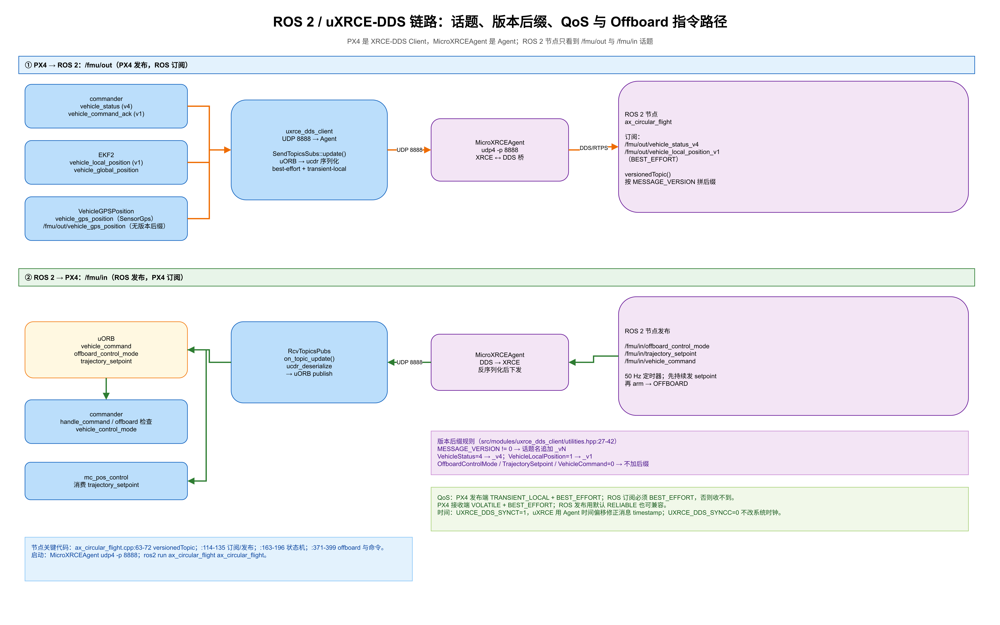

### 7.1 三个实体：Client、Agent、ROS 2 节点

```text
PX4 进程
  └─ uxrce_dds_client 模块（XRCE-DDS Client）
        │  UDP 8888，主动连接 127.0.0.1
        ▼
MicroXRCEAgent（独立进程，XRCE-DDS Agent）
        │  DDS/RTPS（Fast DDS，domain 0）
        ▼
ROS 2 节点 ax_circular_flight
```

- `uxrce_dds_client` 不是“DDS 客户端”，它是 **XRCE-DDS Client**：把 uORB 话题序列化成 CDR，通过 XRCE 协议发给 Agent。
- Agent 负责把 XRCE 实体映射成 DDS 的 participant/topic/datawriter/datareader。
- ROS 2 节点只看到普通 DDS 话题，使用 `px4_msgs` 的消息类型。

### 7.2 启动与会话建立

`rcS:319-326`：

```sh
uxrce_dds_port=8888
if [ -n "$PX4_UXRCE_DDS_PORT" ]; then
    uxrce_dds_port="$PX4_UXRCE_DDS_PORT"
fi
uxrce_dds_client start -t udp -p $uxrce_dds_port $uxrce_dds_ns
```

`UXRCE_DDS_AG_IP` 默认 `2130706433` = `127.0.0.1`（`rcS:185`）。所以 SITL 默认连本机 Agent。

`uxrce_dds_client.cpp` 的建立顺序：

```cpp
// :175 初始化 UDP transport
uxr_init_udp_transport(_transport_udp, UXR_IPv4, _agent_ip, _port)

// :218 setupSession()
uxr_ping_agent_attempts(_comm, 1000, 1);          // 先 ping
uxr_init_session(session, _comm, key);            // key = UXRCE_DDS_KEY
uxr_create_session(session);                      // 创建 XRCE session
// 4 个 stream：reliable out / best-effort out / reliable in / best-effort in
// 创建 participant（domain_id = UXRCE_DDS_DOM_ID）
// 时间同步 uxr_sync_session()
// :370 _pubs->init() 创建 datawriter（/fmu/out）
// :375 _subs->init() 创建 datareader（/fmu/in）
```

`UXRCE_DDS_KEY` 默认 1，多 Client 连同一 Agent 时必须不同；`UXRCE_DDS_DOM_ID` 默认 0，`rcS` 会把它设成 `ROS_DOMAIN_ID`（如果环境变量存在），否则 0。

### 7.3 话题命名与 `_vN` 后缀

话题名的生成在 `src/modules/uxrce_dds_client/utilities.hpp:26-50`：

```cpp
static bool generate_topic_name(char *topic_name, const char *client_namespace,
                                const char *topic, uint32_t message_version = 0)
{
    if (topic[0] == '/') topic++;

    char version[16];
    if (message_version != 0) {
        snprintf(version, sizeof(version), "_v%u", (unsigned)message_version);
    } else {
        version[0] = '\0';
    }

    if (client_namespace != nullptr) {
        snprintf(topic_name, TOPIC_NAME_SIZE, "rt/%s/%s%s", client_namespace, topic, version);
    } else {
        snprintf(topic_name, TOPIC_NAME_SIZE, "rt/%s%s", topic, version);
    }
}
```

- XRCE/DDS 的原始 topic 名是 `rt/fmu/out/vehicle_status_v4`；ROS 2 显示时去掉 `rt/`，变成 `/fmu/out/vehicle_status_v4`。
- `MESSAGE_VERSION != 0` 才加 `_vN`；`=0` 不加后缀。
- `MESSAGE_VERSION` 来自 `msg/versioned/*.msg` 的常量：

| 消息 | 版本 | ROS 2 话题 |
|---|---:|---|
| `VehicleStatus` | 4 | `/fmu/out/vehicle_status_v4` |
| `VehicleLocalPosition` | 1 | `/fmu/out/vehicle_local_position_v1` |
| `VehicleCommandAck` | 1 | `/fmu/out/vehicle_command_ack_v1` |
| `OffboardControlMode` | 0（无版本常量） | `/fmu/in/offboard_control_mode` |
| `TrajectorySetpoint` | 0 | `/fmu/in/trajectory_setpoint` |
| `VehicleCommand` | 0 | `/fmu/in/vehicle_command` |
| `SensorGps` | 0（无版本常量） | `/fmu/out/vehicle_gps_position` |

> 这就是节点的 `versionedTopic<MsgT>()` 存在的原因：它不是“随便拼一个字符串”，而是用 `px4_msgs` 消息自带的 `MESSAGE_VERSION` 常量在编译期生成正确话题名。源码在节点 `ax_circular_flight.cpp:48-72`。

### 7.4 QoS：为什么必须 BEST_EFFORT

PX4 的 datawriter（`utilities.hpp:52-102`）：

```cpp
uxrQoS_t qos = {
    .durability = UXR_DURABILITY_TRANSIENT_LOCAL,
    .reliability = UXR_RELIABILITY_BEST_EFFORT,
    .history = UXR_HISTORY_KEEP_LAST,
    .depth = 0,
};
```

PX4 的 datareader（`utilities.hpp:104-159`）：

```cpp
uxrQoS_t qos = {
    .durability = UXR_DURABILITY_VOLATILE,
    .reliability = UXR_RELIABILITY_BEST_EFFORT,
    .history = UXR_HISTORY_KEEP_LAST,
    .depth = queue_depth,
};
```

因此：

- ROS 2 **订阅** `/fmu/out/*` 时，必须用 `BEST_EFFORT`，否则 DDS 的 offered/requested 不兼容，收不到数据。节点用：

```cpp
const auto qos_sub = rclcpp::QoS(rclcpp::KeepLast(10)).best_effort();
```

- ROS 2 **发布** `/fmu/in/*` 时，默认 `RELIABLE` 也可以，因为 PX4 请求的是 `BEST_EFFORT`；Reliable offered 与 Best-effort requested 是兼容的。
- PX4 的 datawriter 是 `TRANSIENT_LOCAL` + `BEST_EFFORT`（`utilities.hpp:78-83`，depth=0），而本节点订阅用的是 `KeepLast(10).best_effort()`，durability 为 `VOLATILE`（节点 `:112`）。两者 QoS 可以匹配（offered ≥ requested），但 **VOLATILE 订阅者收不到历史样本**，只能收到订阅之后的新数据；要拿“最后一帧”必须由订阅端显式声明 `TRANSIENT_LOCAL`。真正必须满足的是 reliability：PX4 写端是 `BEST_EFFORT`，`RELIABLE` 订阅端不兼容。

### 7.5 时间同步

- `UXRCE_DDS_SYNCT=1`（默认）：`uxrce_dds_client` 通过 `uxr_sync_session()` 测量 PX4 与 Agent 的时间偏移，`session->time_offset` 用于：
  - 发送：`ucdr_serialize_*` 把 PX4 时间戳转成 Agent 时间；
  - 接收：`ucdr_deserialize_*` 把 ROS 2 时间戳转回 PX4 时间。
- `UXRCE_DDS_SYNCC=0`（默认）：不用 Agent 的 UTC 设置 PX4 系统时钟。
- 节点用 `now().nanoseconds()/1000` 填 `timestamp`；因为有时间偏移修正，PX4 仍能正确比较 `trajectory_setpoint.timestamp` 和 `offboard_control_mode.timestamp`。

### 7.6 节点代码：状态机与发布节奏

节点 `~/ros2_ws/src/ax_circular_flight/src/ax_circular_flight.cpp`：

```cpp
// :114-135
vehicle_status_sub_ = create_subscription<VehicleStatus>(
    versionedTopic<VehicleStatus>("/fmu/out/vehicle_status"), qos_sub, ...);
local_position_sub_ = create_subscription<VehicleLocalPosition>(
    versionedTopic<VehicleLocalPosition>("/fmu/out/vehicle_local_position"), qos_sub, ...);

offboard_mode_pub_ = create_publisher<OffboardControlMode>(
    versionedTopic<OffboardControlMode>("/fmu/in/offboard_control_mode"), rclcpp::QoS(10));
trajectory_setpoint_pub_ = create_publisher<TrajectorySetpoint>(
    versionedTopic<TrajectorySetpoint>("/fmu/in/trajectory_setpoint"), rclcpp::QoS(10));
vehicle_command_pub_ = create_publisher<VehicleCommand>(
    versionedTopic<VehicleCommand>("/fmu/in/vehicle_command"), rclcpp::QoS(10));

// :143-145 50 Hz 定时器
timer_ = create_wall_timer(std::chrono::milliseconds(1000 / 50), ...);
```

状态机：

| 状态 | 条件/动作 | 关键代码 |
|---|---|---|
| `WaitForFmu` | 等 `vehicle_status` 和 `vehicle_local_position`，且 `xy_valid && z_valid`；随后记录 `home_x_/home_y_` | `:203-222` |
| `PreStream` | 持续发 `OffboardControlMode` + 位置保持 1 s（1 s 是节点自设，非 PX4 门槛） | `:224-235` |
| `WaitArmed` | 每 0.5 s 发 `ARM`，直到 `arming_state==2`；无重试上限 | `:237-252` |
| `WaitOffboard` | 每 0.5 s 发 `DO_SET_MODE`，直到 `nav_state==14` | `:254-266` |
| `Takeoff` | 爬升到 `-altitude_m`，判据 `|Δalt|<0.5 m` 且 `|vz|<0.3 m/s` | `:268-282` |
| `Transit` | 沿 +X 推到圆周起点，三维距离 `<0.5 m` 转段 | `:284-304` |
| `Circle` | 圆周位置 + 速度 + 加速度前馈，yaw 切向；角速度 1.0 rad/s（r=10 m、v=10 m/s），前 2 s 以 0.5 rad/s² 加速 | `:306-346` |
| `Done` | 保持当前位置；仅 `hold_after_complete_s>0` 可达，默认 0 表示无限绕圈 | 转移在 `:338-343`，保持动作在 `:349-355` |

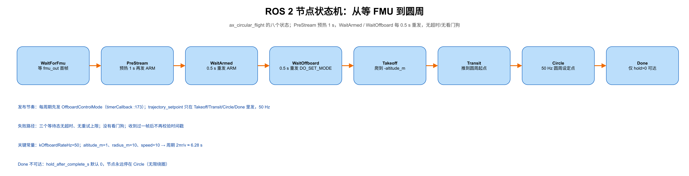

> 图 7-1　节点状态机：**八个**状态与转移条件（`WaitForFmu → PreStream → WaitArmed → WaitOffboard → Takeoff → Transit → Circle → Done`）；`PreStream` 停 1 s 预热，`WaitArmed` / `WaitOffboard` 每 0.5 s 重发命令，没有超时/重试上限/看门狗，`Done` 只有 `hold_after_complete_s>0` 才可达。源文件：[09_节点状态机.drawio](diagrams/09_节点状态机.drawio)。

关键实现细节：

- 无论状态如何，`timerCallback()` 每周期都先 `publishOffboardControlMode()`（`:173`），随后才在该状态里发 `trajectory_setpoint`。停发超过 `COM_OF_LOSS_T`（默认 1.0 s）会判丢；注意 `position=true` 但 `local_position` 无效时，即使 50 Hz 也立即判丢（`offboardCheck.cpp:49-58`），与发布频率无关。
- **节流与失败路径**：三个等待态都没有超时、没有重试上限——`PreStream` 先发 1 s 设定点再发 ARM（`:224-232`），`WaitArmed` 每 0.5 s 重发 ARM（`:248-251`）、`WaitOffboard` 每 0.5 s 重发 `DO_SET_MODE`（`:262-265`），但永不放弃；`Takeoff`/`Transit` 也没有超时。节点没有看门狗：`vehicle_status_`/`local_position_` 只在回调里整帧覆盖（`:117-126`），收到过一帧之后不再校验时间戳，PX4 掉线或 EKF 失效时仍会按旧数据继续发设定点。`Done` 只有 `hold_after_complete_s>0` 才可达（`:338-345`），默认 0 表示无限绕圈；节点没有退出条件，也不调用 `rclcpp::shutdown()`。
- **1 s 预热是节点自设的**：PX4 v1.18 没有“先连续发 N 秒才允许切 OFFBOARD”的规则，`offboardCheck.cpp:49-54` 只要求 `offboard_control_mode` 在 `COM_OF_LOSS_T` 内且至少一位控制位为真；全树也不存在 `TRANSITION_TO_OFFBOARD` 常量。节点 `:226` 注释里的“PX4 要求 > 2 Hz”是旧版本说法。
- `OffboardControlMode` 只把 `position=true`，其余 false；所以 `mc_pos_control` 走位置控制，速度/加速度作为前馈。
- `TrajectorySetpoint` 的 `yaw` 用 `theta + M_PI/2`，机头始终切向；`yawspeed=NAN`。
- 圆周前馈：`vx = -r*omega*sin(theta)`、`vy = r*omega*cos(theta)`、`ax = -r*omega^2*cos(theta)`、`ay = -r*omega^2*sin(theta)`。**注意这只是向心项**：前 2 s 角速度按 0.5 rad/s² 爬升，节点没有加切向项 `r*alpha`（r=10 m 时约 5 m/s²），所以加速段的前馈是不完整的——位置环要靠反馈补这部分，不能把这两个式子当成完整圆周加速度。
- 解锁命令 `param2=21196` 是强制解锁（跳过预检），节点默认 `force_arm=false`，只有参数打开才用。
- `VEHICLE_CMD_DO_SET_MODE` 的 `param1=1`（`MAV_MODE_FLAG_CUSTOM_MODE_ENABLED`），`param2=6`（`PX4_CUSTOM_MAIN_MODE_OFFBOARD`）。

### 7.7 常见问题

| 现象 | 原因 | 处理 |
|---|---|---|
| `ros2 topic list` 没有 `/fmu/out/*` | Agent 没起；PX4 没起 `uxrce_dds_client`；domain 不匹配 | `ss -lunp \| grep 8888`；`uxrce_dds_client status`；`ROS_DOMAIN_ID` 一致 |
| 有话题但 `echo` 无数据 | 订阅 QoS 用了 RELIABLE；话题名缺 `_v4`/`_v1` | 用 `--qos-reliability best_effort`；`ros2 topic list` 看真实后缀 |
| 节点一直 `WaitForFmu` | EKF 没有 `xy_valid/z_valid`；GPS 未融合 | `ros2 topic echo /fmu/out/vehicle_local_position_v1`；查 GPS/EKF |
| 解锁被拒 | 预检不通过；`COM_RC_IN_MODE`/EKF/GPS；`force_arm=false` | QGC/`commander check`；SITL 可临时 `force_arm:=true` |
| 进不了 OFFBOARD | `offboard_control_mode` 没持续发；位置无效；`COM_OF_LOSS_T` | 看 `/fmu/in/offboard_control_mode` 频率；看 `vehicle_status.nav_state` |
| 飞起来但很快掉 | Offboard 流中断；节点崩溃；时间戳不同步 | `ros2 topic hz`；`UXRCE_DDS_SYNCT`；看 PX4 日志 `No offboard signal` |

---

## 8. Offboard 控制闭环：从设定点到电机转速

本章分两层。8.1～8.6 是**正常链路**：ROS 2 的命令如何把 `nav_state` 切到 OFFBOARD，`trajectory_setpoint` 如何经位置环、姿态环、角速率环、控制分配和输出映射变成四个电机转速——回答“正常时怎么飞”。8.7 是**监督层**：当 Offboard/RC/GCS/GNSS/电池/位置估计中的任何一个失效时，PX4 如何检测、选动作、延迟并最终改写 `nav_state`——回答“出问题时谁接管”。两层共用 `vehicle_status`，但代码入口（`commander`/`mc_pos_control` 与 `FailsafeBase`）和状态变量都不同，读的时候不要混在一起。

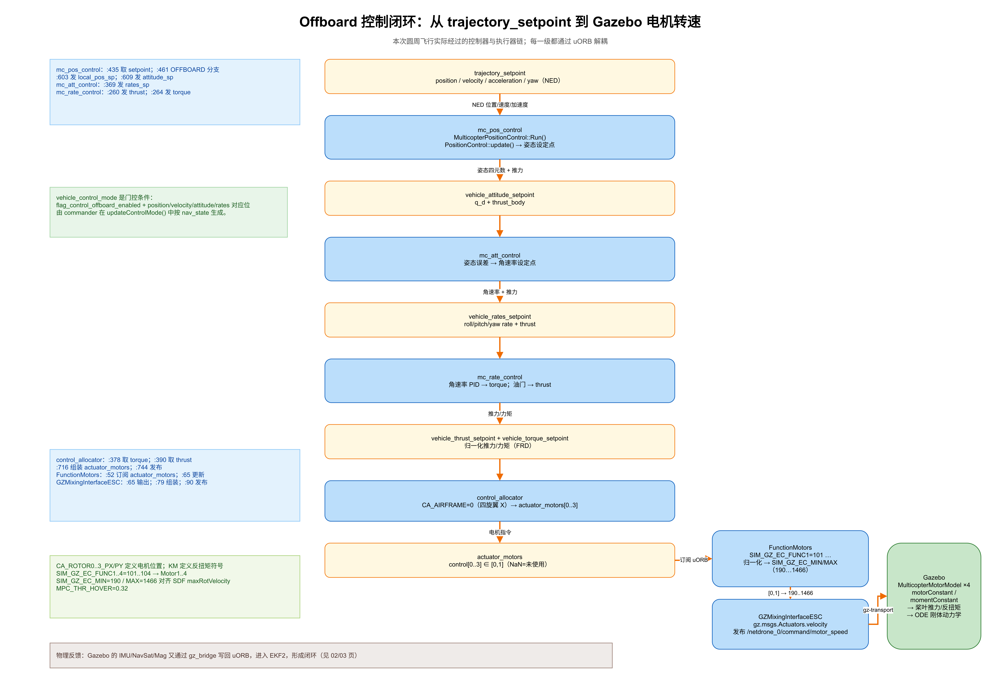

### 8.1 命令路径：ROS 2 → commander → 控制模式

1. ROS 2 发 `/fmu/in/vehicle_command`，`RcvTopicsPubs::on_topic_update()` 反序列化后 `vehicle_command_pub.publish(data)`。
2. `commander` 在 `Commander.cpp:2082` 轮询 `_vehicle_command_sub`，调用 `handle_command(cmd)`（`:854`）。
3. `VEHICLE_CMD_DO_SET_MODE` 分支（`:925`）把 `custom_main_mode=6` 映射到 `NAVIGATION_STATE_OFFBOARD`，再 `_user_mode_intention.change(...)`。
4. `Commander::updateControlMode()`（`:2761`）调用 `mode_util::getVehicleControlMode()`，根据 `nav_state` 和 `offboard_control_mode` 生成 `vehicle_control_mode`，并发布（`:2777`）。
5. `mode_util::getVehicleControlMode()` 的 OFFBOARD 分支（`control_mode.cpp:111`）：

```cpp
case vehicle_status_s::NAVIGATION_STATE_OFFBOARD:
    vehicle_control_mode.flag_control_offboard_enabled = true;

    if (offboard_control_mode.position) {
        getControlMode(SetpointType::Trajectory, vehicle_control_mode);
    } else if (offboard_control_mode.velocity) {
        getControlMode(SetpointType::Trajectory, vehicle_control_mode);
        vehicle_control_mode.flag_control_position_enabled = false;
    } else if (offboard_control_mode.acceleration) {
        ...
    } else if (offboard_control_mode.attitude) {
        getControlMode(SetpointType::Attitude, vehicle_control_mode);
    } else if (offboard_control_mode.body_rate) {
        getControlMode(SetpointType::Rates, vehicle_control_mode);
    } else if (offboard_control_mode.thrust_and_torque) {
        getControlMode(SetpointType::ThrustAndTorque, vehicle_control_mode);
    } else if (offboard_control_mode.direct_actuator) {
        getControlMode(SetpointType::DirectActuators, vehicle_control_mode);
    }
    break;
```

6. `commander` 的 `offboardControlCheck()`（`:3177`）只做一件事：如果 `_failsafe_flags.offboard_control_signal_lost` 刚恢复，标记 `_status_changed` 以便立即重新跑 arming checks。真正的“信号丢失”判定在 `offboardCheck.cpp:38-110`：

```cpp
// HealthAndArmingChecks/checks/offboardCheck.cpp:47-54
if (_offboard_control_mode_sub.copy(&offboard_control_mode)) {
    bool data_is_recent = hrt_absolute_time() < offboard_control_mode.timestamp
                          + static_cast<hrt_abstime>(_param_com_of_loss_t.get() * 1_s);

    bool offboard_available = (offboard_control_mode.position || ... ) && data_is_recent;
    ...
    reporter.failsafeFlags().offboard_control_signal_lost = !offboard_available;
}
```

所以 **`COM_OF_LOSS_T` 默认 1.0 s**：ROS 2 节点必须持续发 `offboard_control_mode`，否则 1 秒后 `offboard_control_signal_lost` 置位。注意这不只是超时判断：`offboardCheck.cpp:49-95` 先要求消息新鲜且至少一位控制位为真，再用 else-if 链检查对应估计（position→`local_position_invalid`、velocity→`local_velocity_invalid`、acceleration/attitude→`attitude_invalid`；body_rate、thrust_and_torque、direct_actuator 不检查估计）；位置失效时即使设定点还在发，也会立即判为 Offboard 不可用。该标志只在 OFFBOARD 模式下触发 `COM_OBL_RC_ACT` 动作（`failsafe.cpp:735`）。

### 8.2 设定点路径：`trajectory_setpoint` → 姿态

`mc_pos_control` 的 `Run()`（`MulticopterPositionControl.cpp:374`）：

```cpp
if (_local_pos_sub.update(&vehicle_local_position)) {
    ...
    _trajectory_setpoint_sub.update(&_setpoint);       // :435
    ...
    if (_vehicle_control_mode.flag_multicopter_position_control_enabled &&
        (_setpoint.timestamp >= _time_position_control_enabled)) {
        ...
        if (_vehicle_control_mode.flag_control_offboard_enabled) {
            // 处理起飞爬升约束
            ...
        }
        ...
        _control.setInputSetpoint(_setpoint);
        _control.setState(states);
        if (_control.update(dt)) { ... }
        ...
        _control.getLocalPositionSetpoint(local_pos_sp);
        _local_pos_sp_pub.publish(local_pos_sp);        // :603

        _control.getAttitudeSetpoint(attitude_setpoint);
        _vehicle_attitude_setpoint_pub.publish(attitude_setpoint);  // :609
    }
}
```

- `trajectory_setpoint.position` 是 NED，单位 m；`velocity` 是 NED，m/s；`acceleration` 是 NED，m/s²；`yaw` 是弧度。
- 某个字段为 `NAN` 表示“不控制该维度”；节点在圆周模式同时给 position/velocity/acceleration，形成前馈 + 反馈。
- `PositionControl::update()` 是**两级**：位置环只有比例项 P（`src/modules/mc_pos_control/PositionControl/PositionControl.cpp:127-141`，把位置误差变成速度设定点，含水平速度前馈），**PID 在速度环**（`:143-155`，D 项用的是实测加速度），再叠加加速度前馈；之后才是倾角限制与推力计算，最终输出 `vehicle_attitude_setpoint`（四元数 `q_d` + `thrust_body`）。把整条说成“位置 PID”会漏掉“位置 P → 速度 PID”这个级联结构。

### 8.3 姿态 → 角速率 → 推力/力矩

`mc_att_control`：

```cpp
// mc_att_control_main.cpp:317-376（简化）
if (_vehicle_attitude_setpoint_sub.updated()) {
    _attitude_control.setAttitudeSetpoint(Quatf(q_d), yaw_sp_move_rate, setpoint_dt);
    _thrust_setpoint_body = Vector3f(vehicle_attitude_setpoint.thrust_body);
}
...
vehicle_rates_setpoint_s rates_setpoint{};
_attitude_control.getRatesSetpoint(rates_setpoint);
_vehicle_rates_setpoint_pub.publish(rates_setpoint);   // :376
```

`mc_rate_control`：

```cpp
// MulticopterRateControl.cpp:231-264（简化）
_vehicle_thrust_setpoint_pub.publish(vehicle_thrust_setpoint);  // :260
_vehicle_torque_setpoint_pub.publish(vehicle_torque_setpoint);  // :264
```

它按 `torque = Kp·(ω_sp−ω) + I − Kd·ω̇ + Kff·ω_sp` 算力矩：**角加速度 `ω̇` 是 D 项的测量反馈，前馈项是角速率设定值 `ω_sp`**；推力设定值由上游传递（电池补偿时可能缩放），不是由角速率环“算”出来的。

### 8.4 控制分配：推力/力矩 → 四个电机

`control_allocator` 读取：

```cpp
// ControlAllocator.cpp:382-390
if (_vehicle_torque_setpoint_sub.update(&vehicle_torque_setpoint)) {
    _torque_sp = matrix::Vector3f(vehicle_torque_setpoint.xyz);
    _timestamp_sample = vehicle_torque_setpoint.timestamp_sample;
}
if (_vehicle_thrust_setpoint_sub.update(&vehicle_thrust_setpoint)) {
    _thrust_sp = matrix::Vector3f(vehicle_thrust_setpoint.xyz);
}
```

它根据 `CA_AIRFRAME=0`（Multirotor 分配类型）选择效能模型，再由 `CA_ROTOR_COUNT=4` 与 `CA_ROTOR0..3_PX/PY/KM` 共同定义四旋翼 X 几何，构造效率矩阵、求解电机指令，最后：

```cpp
// ControlAllocator.cpp:716-744（简化）
actuator_motors_s actuator_motors;
actuator_motors.timestamp = hrt_absolute_time();
actuator_motors.timestamp_sample = _timestamp_sample;
actuator_motors.reversible_flags = _param_r_rev.get();

for (motors_idx = 0; motors_idx < _num_actuators[0] && ...; motors_idx++) {
    float actuator_sp = ...;
    actuator_motors.control[motors_idx] = PX4_ISFINITE(actuator_sp) ? actuator_sp : NAN;
}
_actuator_motors_pub.publish(actuator_motors);   // :744
```

`actuator_motors.control[i]` 是归一化电机指令（0..1，NaN 表示未使用）。注意：它不是 PWM，也不是转速；真正的缩放发生在 `FunctionMotors`/`MixingOutput`。

### 8.5 电机映射：控制分配 → 功能映射 → Gazebo

这条链要拆成三段，不能简化成“数组直接乘 MIN/MAX”：

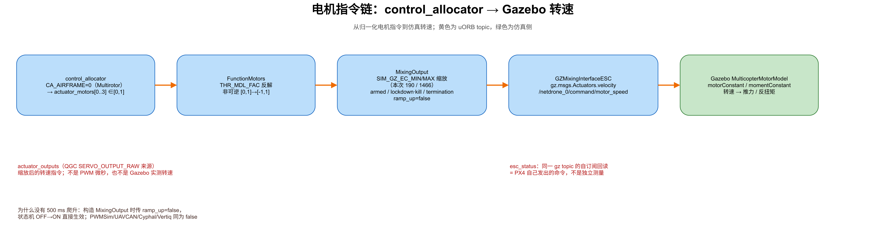

> 图 8-1　电机指令链：`control_allocator` 产生归一化指令，`FunctionMotors` 做推力模型反解与 `[0,1]→[-1,1]`，`MixingOutput` 做 190..1466 缩放与 armed/lockdown·kill/termination 门控，`GZMixingInterfaceESC` 写入 gz topic；下方标出 `actuator_outputs` 与 `esc_status` 的真实语义。源文件：[08_电机指令链.drawio](diagrams/08_电机指令链.drawio)。

```text
阶段 1：控制分配
vehicle_thrust_setpoint + vehicle_torque_setpoint
  → control_allocator
  → actuator_motors.control[0..3] ∈ [0,1]（NaN = 未使用）

阶段 2：功能映射与输出处理
actuator_motors
  → FunctionMotors::updateValues()
      ├─ THR_MDL_FAC > 0：按 rel_thrust = a*x² + (1-a)*x 反解控制量
      └─ 非可逆电机：[0,1] → [-1,1]（x*2-1）
  → MixingOutput::output_limit_calc()
      ├─ [-1,1] → [SIM_GZ_EC_MINn, SIM_GZ_EC_MAXn]
      ├─ armed：OFF → ON（ramp_up=false，无 RAMP 状态）
      ├─ disarmed → 回 OFF，输出 DIS 值
      ├─ lockdown / kill → DIS 值
      └─ termination → FAIL 值
  → GZMixingInterfaceESC::updateOutputs()

阶段 3：Gazebo 执行器
gz.msgs.Actuators.velocity
  → /netdrone_0/command/motor_speed
  → MulticopterMotorModel → 推力/反扭矩
```

`FunctionMotors` 订阅 `actuator_motors`（`FunctionMotors.hpp:52`），`updateValues()` 先做 `THR_MDL_FAC` 反解，再把非可逆电机从 `[0,1]` 映射到 `[-1,1]`；`MixingOutput` 最后按通道映射到 `SIM_GZ_EC_MIN1..4/MAX1..4`。

只有在 `THR_MDL_FAC=0`、电机非可逆、且输出处于 armed/ON 状态时，才有：

```text
out = MINn + control * (MAXn - MINn)
```

`THR_MDL_FAC>0` 时 `control` 先被反解成 `x`，上式不成立；可逆电机不做 `x*2-1`，映射也不同。`SIM_GZ_EC_MIN1..4=190`、`MAX1..4=1466` 与 SDF `maxRotVelocity=1466.32` 对齐，所以输出是 **rad/s 量级的转速指令**，不是 PWM。

`GZMixingInterfaceESC::updateOutputs()` 把这些值写进 `gz.msgs.Actuators.velocity`，发布到 `/netdrone_0/command/motor_speed`；Gazebo 的 `MulticopterMotorModel` 按 `motorConstant`/`momentConstant` 产生推力和反扭矩。

### 8.6 为什么这套东西能飞起来

把闭环按因果串起来：

1. **EKF2** 用 IMU + GPS + 磁力计 + 气压计估计出 `vehicle_local_position`（NED 位置/速度）和姿态。
2. **ROS 2 节点** 以 50 Hz 发一个“位置 + 速度 + 加速度前馈”的圆周轨迹；这些设定点在 NED 下是连续的、可跟踪的。
3. **mc_pos_control** 把位置误差变成姿态设定点（倾斜）和总推力；`MPC_THR_HOVER=0.32` 给前馈，PID 修正误差。
4. **mc_att_control** 把姿态误差变成角速率设定点；**mc_rate_control** 把角速率误差变成力矩，并把上游 `vehicle_rates_setpoint.thrust_body` 传递（电池补偿时可能缩放）为 `vehicle_thrust_setpoint`——它**不重新计算**总推力。
5. **control_allocator** 用几何矩阵把“总推力 + 三轴力矩”分配到四个电机；正反桨的 `KM` 符号保证偏航力矩方向正确。
6. **GZMixingInterfaceESC** 把 0..1 指令缩放成 190..1466 的转速指令；**Gazebo** 的电机模型产生推力/反扭矩，机体由本机 world 指定的物理引擎推进（`default.sdf` 显式写 `<physics type="ode">`；gz-sim 8 自身默认是 DART，两者不要混）。
7. **Gazebo 传感器** 再把新的 IMU/GPS/姿态写回 uORB，EKF2 更新估计，闭环继续。

只要以下任一环节不一致，就会“起飞即翻”或“飞不稳”：

- airframe 的 `CA_ROTOR*_PX/PY/KM` 与 SDF 的 rotor pose/turningDirection 不一致；
- `SIM_GZ_EC_MAXn` 与 SDF `maxRotVelocity` 不一致；
- `MPC_THR_HOVER` 与机体质量/推力系数不匹配；
- `trajectory_setpoint` 的坐标系不是 NED，或 yaw 方向错；
- Offboard 流中断超过 `COM_OF_LOSS_T`。

### 8.7 失效保护：检测、决策、动作是三层
#### 8.7.1 三层架构：检测、决策、动作

PX4 的 failsafe 不是“某个 topic 超时就返航”。源码把它拆成三段，读的时候必须按段查：

1. **检测**：`src/modules/commander/HealthAndArmingChecks/checks/*.cpp` 把观测翻译成 `failsafe_flags` 里的布尔位（`manual_control_signal_lost`、`offboard_control_signal_lost`、`gcs_connection_lost`、`gnss_lost`、`local_position_invalid`、`position_accuracy_low` …）。
2. **决策**：PX4 并没有“所有 failsafe 都先过一遍 `mode_req_*`”的统一闸门。独立 failsafe（RC、GCS、GNSS、电池等）由 `failsafe.cpp` 的 `checkStateAndMode()` 依据各自的状态标志、动作参数、解锁状态与豁免条件决定是否入队（`failsafe.cpp:548-713`）；`mode_req_*` 与 `FailsafeBase::modeCanRun()`（`framework.cpp:707-724`）主要用于判断**模式是否仍可运行**，并参与 mode-fallback。本 tag 没有 `isFailsafeRequired` 这个符号。
3. **动作**：飞行中的普通 failsafe 动作受 armed 门控，但有一个更早的 Terminate 保持分支（`framework.cpp:452-458`）：先判 `state.user_intended_mode == NAVIGATION_STATE_TERMINATION || _selected_action == Action::Terminate`，再判 `!state.armed`。这里用的是**上一轮已选中的 `_selected_action`**，不能泛化成“任意新入队的 Terminate 都绕过 armed 门控”。另一套独立机制是解锁前的 HealthAndArmingChecks：以 `NavModes::All` 报告失败时可以直接阻止解锁，它不是飞行中的 action。
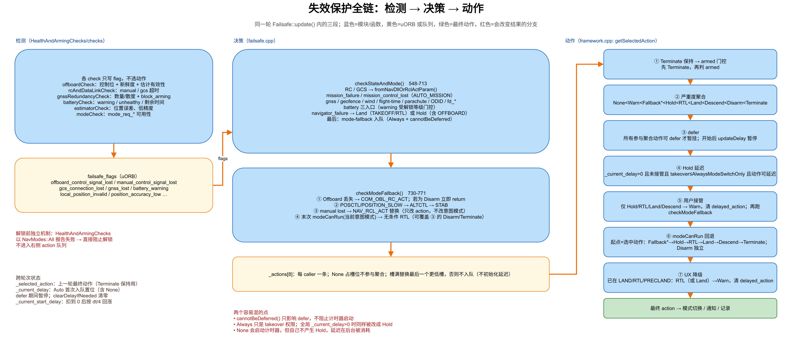

> 图 8-2　失效保护**一条链**：左列检测写 `failsafe_flags`，中列 `checkStateAndMode()` 把独立 failsafe 入队、`checkModeFallback()` 产生 fallback，选中的动作经 8 槽队列 `_actions`（下标 0～7）进入右列 `getSelectedAction()` 的七阶段（①～⑦），最后落到模式切换/通知。三个色块是同一轮 `Failsafe::update()` 里的连续调用；灰色是跨轮次状态。源文件：[07_失效保护全链.drawio](diagrams/07_失效保护全链.drawio)。


#### 8.7.2 一帧之内的执行时序


先看顺序，再看细节。下面这张图是 `Failsafe::update()` 一帧之内实际发生的事，八个步骤按源码顺序排列（第 3、4 步都写进同一个 8 槽队列 `_actions`，下标 0～7）。**计时器出现两次**：`updateDelay()` 在第 2 步、决策之前扣减 `_current_delay`；`updateStartDelay()` 在第 7 步、动作选定之后更新准备值。这个顺序决定了“延迟到期的那一拍就能执行”，也是 §8.7.6 里 499/500 拍解释的前提。8.7.3 讲图中第 3 步的检测，8.7.4 讲第 4 步的 mode-fallback，8.7.5 讲第 6 步的七阶段，8.7.6 单独讲第 2、7 步的计时器，8.7.7 用本次实验把整条链走一遍。

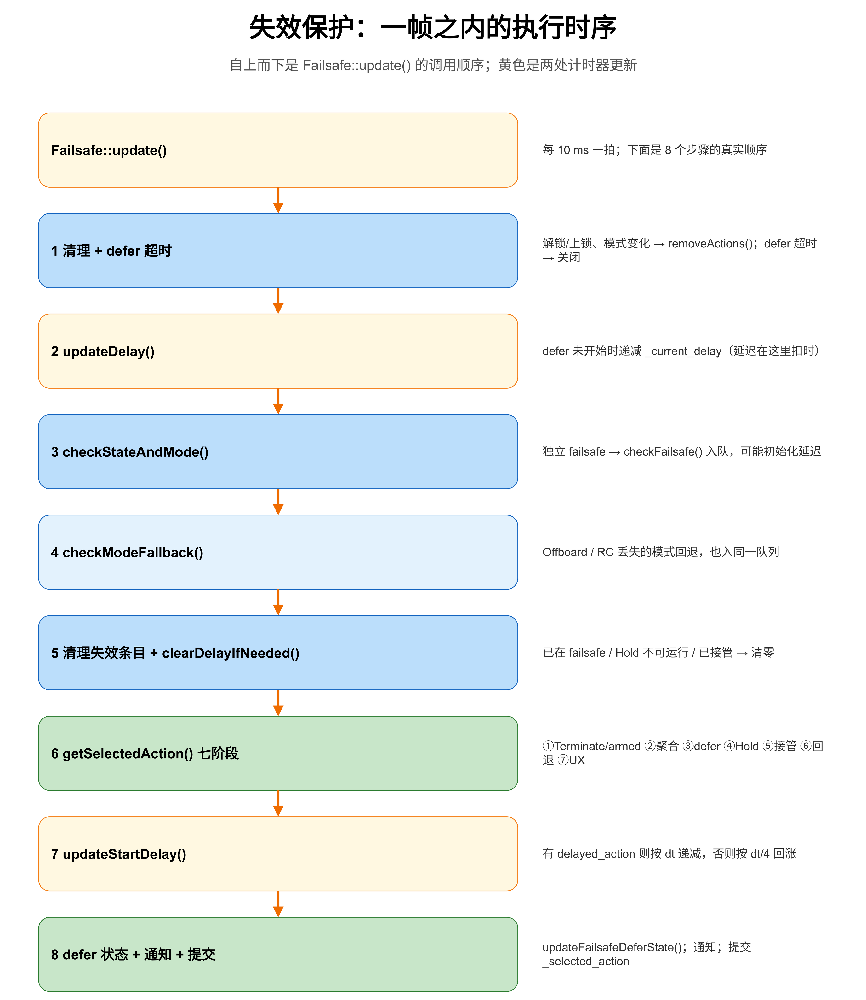

> 图 8-3　失效保护**一帧之内**的八个步骤（黄色为计时器更新）。图 8-2 是概念图，这张是调用顺序。源文件：[11_失效保护时序.drawio](diagrams/11_失效保护时序.drawio)。

#### 8.7.3 检测：`failsafe_flags` 从哪来，各自对应什么动作

**逐条说明（代码级）**：

- **Offboard 信号**：`offboardCheck.cpp:40` 先把标志预置为真（收不到 `offboard_control_mode` 时一直为真）；收到消息后要求“至少一位控制位为真 + 消息在 `COM_OF_LOSS_T` 内”（`:49-54`），再用 else-if 链检查估计：`position`→`local_position_invalid`、`velocity`→`local_velocity_invalid`、`acceleration/attitude`→`attitude_invalid`（`:56-95`）；`body_rate`、`thrust_and_torque`、`direct_actuator` 不做估计检查。`mode_req_offboard_signal` 只有 OFFBOARD 一处置位（`mode_requirements.cpp:165`），因此在 `failsafe.cpp:735` 之外，这个标志只影响模式可用性。
- **手动控制**：`rcAndDataLinkCheck.cpp:48-57` 判定 `manual_control_setpoint` 无效或超时；模块在没有输入时也会发布一次 `valid=false`（`ManualControl.cpp:176-180`）。决策前先算 `rc_loss_ignored`（`failsafe.cpp:559-570`）：`COM_RCL_EXCEPT` 豁免模式、VTOL 起飞前段、或解锁瞬间手动输入已丢失（`_manual_control_lost_at_arming`，`:716-725`）都算“可选输入”。`NAV_RCL_ACT=7` 是特殊值：它不产生 failsafe action，而由 `Commander::manualControlLossModeSwitch()` 以**普通模式切换**进 Hold（`Commander.cpp:3149-3185`，仅手动模式下、且用边沿触发）；`NAV_RCL_ACT=0` 只是 `Disabled→Action::None`，不会触发这条模式切换。`COM_RC_IN_MODE=4` 只让**独立 RC-loss action 不入队**（`failsafe.cpp:567-570` 的 `!= DisableManualControl` 条件），它既不清除 `manual_control_signal_lost`，也不让 `checkModeFallback()` 忽略该标志。
- **GCS 链路**：`gcs_connection_lost` 在 Commander 构造时初值为真（`Commander.cpp:815`），收到 `heartbeat_type_gcs` 才清除（`:2944-2956`）；清除后超过 `COM_DL_LOSS_T` 无新心跳再次置真（`:3027-3032`）。`rcAndDataLinkCheck.cpp:78-83`：`NAV_DLL_ACT>0` 时以 `NavModes::All` 阻止解锁，所以“从未连过 QGC”与“连过又断”在标志层面同为真，差别在预检与动作。**`NAV_DLL_ACT=0` 不等于所有模式下都没有动作**：AUTO_MISSION 且 `mission_finished` 时，若 RC 输入被禁用或 `COM_RCL_EXCEPT` 豁免了该模式，`checkStateAndMode()` 还会用独立的 `_caller_id_mission_control_lost` 把 `gcs_connection_lost` 映射为 `Action::RTL`（`failsafe.cpp:595-603`），与 `NAV_DLL_ACT` 无关。本次是 OFFBOARD，这条分支不会进入。
- **导航故障（最容易被漏掉的 `Auto` 入口）**：`navigator_failure` 在 AUTO_TAKEOFF/AUTO_RTL 下映射为 `Action::Land`，**其余模式（含 OFFBOARD）映射为 `Action::Hold`**（`failsafe.cpp:616-624`）。两处都用 `ActionOptions` 的默认 `takeover=Auto`，所以置位时都可能初始化 `_current_delay`；但 **`Hold` 本身被排除在可延迟动作之外**（`action_can_be_delayed` 明确排除 `Action::Hold`，`framework.cpp:496-501`），所以 OFFBOARD 下的导航故障是**立即选中 Hold**，计时器只在后台递减；`Land` 才可能被改写成延迟 Hold。这个后台计时器仍可能影响随后到来的 RTL/Land。本次实测该 flag 为假。同类默认 `Auto` 的还有 `mission_failure`、`wind_limit_exceeded`、`flight_time_limit_exceeded`、`geofence_breached`、`fd_motor_failure`、`gnss_lost`、`parachute_unhealthy` 等，入队各自受模式或参数门控（见 C.4 的实测快照）。
- **GNSS 冗余**：`below_required = SYS_HAS_NUM_GNSS>0 && fixed_count < SYS_HAS_NUM_GNSS`，双接收机散度（3σ 门限 + 2 s 双向滞回）只在 `SYS_HAS_NUM_GNSS>=2` 时升级为 failsafe（`gnssRedundancyCheck.cpp:97-105`）。`fixed_count` 只统计 `device_id≠0`、消息新鲜（<1 s）、`fix_type>=3` 的实例（`:53-66`）。数量掉到峰值以下（`dropped_below_peak`）**单独**触发时只发告警；若同一时刻还满足 `below_required` 或散度 failsafe 条件，仍可能按对应分支阻止解锁。阻止解锁有**两个**独立条件：数量不足分支在 `gnssRedundancyCheck.cpp:107-139`（`block_arming = below_required && act_configured` 在 `:108`），散度分支在 `:141-159`（`block_arming = divergence_triggers_failsafe && act_configured` 在 `:142`）。两处都用 `NavModes::All` 上报健康失败，所以条件是 `below_required && COM_GNSSLOSS_ACT>0`，或 `divergence_triggers_failsafe && COM_GNSSLOSS_ACT>0`（后者还要求散度滞回已触发且 `SYS_HAS_NUM_GNSS>=2`）。本次 `SYS_HAS_NUM_GNSS=0`，两条都不成立。另做了对照实验（C.6）：SITL 单接收机 `device_id=11469068`、`fix_type=3`，`fixed_count` 实测为 1；`SYS_HAS_NUM_GNSS=2` + `COM_GNSSLOSS_ACT=1`（Return）时，解锁前 `can_arm_mode_flags=0`、`health_error_flags=8`、`Arming denied: Resolve system health failures first`；飞行中改参后 `gnss_lost` 0.5 s 内置位，`nav_state` 14→4（Hold）停留 **5.004 s**，再转 5（RTL）。
- **电池**：三个入口不能合并成一个 `COM_LOW_BAT_ACT`：
  1. **警告等级**（`failsafe.cpp:649-700`）：先算 `warning_worse_than_at_arming = battery_warning > _battery_warning_at_arming`（`:651-653`；解锁瞬间记录，`:717-720`）。当前等级没有高于解锁时等级，就把动作参数强制替换为 `LowBatteryAction::Warning`，配置的 `COM_LOW_BAT_ACT` 暂不生效。映射细节：`WARNING_LOW` 恒为 `Warn`；`WARNING_CRITICAL` 在 `Return`/`ReturnOrLand` 时 `RTL`、`Land` 时 `Land`（`:183-201`）；`WARNING_EMERGENCY` 在 `Return` 时 `RTL`、`ReturnOrLand`/`Land` 时 `Land`（`:204-221`）。
  2. **电池不健康**（`:632-639`）：解锁后 `COM_SPOOLUP_TIME`（默认 1 s）内为 `Action::Disarm`（`cannotBeDeferred`），之后为 `Action::Warn`。**注意两条 caller 与字段保留**：Spoolup 分支还会用另一个 caller `_caller_id_battery_unhealthy_spoolup` 再入队一个 `Disarm`（`:676-686`）；退出 Spoolup 后这个条目不再被调用，会被 `removeNonActivatedActions()` 清掉。但主 `battery_unhealthy` caller 只是把 action 更新成 `Warn`，`can_be_deferred=false` **仍保留**（`framework.cpp:322-335`），所以一个已经降级为 Warn 的条目仍可能否决整组 defer。
  3. **剩余飞行时间**（`:628-630`）：独立走 `COM_FLTT_LOW_ACT`（0=None / 1=Warning / 3=Return），由 `fromRemainingFlightTimeLowActParam()` 映射（`failsafe.cpp:447-475`），且 `takeover=Auto`。注意 `batteryCheck.cpp` 只要时间条件成立就置位该 flag（`:309-314`），与参数是否为 0 无关（`:318` 只控制是否上报），所以参数为 0 时它仍可能以 `Action::None` 启动上文的全局延迟计时器。
- **位置误差与低精度**：`estimatorCheck.cpp:735` 取 `COM_POS_FS_EPH`（-1 视为无穷），local 与 global 共用；`:874-893` 的滞回是“已有效时门限放大 2.5 倍、恢复需 1 s 稳定期”。低精度由 `lowPositionAccuracy()`（`:692`）判定：只有 `COM_POS_LOW_EPH > 0` 且 `eph` 超过该阈值才置 `position_accuracy_low`；动作 `COM_POS_LOW_ACT` 只在 AUTO_MISSION/AUTO_LOITER 执行（`failsafe.cpp:610-614`）。因此 **`COM_POS_LOW_ACT=3` 不等于保护已启用**——本次 `COM_POS_LOW_EPH=-1`，触发条件本身就是关闭的。
- **EKF 惯性递推**：`EKF/ekf_helper.cpp:885`、`:911`、`:919` 在超过 `EKF2_NOAID_TOUT` 没有辅助观测时置 `_horizontal_deadreckon_time_exceeded`；`ekf.h:253-256` 据此返回无效，`EKF2.cpp:1725-1726` 写成 `xy_valid=false`、`v_xy_valid=false`，并清 `solution_status_flags` 对应位。它**不直接**写 `local_position_invalid`，而是改由 `COM_POS_FS_EPH` 那条链路间接产生动作。

表里是每一类保护对应的检测模块、关键参数与动作限制（“固件默认 → 本次运行值”）：

| 保护 | 检测模块 | 关键参数（固件默认 → 本次运行值；= 表示两侧实测相同） | 动作与模式限制 | 本次 SITL |
|---|---|---|---|---|
| Offboard 信号 | `offboardCheck.cpp` | `COM_OF_LOSS_T` 1.0 → 1.0；`COM_OBL_RC_ACT` 0 → 0 | 仅 OFFBOARD 模式；结果会被 RC 标志、聚合与可运行性检查改写 | 停发 1 s 触发；位置无效立即触发；本次 `checkModeFallback()` **返回值**为 **RTL**（非最终执行动作，见下） |
| 手动控制 | `rcAndDataLinkCheck.cpp` | `COM_RC_LOSS_T` 0.5 → 0.5；`NAV_RCL_ACT` 2 → 2；`COM_RCL_EXCEPT` 0 → 0 | 解锁后；多处豁免（见下）；该标志仍会改写 Offboard 的 fallback | 解锁时已丢失 → 独立保护不触发，但 Offboard 丢失后的动作会被改写成 RTL |
| GCS 链路 | `Commander.cpp`、`rcAndDataLinkCheck.cpp` | `COM_DL_LOSS_T` 10 → 10；`NAV_DLL_ACT` 0 → 0 | `NAV_DLL_ACT>0` 时**解锁前**以 `NavModes::All` 拒绝解锁；解锁后按动作参数，另有 `COM_DLL_EXCEPT`、AUTO_LAND/PRECLAND、未解锁等豁免 | 本次 OFFBOARD 下只置标志；但 AUTO_MISSION+mission_finished 时另有 RTL 分支（见下） |
| GNSS 冗余 | `gnssRedundancyCheck.cpp` | `SYS_HAS_NUM_GNSS` 0 → 0；`COM_GNSSLOSS_ACT` 0 → 0 | `COM_GNSSLOSS_ACT>0` 时**解锁前**以 `NavModes::All` 拒绝解锁（数量不足或散度触发）；解锁后按同一参数执行动作（0=Warning/1=Return/2=Land/3=Terminate） | 本次参数为 0 恒假；另做实验：`SYS_HAS_NUM_GNSS=2` 时解锁被拦，飞行中 5.004 s Hold → RTL（C.6） |
| 位置误差 | `estimatorCheck.cpp` | `COM_POS_FS_EPH` 5.0 → 5.0 | 无独立动作，经模式回退 | 5 m，2.5× 滞回 |
| 低位置精度 | `estimatorCheck.cpp` | `COM_POS_LOW_EPH` -1.0 → -1.0；`COM_POS_LOW_ACT` 3 → 3 | 仅 AUTO_MISSION/AUTO_LOITER | 默认关闭 |
| EKF 惯性递推 | `ekf2` | `EKF2_NOAID_TOUT` 5000000 us → 5000000 | 经“位置误差”间接触发 | 无辅助观测超时；本次只有 GNSS 提供水平辅助时才≈掉 GPS 后 5 s |
| 电池 | `batteryCheck.cpp` | `COM_LOW_BAT_ACT` 0 → 3（`rcS:182`）；`COM_FLTT_LOW_ACT` 0 → 0；`COM_SPOOLUP_TIME` 1.0 → 1.0 | 警告（受解锁等级门控）/ 不健康（Spoolup 期 Disarm，之后 Warn）/ 剩余时间（独立参数，`None` 也启动延迟） | 运行 3；`time_remaining_s=nan`，剩余时间 flag 实测为假 |
| 着陆 | `vehicle_land_detected` | `COM_DISARM_LAND` 2.0 → 2.0 | **Commander 独立机制，不走 `FailsafeBase` 队列**：参数>0、无 mission in progress、未禁用 auto-disarm、本次解锁后起飞过，才按参数延时上锁 | 两轮独立会话：参数 2 s → **2.016 s**、参数 5 s → **5.008 s**（C.9） |

> **四条容易误读的边界**：
>
> 1. **Offboard 丢失 ≠ 只是停发设定点**。只发 `offboard_control_mode` 但位置无效，仍会置 `offboard_control_signal_lost`；只发 `trajectory_setpoint` 而不发 `offboard_control_mode`，则从启动起该标志就为真。
> 2. **RC 丢失标志会影响 Offboard 的最终动作**。独立 RC-loss 保护是否执行由 `rc_loss_ignored` 决定，本次因 `_manual_control_lost_at_arming` 被忽略；但这**不是**全部：`manual_control_signal_lost` 仍然参与 `checkModeFallback()`，会把 `COM_OBL_RC_ACT` 产生的 `FallbackPosCtrl/AltCtrl/Stab` 替换成 `NAV_RCL_ACT` 的动作。本次位置有效，动作通常不会被降级，而是直接从 `FallbackPosCtrl` 被 `NAV_RCL_ACT=2` 替换为 **RTL**，而不是“按 `COM_OBL_RC_ACT=0` 回退 POSCTL”；是否经过 ALTCTL/STAB，取决于 `modeCanRun()` 检查的位置/姿态/高度位，不能由“无手动输入”推断。单独把每个 check 读对、却忽略它们最终汇合到同一条 fallback 链，仍然会判错行为——这是本节最值得记住的一点。
> 3. **GCS 丢失的标志初值为真**。`_datalink_last_heartbeat_gcs != 0` 只约束“超时再置真”这条路径；从未连过 QGC 时标志同样为真，`NAV_DLL_ACT>0` 会直接阻止解锁，`NAV_DLL_ACT=0` 时才只剩标志、没有动作。
> 4. **参数只有三层存储，但有多个写入时机**：固件默认（yaml）、运行时默认（`rcS`/airframe 的 `param set-default`）、用户层（`parameters.bson`、`param set`、`PX4_PARAM_*`）。读取始终按“用户层 → 运行时默认 → 固件默认”回退，优先级是结构性的，与脚本顺序无关；顺序只决定“同一层里谁后写谁赢”。`PX4_SIM_SPEED_FACTOR` 只有被显式设置时才用 `bc` 改写 `COM_DL_LOSS_T`（×10）、`COM_RC_LOSS_T`（×1.0）、`COM_OF_LOSS_T`（×1.0）；本次实测三者仍是 10 / 0.5 / 1.0，说明该分支未执行。

#### 8.7.4 决策一：mode-fallback 的四步

先说清这一节最容易混的一件事：**这里有五个不同的“模式”，名字都像“意图模式”，但不是同一个变量**。

| 名称 | 是什么 | 本次取值 |
|---|---|---|
| `state.user_intended_mode` | Commander 记的用户意图；OFFBOARD 时是 14 | 14 |
| `checkModeFallback(…, uint8_t user_intended_mode)` 的形参 | **按值**传入的副本（`failsafe.cpp:730` 的签名没有 `&`） | 14 |
| `fromOffboardLossActParam(…, uint8_t &user_intended_mode)` 的第二参数 | **引用**（`:258`），改的是上面那个副本 | 14 → 2（POSCTL 的 `nav_state` 是 2，不是 3） |
| `updated_user_intended_mode` | 框架层 `modifyUserIntendedMode()` 决定是否采纳的目标模式（`framework.cpp:102-103`） | 由选中动作决定 |
| 最终 `nav_state` | 实际执行的导航状态 | 5（AUTO_RTL） |

关键点：`checkModeFallback()` 是 `const` 成员函数、形参按值传、函数体只 `return action`（`:770`），所以**第 1 步改写出来的 POSCTL 走不出这个函数**，Commander 的 `state.user_intended_mode` 不会变成 POSCTL。它只影响本函数后面几次 `modeCanRun()` 的判据。

1. `COM_OBL_RC_ACT` 先把 Offboard 丢失映射成初始动作（0 → `FallbackPosCtrl`），**同时把上面那个局部副本写成 `NAVIGATION_STATE_POSCTL`**（`:263-267`；`Position_mode` 与 `default` 分支共用这段代码，所以越界参数值也走这里）。若**这一步**返回 `Action::Disarm` 则立即返回（`:735-741`）：`Disarm` 是唯一不改写副本的分支（`:299-301`），提前返回使后面三次 `modeCanRun()` 全部跳过。注意该提前返回只针对 Offboard 分支初始生成的 Disarm，后续由 `NAV_RCL_ACT` 替换出来的 Disarm 不会触发它。**`COM_OBL_RC_ACT` 的 `Disarm` 是 7 不是 1**——1 是 Altitude mode（→ `FallbackAltCtrl` + ALTCTL）。
2. `modeCanRun()` 判 POSCTL/POSITION_SLOW 不可运行时退到 `FallbackAltCtrl`（目标 ALTCTL，`:745-751`）；ALTCTL 仍不可运行时退到 `FallbackStab`（目标 STAB，`:753-758`）。`modeCanRun()` 只检查角速度/姿态/位置/高度/任务/offboard/home 等位，`mode_req_manual_control` 明确“另行处理”（`framework.cpp:707-711` 的注释），所以**无手动输入本身不会让 POSCTL 不可运行**。
3. 若此时 `manual_control_signal_lost` 为真且动作仍是三种 `Fallback*` 之一，替换为 `manualControlLossFallbackAction()`，即 `NAV_RCL_ACT` 的动作（`:760-762`、`failsafe.h:194`、`failsafe.cpp:43-47`）。**注意它只改 `action`，不改局部副本**——所以替换成 RTL 之后，`user_intended_mode` 仍是 POSCTL。这条替换也不是单向升级：`NAV_RCL_ACT=0`（Disabled）或 `7`（Hold 走普通模式切换）经 `fromNavDllOrRclActParam()` 返回的是 `Action::None`（`:55-62`），会把 `FallbackPosCtrl` 直接抹成 `None`。
4. 最后再判一次 `modeCanRun()`，不满足则**无条件**把动作改成 RTL（`:765-769`）。这一步检查的**不是**第 3 步替换出的动作所对应的 AUTO 模式，而是被第 1、2 步改写过的**局部副本**（本次为 POSCTL）——`NAV_RCL_ACT` 的替换代码在 `:760-762`，位于 `:765` 之前，两者之间没有重新同步。因此它不只改写 `FallbackStab`，也可能把 `NAV_RCL_ACT` 替换出的 `Disarm`/`Terminate`/`Land` 覆盖成 RTL。只有这一步通过，替换动作才进入七阶段第 6 步的模式可运行性检查。

注意：以上四步得到的是 **mode-fallback action**，还不是全局最终动作；而且第 1 步写出来的目标模式（POSCTL）**只活在这个函数内部**，不会成为 Commander 的 `user_intended_mode`。`checkStateAndMode()` 在此之前已经把 GCS、电池、任务、GNSS 等独立 failsafe 入队；`FailsafeBase::getSelectedAction()`（`framework.cpp:441-653`）随后还要做七件事：


#### 8.7.5 决策二：动作队列与 `getSelectedAction()` 的七阶段

1. **Terminate 保持 / armed 门控**：先判 `state.user_intended_mode == NAVIGATION_STATE_TERMINATION || _selected_action == Action::Terminate`，成立就**直接返回 Terminate，不再看 armed**（`:449-453`）；只有不成立时才判未解锁并返回 `None`（`:455-458`）。所以顺序是“Terminate 保持 → armed”，不是“armed → Terminate 例外”。这里的保持只覆盖“意图模式已是 TERMINATION”或“上一轮已选中 Terminate”，新入队的 Terminate 仍受 armed 门控。
2. **严重度聚合**：`Action` 枚举越靠后越严重——`None < Warn < FallbackPosCtrl < FallbackAltCtrl < FallbackStab < Hold < RTL < Land < Descend < Disarm < Terminate`（`framework.h:52-70`），取最大者（`:479-482`）；`None` 条目被跳过（`:470-472`）。因此活动的 `Land` 覆盖 `RTL`，`Disarm` 覆盖 `Descend`，`Terminate` 覆盖全部。
3. **defer**：`_defer_failsafes` 且所有**参与聚合的**活动动作都可 defer 时，动作暂挂为 `None`（`:484-494`）。`Action::None` 条目在 `:470-472` 已被 `continue` 跳过，因此它既不参与严重度和 takeover，也不参与 `allow_failsafe_to_be_deferred` 的计算——即使它带着 `can_be_deferred=false` 也挡不住 defer。defer 本身只在上一轮选中动作 ≤ `Warn` 时才能开启：`deferFailsafes()` 在 `_selected_action > Warn` 时直接返回 false（`:728-730`），所以“已经 Hold 了再开 defer”不成立（实测返回 false）。两套机制还有**计时耦合**：defer 已开始时 `update()` 不再调用 `updateDelay()`（`:78-80`），`_current_delay` 暂停递减；若 defer 尚未开始就被关闭，`deferFailsafes()` 会直接清零 `_current_delay`（`:732-734`）；一旦 defer 已经开始（`_failsafe_defer_started != 0`），关闭时不清零；恢复后的第一拍 `update()` 仍走 defer 分支、不调 `updateDelay()`（`:78-80` 的判据用的是上一拍的 `_failsafe_defer_started`），所以要到第二拍 `_current_delay` 才开始递减。实测：先开 defer 再触发 `battery_low_remaining_time`，`_current_delay=5,000,000 us` 且动作暂挂 `None`，1 s（100 拍）后仍精确 5,000,000；关闭 defer 后第 1 拍仍 5,000,000，第 2 拍 4,990,000、第 3 拍 4,980,000。
4. **Hold 延迟**：具体机制见下文 §8.7.6；这里只记结论——`_current_delay>0` 时它能把 RTL 改写成 `Hold`，原动作存进 `delayed_action`（`:496-508`）。
5. **用户接管**：只有 `Hold/RTL/Land/Descend` 允许接管（`actionAllowsUserTakeover()`，`:655-659` 仅对这四种返回真）。接管时先把 `selected_action` 改成 `Warn`、清空 `delayed_action`，**然后**才调用 `checkModeFallback(status_flags, modeFromAction(selected_action, updated_user_intended_mode))`（`:519-543`）。注意此时 `selected_action` 已经是 `Warn`，`modeFromAction(Warn, …)` 走 default 分支、原样返回 `updated_user_intended_mode`（`:685-703`）——所以第二次 fallback 判的是**用户接管后的意图模式**，不是把原来的 RTL/Land 再映射一次；返回值比 `Warn` 更严重才采纳。
6. **模式可运行性回退**：从**当前选中的动作**开始 fallthrough——`FallbackPosCtrl → FallbackAltCtrl → FallbackStab → Hold(AUTO_LOITER) → RTL(AUTO_RTL) → Land(AUTO_LAND) → Descend → Terminate`（`:546-613`）。起点取决于选中动作：选中 RTL 就从 RTL 开始判，不是每次都从 `FallbackPosCtrl` 起跑。`Disarm` 是独立分支（`:615-617`），不在这条链上。
7. **UX 降级**（内联在函数尾部，`:625-652`）：判断依据是 `returned_state.updated_user_intended_mode`（用户意图模式），不是当前 `nav_state`。三块规则不同：AUTO_LAND 只把 **RTL** 降为 `Warn`（`:627-633`）、AUTO_RTL 只把 **RTL** 降为 `Warn`（`:636-642`）、AUTO_PRECLAND 把 **RTL 或 Land** 降为 `Warn`（`:645-652`）；每块都要求该模式 `modeCanRun()` 为真，并同时检查 `delayed_action`，命中后一并清空。

还有一处容易误读：**同一 `caller_id` 再次失败时只更新 action**（`framework.cpp:322-335`），`allow_user_takeover` 与 `can_be_deferred` 保留首次入队时的值。实测：同一个 id 先以 `Disarm + Never + cannotBeDeferred` 入队、随后降级为 `Warn`，条目变成 `Warn` 但 takeover 仍是 `Never`、`can_be_deferred` 仍是 false；此后即使另有一个可延迟的动作，`deferFailsafes()` 仍被这个旧的 `cannotBeDeferred` 否决（`failsafeDeferred()=false`，选中 `RTL`）。所以“动作降级了，权限也跟着降级”是错的。

所以“没有其它活动 action”远不足以断定最终动作。


#### 8.7.6 独立机制：`COM_FAIL_ACT_T` 全局延迟

前面 8.7.3～8.7.5 讲的是“动作怎么产生、怎么被选中”；这一节讲的是**另一个独立机制**：为什么有时会先 Hold 一段时间再执行。两者通过 `_current_delay` 耦合，但不要混为一谈。


`COM_FAIL_ACT_T`（默认 5 s）**不是**按最终 Action 类型统一施加的延迟，而是一套全局计时器机制，四个环节要分别看：

- **准备值**：`_current_start_delay` 在构造函数与 `updateParams()` 里取 `COM_FAIL_ACT_T * 1_s`（`framework.cpp:48-50`、`:146-150`）。它**不是常量**：`updateStartDelay()`（`:124-144`）在延迟生效期间按 `dt` 递减它，在无效期间按 `dt/4` 回涨、并被 `COM_FAIL_ACT_T` 封顶。所以“入队时它一定为正”并不成立。10 ms 周期的单元测试给出精确时序：第 499 拍结束时 `_current_start_delay=0`，而 `_current_delay=10,000 us`，仍是 Hold；第 500 拍 `updateDelay()` 先把 `_current_delay` 减到 0，聚合阶段不再插入 Hold，`updateStartDelay()` 因 `delayed_action=None` 按 `dt/4` 把准备值回升到 `2,500 us`。也就是说，**归零发生在最后一个仍 Hold 的周期，而不是延迟到期那一拍**；1 s 后为 `252,500 us`，19.99 s 才回到 5,000,000 封顶。
- **启动**：`checkFailsafe()`（`:354-365`）只对 `allow_user_takeover == Auto` 的新动作做改写；当 `COM_FAIL_ACT_T>0.1` 时把动作改成 `Always`，并且只要动作**不是 `Warn`**、`_current_delay==0`，就执行 `_current_delay = _current_start_delay`。**这里不排除 `Action::None`**：`fromRemainingFlightTimeLowActParam()` 生成的 action 固定 `takeover=Auto`（`failsafe.cpp:447-475`），本次 `COM_FLTT_LOW_ACT=0` 时它返回的正是 `Action::None`，却仍可能启动这个计时器。若 `COM_FAIL_ACT_T<=0.1`，动作被改写成 `AlwaysModeSwitchOnly`。**不止 FLTT 一个入口**：只要 `ActionOptions` 用的是默认 `takeover=Auto`，`GF_ACTION=0`（`fromGfActParam()` 的 None，`failsafe.cpp:99-101`）、`COM_WIND_MAX_ACT=0`（`fromHighWindLimitActParam()` 的 None）、`NAV_RCL_ACT=0` 的 RC-loss 路径（`fromNavDllOrRclActParam()` 的 Disabled→None，`:54-62`）、电池 CRITICAL/EMERGENCY 映射成 RTL/Land（`:183-221`），置位时都会走同一段延迟初始化——`cannotBeDeferred()` 不改变 takeover，因此挡不住它。**这里还有两个边界**：①只有**新入队**才走这段——同一 `caller_id` 已存在时只更新 `action`（`:330`），保留原来的 takeover/defer 字段，不会重新初始化延迟；②赋值不等于形成有效延迟——若 `_current_start_delay` 已被 `updateStartDelay()` 消耗到 0，`_current_delay` 仍是 0，不会出现 Hold。
- **聚合**：`Action::None` 在聚合时被直接 `continue` 跳过（`framework.cpp:469-472`），既不参与严重度，也不参与 takeover 聚合。上游测试 `NoneActionDoesNotRestrictUserTakeover`（`failsafe_test.cpp:342-379`）验证的正是这一点，但要看清它的构造方式：`FailsafeTester` 重写了 `checkStateAndMode()`，把 `fd_imbalanced_prop` 显式映射成 `Action::None` + `AlwaysModeSwitchOnly`（`failsafe_test.cpp:44-82`，见 `:66-67`），而不是生产代码里那条 `Action::Warn` 的映射（`failsafe.cpp:702`）。所以该测试能证明“None 不参与聚合”，但不能反推生产 flag 的映射。所以 None 动作“不产生动作”，但**仍可能“启动计时器”**，这两件事不能混为一谈。更细的是：None 条目不会产生自己的 Hold（聚合时被跳过，`delayed_action` 保持 `None`），`updateStartDelay()` 因此按 `delay_active=false` 让 `_current_start_delay` 按 `dt/4` 回涨；与此同时 `updateDelay()` 仍在递减 `_current_delay`。也就是说，**没有实际动作形成 `delayed_action` 时，全局延迟仍可能在消耗**——但这以 `clearDelayIfNeeded()` 没有触发清零为前提：若上一轮选中动作已高于 `Hold`、`AUTO_LOITER` 不可运行、或用户接管已激活，`_current_delay` 会被直接清零（`framework.cpp:661-676`）。之后 RTL/Land 到来时只能用剩余时间，若已归零就直接执行、不再有 Hold。队列只有 8 个槽位（`framework.h:264`）：槽满时 `checkFailsafe()` 按严重度替换**最后一个**更低的槽（`:337-346` 的循环没有 `break`）；若新动作不比任何槽更严重，则**不入队**（`checkFailsafe()` 仍返回 true，`_actions` 不变）。注意 `ERROR No free failsafe action idx` 在**尝试替换之前**就打印，所以即使随后替换成功，日志里也可能出现它；只有 `free_idx` 最终仍为 −1 才是真正丢弃。这一步发生在 Auto 改写与 `_current_delay` 初始化之前：入队失败的动作**也不会启动** `COM_FAIL_ACT_T`，所以“flag 置位”不等于“计时器启动”，还要看它是否真的进了队列。实测：8×`None` 占满后 `RTL` 挤掉一个 `None`（`None` 8→7，`RTL` 落在 index 7）；8×`Disarm` 占满后再入队 `RTL`，`RTL` 计数为 0、新 caller 不在 `_actions` 里、选中仍是 `Disarm`。
- **清零**：`_current_delay` 每周期由 `updateDelay()` 递减（`:152-160`）；`clearDelayIfNeeded()`（`:661-676`）在“上一轮选中动作 > `Hold`”、Hold 不可运行、或用户已接管时把它清零。

是否插入 Hold，取决于全局 `_current_delay>0`、`!_user_takeover_active`、聚合后 `allow_user_takeover <= AlwaysModeSwitchOnly`，且选中动作本身可延迟（不是 `None`/`Warn`/`Disarm`/`Terminate`/`Hold`）（`:496-508`）。`UserTakeoverAllowed` 的实际数值顺序是 `Always(0) < AlwaysModeSwitchOnly(1) < Auto(2) < Never(3)`（`framework.h:175-180`）；由于 `Auto` 在入队时已被改写，聚合后能超过 `AlwaysModeSwitchOnly` 的实际上只剩 `Never`。mode-fallback 自身用 `Always`（`failsafe.cpp:709-712`），不初始化延迟；但同一条入队语句还调用了 `.cannotBeDeferred()`，所以只要这个非 `None` 条目有效，它就会把 `allow_failsafe_to_be_deferred` 置 false，否决整组 defer——`Always`、不初始化延迟、允许 defer 是三个维度，不能互相推导。

**端到端正例（实测）**：`COM_FLT_TIME_MAX=5`（单位 s）触发 `flight_time_limit_exceeded` → `ActionOptions(Action::RTL).cannotBeDeferred()`（takeover 默认 `Auto`，`failsafe.cpp:608`）后，`nav_state` 由 14 变 4 用 0.024 s，4→5 用 5.028 s，**Hold = 5.004 s**（`nav_state_timestamp` µs 级）；把 `COM_FAIL_ACT_T` 改成 2 s 复测，Hold 变为 **2.004 s**，证明观察到的是该参数。对照 C.4 的断流实验没有 4：那个动作来自 `checkModeFallback()`、显式 `Always`，**自身不会初始化** `_current_delay`；但 `Always` 并不豁免 Hold——Hold 判断的是聚合后 `allow_user_takeover <= AlwaysModeSwitchOnly`，而 `Always=0` 满足该条件，只要别的入口把 `_current_delay` 置正，mode-fallback 动作同样会被改成 Hold。C.4 没有 4 的真正原因是那次没有其他入口留下正延迟。这一点已用单元测试钉死：先入队 `Action::None`（默认 `Auto`）把 `_current_delay` 置为 5,000,000 us，再入队显式 `Always` 的 RTL，当拍 `selectedAction()==Hold`、`delayed_action==RTL`，499 个 10 ms 拍后仍 Hold，第 500 拍转 RTL；负向对照把 `Never` 的 RTL 放进同一场景，选中直接是 RTL（`Never(3) > AlwaysModeSwitchOnly(1)`，Hold 条件不成立），且下一拍 `clearDelayIfNeeded()` 因上一轮 `RTL > Hold` 把计时器清零。


#### 8.7.7 案例：本次 Offboard 丢失到底走了哪条路

本次 SITL 的 GPS/位置有效，POSCTL 在 `modeCanRun()` 意义上仍可运行，所以 mode-fallback 在第 2 步停在 `FallbackPosCtrl`（局部副本随之是 POSCTL），第 3 步被 `NAV_RCL_ACT=2` 替换为 RTL，第 4 步用 **POSCTL** 再判一次 `modeCanRun()` 并通过，RTL 得以保留。`NAV_RCL_ACT=2` 对应 `gcs_connection_loss_failsafe_mode::Return_mode`（枚举值 2，`failsafe.h:100-108`；参数表 `commander_params.yaml:412-432`），`fromNavDllOrRclActParam()` 的 `case Return_mode` 映射为 `Action::RTL`（`failsafe.cpp:69-72`）。这一步是函数级证据，不再只是参数表推断。

反过来如果第 4 步检查的真是 OFFBOARD，结论就完全不同：`offboard_control_signal_lost=true` 正是让 OFFBOARD 不可运行的那一位（`mode_req_offboard_signal` 只在 OFFBOARD 置位，`mode_requirements.cpp:165`）。RTL 之所以没被覆盖，恰恰是因为 `checkModeFallback()` 此时判的是 POSCTL 而不是 OFFBOARD——这也是上面那张“五个模式”表要单独列出来的原因。

**最终动作判定（本次，实测）**：mode-fallback 的返回值是 RTL（`failsafe.cpp:760-769`）。决定最终执行的是第 2、4、5、6 步，所以不能停在推导——2026-11-13 我们在 SITL 里做了对照实验：车辆在 OFFBOARD 悬停时直接杀掉 ROS 2 发布节点，同时用 pxh `listener` 按轮次读取 `vehicle_status`、`failsafe_flags`、`rtl_time_estimate`、`battery_status`（四个 topic 各读一次算一轮）。四个 topic 是**串行**读的，所以单个 topic 的间隔不等于轮询周期：`vehicle_status` 的实测间隔是 1.83～1.84 s（见下）。原始日志与复现脚本在 `实验/2026-11-13_offboard_loss/`。

| 相对停流时刻 | `nav_state` | `arming_state` | `failsafe` |
|---|---|---|---|
| −4.01 s / −2.18 s / −0.35 s | 14（OFFBOARD） | 2（armed） | False |
| **+1.48 s** | **5（AUTO_RTL）** | 2（armed） | **True** |
| +3.32 s / +5.16 s | 5（AUTO_RTL） | 2（armed） | True |
| +6.99 s 起 | 14（上锁后的显示值） | 1（disarmed） | False |

同一时刻 commander/navigator 的日志是 `WARN [failsafe] Failsafe activated` → `[navigator] RTL: start return at 2 m (2 m above destination)` → `RTL: land at destination`。整段采样中**没有采到 `nav_state=4`（AUTO_LOITER）**；从停流到 RTL 约 1.5 s，与 `COM_OF_LOSS_T=1 s` 吻合。

注意这是**离散轮询**：`samples.txt` 里 `vehicle_status` 的采样间隔实测是 **1.83 s**（11 个样本跨 18.35 s，`deltas` 全为 1.83~1.84）。5 s 的 Hold 至少会落进两个采样点，所以“没采到 `nav_state=4`”足以排除**5 s 那个量级**的 Hold；但 1.8 s 以内的瞬态 Hold 仍不能排除。要做到“证明全程不存在任何瞬态 Hold”，需要连续订阅或 ULog 时间序列补证。

`failsafe_flags` 快照（停流后 1.7 s，已进入 RTL 且仍 armed，全字段读取）：为真的有 `offboard_control_signal_lost`、`manual_control_signal_lost`、`gcs_connection_lost`，以及 `auto_mission_missing`（本机没有加载任务，9 次快照里它一直为真；`mode_req_mission` 只对 AUTO_MISSION 置位，所以不影响本次 RTL）；`navigator_failure`、`geofence_breached`、`position_accuracy_low`、`gnss_lost`、`local_position_invalid`、`battery_low_remaining_time`、`battery_unhealthy`、`fd_motor_failure`、`fd_critical_failure`、`fd_imbalanced_prop`、`fd_alt_loss`、`mission_failure`、`parachute_unhealthy`、`wind_limit_exceeded`、`flight_time_limit_exceeded` 全为假，`battery_warning=0`。唯一“看起来该触发”的是 `remote_id_unhealthy=true`（断流前就为真，因为本机没有 Remote ID），但入队条件是 `state.armed && COM_ARM_ODID >= Return_mode`（`failsafe.cpp:645`），本次 `COM_ARM_ODID=0`，因此不入队。

这就把“有没有 Auto 动作先启动延迟”从参数排除变成了逐项核对：OFFBOARD 下真正会以 `Auto` 入队并可能启动计时器的是 `navigator_failure`（→ `Hold`，`failsafe.cpp:622`，无需额外参数），本次该 flag 为假；其余入口分别被模式（如 mission/quadchute 只在 AUTO_* 下入队）或参数（`COM_WIND_MAX=-1`、`COM_FLT_TIME_MAX=-1`、`COM_PARACHUTE=0`、`NAV_DLL_ACT=0` 等）关掉。`NAV_DLL_ACT=0` 与 `rc_loss_ignored` 还分别让 GCS 与独立 RC-loss 两条 `Auto` 入口不入队（`failsafe.cpp:567-581`）。

**对 v1.9 的更正**：v1.9 说“`rtl_time_estimate` 只由 RTL 任务发布、OFFBOARD 期间不可能有效”，这是错的。RTL 任务的 `on_inactive()` 在**非激活**时同样每 2 s 计算并发布一次（`rtl.cpp:162-189`，发布函数 `:191-220`），导航器对未激活任务每周期都调用 `on_inactive()`（`navigator_mode.cpp:67-74`）。本次实测该 topic 在 OFFBOARD 期间 `valid=True`、`safe_time_estimate≈100.7 s`。`battery_low_remaining_time` 之所以为假，是电池侧没有可用剩余时间：`battery_status.time_remaining_s=nan`，而 `batteryCheck` 要求 `PX4_ISFINITE(worst_battery_time_s)`（`batteryCheck.cpp:313`）。换句话说，**“没进过 RTL”不能作为排除理由，必须看实际 flag**。

**所以本次的准确表述是**：实测 `nav_state` 由 14 直接变为 5、全程无 4，因此“本次 Offboard 丢失后没有出现 5 s 量级的 Hold、直接 RTL”是实测结论（受 1.83 s 采样栅格限制，不能排除 1.8 s 以内的瞬态 Hold）；但它依赖本次 `navigator_failure=false`、`_current_delay=0`、无更高严重度动作、`AUTO_RTL` 可运行这些前提。换个场景（例如同时置位 `navigator_failure`、或 Spoolup 期 `battery_unhealthy`、或 GNSS `Terminate`），聚合与延迟会给出不同结果。`modeCheck.cpp:161-180` 清掉的手动模式 `canRun` 位属于**解锁/模式可用性**报告，不是 `FailsafeBase::modeCanRun()` 的输入，两者不能混为一谈。

> 本次实验最容易踩的坑：ROS 2 节点被 Ctrl-C、或 `ros2 run` 终端卡住，`offboard_control_mode` 停发，超过 `COM_OF_LOSS_T`（1 s）后 `offboard_control_signal_lost` 置位，mode-fallback 先按 `COM_OBL_RC_ACT=0` 得到 `FallbackPosCtrl`；由于本机没有有效手动输入，该动作再被 `NAV_RCL_ACT=2` 改写为 RTL。
>
> 这里有两个容易写错的细节：其一，`cannotBeDeferred()` 只阻止 `_defer_failsafes` 机制把动作暂时挂起，**并不等于**不会进入 `COM_FAIL_ACT_T` 的 Hold（Hold 用的是全局 `_current_delay`，`framework.cpp:496-508`）；本次不经过 5 s Hold 是逐项排除的结果（见上），不是 `cannotBeDeferred()` 的功劳，也不能简化成“没有其它 Auto 动作”。其二，RTL 是 **mode-fallback 的返回值**，最终执行还要经过严重度聚合、Hold 延迟、用户接管和模式可运行性回退（RTL 不可运行会继续退 Land/Descend/Terminate；已在 RTL 时再触发 RTL 会被降成 Warn）。
>
> 本次实验**没有启动 QGC**，所以快照里 `gcs_connection_lost=true` 是因为 Commander 从未收到过 GCS heartbeat（初值即真），不是“QGC 在线却误判”。即便 QGC 在线，它也不影响 Offboard 控制链：设定点走 `uxrce_dds_client → 8888 → MicroXRCEAgent → ROS 2`，MAVLink 只是监视/地面操作。

---

## 9. 本次实验的时序（从启动到圆周）

| 时间（相对，示意） | 发生的事 | 关键话题/日志 | 代码 |
|---|---|---|---|
| T+0 | `make px4_sitl gz_netdrone` 启动 | `INFO [init] found model autostart file as SYS_AUTOSTART=4050` | `src/modules/simulation/gz_bridge/CMakeLists.txt:116`、`rcS:55-63` |
| T+0.1 | Gazebo world 启动 | `INFO [init] Starting gazebo with world: .../default.sdf` | `px4-rc.gzsim:50` |
| T+0.5 | 模型 `netdrone_0` 生成 | `INFO [init] Spawning Gazebo model` | `px4-rc.gzsim:139`、`:145` |
| T+1.0 | `gz_bridge` 启动 | `INFO [init] world: default, model: netdrone_0` | `GZBridge.cpp:926` |
| T+1.0 | `gz_bridge` 等 clock、订阅传感器 | `gz_bridge` 无报错；`/world/default/clock` 存在 | `GZBridge.cpp:64-171` |
| T+1.5 | `sensors`/`ekf2`/`commander` 启动 | `ekf2 start`；`commander start` | `rcS:260-291` |
| T+2.0 | GPS 首次 fix，EKF 开始融合 | `sensor_gps.fix_type=3`；`vehicle_local_position.xy_valid=true` | `GZBridge.cpp:668-755`、`EKF2.cpp:2617` |
| T+2.0 | `uxrce_dds_client` 连上 Agent | `INFO [uxrce_dds_client] successfully created ... data writer` | `uxrce_dds_client.cpp:370`、`utilities.hpp:98` |
| T+2.0 | `mavlink` 绑定 18570，等 QGC | `INFO [mavlink] mode: Normal, data rate: 4000000 B/s on udp port 18570 remote port 14550` | `px4-rc.mavlink:20`、`mavlink_main.cpp:1136-1144` |
| T+3.0 | QGC 心跳到达，地图/姿态出现 | `GLOBAL_POSITION_INT`、`ATTITUDE`、`GPS_RAW_INT` | `px4-rc.mavlink:21-29` |
| T+3.0 | ROS 2 节点启动，发现 `/fmu/out/*` | `ros2 topic list` 出现 `_v4`/`_v1` | 节点 `:114-135` |
| T+3.1 | 节点进入 `WaitForFmu` | 收到 `vehicle_status` + `vehicle_local_position` | 节点 `:203-222` |
| T+3.2 | 节点进入 `PreStream` | `/fmu/in/offboard_control_mode` 50 Hz | 节点 `:224-235` |
| T+4.2 | 发 `ARM` | `/fmu/in/vehicle_command`，`command=400` | 节点 `:385-389` |
| T+4.3 | 解锁成功 | `vehicle_status.arming_state=2` | `Commander.cpp:728-729` |
| T+4.4 | 发 `DO_SET_MODE` | `/fmu/in/vehicle_command`，`command=176` | 节点 `:391-395` |
| T+4.5 | 进入 OFFBOARD | `vehicle_status.nav_state=14` | `Commander.cpp:1014-1015`、`:812`、`control_mode.cpp:111` |
| T+4.5 | 开始爬升 | `trajectory_setpoint.position.z=-10` | 节点 `:268-282` |
| T+8~10 | 到达 10 m，飞向圆周起点 | `trajectory_setpoint.position=(home_x+10, home_y, -10)` | 节点 `:284-304` |
| T+10~12 | 进入圆周 | 位置/速度/加速度前馈，yaw 切向 | 节点 `:306-346` |
| 持续 | 控制闭环 | `actuator_motors` → 电机转速 → Gazebo | `ControlAllocator.cpp:744`、`GZMixingInterfaceESC.cpp:90` |

> 上面的“时间”是示意，不是实测时间戳；实际取决于电脑性能、EKF 收敛、GPS fix 速度。关键是**顺序**：先有 GPS/本地位置，再有 Offboard 流，再解锁，再切模式，最后才发轨迹。

---

## 10. 参数、端口与排障总表

### 10.1 本次实验最重要的参数

读这张表之前先记住参数的三层存储：**固件默认（yaml 生成）→ 运行时默认（`rcS`/airframe 的 `param set-default`）→ 用户层（`parameters.bson`、`param set`、`PX4_PARAM_*`）**。读取时永远按“用户层 → 运行时默认 → 固件默认”逐层回退（`parameters.cpp:104-106`、`:310`、`DynamicSparseLayer.h:196-210`），所以优先级由层的结构决定，与脚本执行顺序无关。

表分五列，**默认值与运行值不再混写**：

- **固件默认**：tag 里 yaml 的 `default:`，逐项从 `commander_params.yaml` / `system_params.yaml` / `ekf2/params_gnss.yaml` / `gz_bridge/module.yaml` / `uxrce_dds_client/module.yaml` 读出；
- **本次运行值**：启动后 `param show` 的实际读数（2026-11-13 21:27 复测，`PX4_SIM_SPEED_FACTOR` 未设置）；
- **覆盖来源**：谁把它改成运行值；写“默认”表示没有人改。

| 参数 | 固件默认（yaml） | 本次运行值 | 覆盖来源 / 层级 | 作用 |
|---|---:|---:|---|---|
| `SYS_AUTOSTART` | 0 | 4050 | `rcS` 按机型匹配后 `param set`（进 bson） | 选择 `4050_gz_netdrone` |
| `SIM_GZ_EN` | 0 | 1 | airframe `4050_gz_netdrone:17`，`set-default` | 启用 Gazebo 桥 |
| `SIM_GZ_EN_GPS/IMU/MAG/BARO` | 1 | 1 | `gz_bridge/parameters.yaml` | 各传感器开关 |
| `SIM_GPS_USED` | 10 | 10 | `sensor_gps_sim/parameters.yaml` | 仿真卫星数 |
| `COM_RC_IN_MODE` | 3 | 1 | `rcS:162`，`set-default` | 手动输入来源；1=只收 MAVLink，绕过 RC 校准 |
| `COM_OF_LOSS_T` | 1.0 | 1.0 | 默认 | Offboard 丢失超时 |
| `COM_RC_LOSS_T` | 0.5 | 0.5 | 默认（见下方 `PX4_SIM_SPEED_FACTOR` 说明） | 手动控制丢失超时 |
| `EKF2_REQ_GPS_H` | 10.0 | 0.5 | `rcS:165`，`set-default` | GPS 健康时间要求 |
| `CA_AIRFRAME` | 0 | 0 | airframe `:23` `param set`（值与默认相同，所以符号列仍是空白） | Multirotor 分配类型（不是“四旋翼 X”）；X 几何由 `CA_ROTOR_COUNT` 与 `CA_ROTOR*_PX/PY/KM` 定义 |
| `CA_ROTOR0..3_PX/PY/KM` | 0 | 见 airframe `:25-36` | airframe `param set`（进 bson） | 电机位置/反扭矩 |
| `SIM_GZ_EC_FUNC1..4` | 0 | 101..104 | airframe `:38-41`，`set-default` | 输出通道→Motor1..4 |
| `SIM_GZ_EC_MIN1..4` | 0 | 190 | airframe `:43-46`，`set-default` | 归一化下限（不落盘） |
| `SIM_GZ_EC_MAX1..4` | 1000 | 1466 | airframe `:47-50`，`param set`（回写 bson） | 归一化上限 |
| `MPC_THR_HOVER` | 0.5 | 0.32 | airframe `:53`，`param set`（回写 bson） | 悬停油门前馈 |
| `THR_MDL_FAC` | 0.0 | 0.0 | 默认 | 推力模型修正；0 时才可简化为线性缩放 |
| `MAN_OVERRIDE_SPD` | 1.0 | 1.0 | 默认 | 打杆接管阈值；-1 关闭 |
| `NAV_DLL_ACT` | 0 | 0 | 默认（x500 机型设为 2，4050 未设置） | GCS 数据链丢失动作 |
| `COM_DL_LOSS_T` | 10 | 10 | 默认 | GCS 数据链丢失判定时间 |
| `COM_LOW_BAT_ACT` | 0 | 3 | `rcS:182`，`set-default` | 电池失效保护动作 |
| `COM_FAIL_ACT_T` | 5.0 | 5.0 | 默认 | **全局**延迟计时器配置值，不是每个 action 独立的等待时间；`None` 也能启动它，`Always` 也可能被它改成 Hold |
| `NAV_RCL_ACT` | 2 | 2 | 默认 | 手动控制丢失动作；同时决定 Offboard 丢失后 fallback 的替换动作 |
| `COM_RCL_EXCEPT` | 0 | 0 | 默认 | RC 丢失豁免模式位掩码 |
| `COM_DLL_EXCEPT` | 0 | 0 | 默认 | GCS 数据链丢失豁免模式位掩码 |
| `COM_GNSSLOSS_ACT` | 0 | 0 | 默认 | GNSS 冗余/丢失动作：0=Warning、1=Return、2=Land、3=Terminate |
| `SYS_HAS_NUM_GNSS` | 0 | 0 | 默认 | 系统期望 GNSS 数量；0 关闭整条 GNSS 失效链 |
| `COM_ARM_ODID` | 0 | 0 | 默认 | Remote ID 不健康时的解锁/失效保护要求 |
| `COM_OBL_RC_ACT` | 0 | 0 | 默认 | Offboard 丢失后的**初始**动作（0→`FallbackPosCtrl`）；它不决定最终动作，会被手动丢失标志与 `modeCanRun()` 改写（§8.7） |
| `COM_POS_FS_EPH` | 5.0 | 5.0 | 默认 | 位置误差失效阈值（2.5× 滞回） |
| `COM_POS_LOW_EPH` | -1.0 | -1.0 | 默认 | 低位置精度保护开关；≤0 关闭 |
| `COM_POS_LOW_ACT` | 3 | 3 | 默认 | 低位置精度动作；仅在参数开启时才有效 |
| `COM_SPOOLUP_TIME` | 1.0 | 1.0 | 默认 | 起飞前 Spoolup 时长；决定电池不健康在 Spoolup 期是 Disarm、之后是 Warn |
| `COM_FLT_TIME_MAX` | -1 | -1（C.7 实验时临时设为 5，已恢复） | 默认 | 飞行时间上限；触发 `flight_time_limit_exceeded` |
| `COM_FLTT_LOW_ACT` | 0 | 0 | 默认 | 剩余飞行时间不足时的动作（0=None/1=Warning/3=Return） |
| `COM_DISARM_LAND` | 2.0 | 2.0 | 默认 | 着陆后自动上锁延时；由 `Commander::handleAutoDisarm()` 独立处理，不走 `FailsafeBase` 队列（§8.7.3、C.9） |
| `UXRCE_DDS_PRT` | 8888 | **本构建未注册** | — | 端口实际由 `rcS:318-326` 的 `uxrce_dds_port=8888` 决定（可被环境变量 `PX4_UXRCE_DDS_PORT` 覆盖）；该参数 `requires_ethernet: true`，`param show UXRCE_DDS_PRT` 无输出，不能把它当成本次端口的来源 |
| `UXRCE_DDS_AG_IP` | 2130706433（=127.0.0.1） | 2130706433 | 默认 | Agent 地址（十进制点分不支持） |
| `UXRCE_DDS_SYNCT` | 1 | 1 | 默认 | 时间同步开关 |
| `UXRCE_DDS_DOM_ID` | 0 | 0 | `rcS:314-320`：有 `ROS_DOMAIN_ID` 就用它，否则 `param set 0` | DDS domain |

三点说明：

1. **`PX4_SIM_SPEED_FACTOR` 会改三个超时**。`rcS:189-201` 里有 `if [ -n "$PX4_SIM_SPEED_FACTOR" ]` 分支，用 `bc` 把 `COM_DL_LOSS_T`（×10）、`COM_RC_LOSS_T`（×1.0）、`COM_OF_LOSS_T`（×1.0）改成“仿真加速后的等效值”。本次实验**没有设置**该变量，所以三者是 10 / 0.5 / 1.0；如果你按 `PX4_SIM_SPEED_FACTOR=2` 启动，`COM_RC_LOSS_T` 会变成 2.0（这一条我在 2026-11-13 复测时踩到过，确认分支真实生效）。跨机器比较参数前先确认这一点。
2. **`param set-default` 只改运行时默认层**：不落盘、不进 `parameters.bson`、也压不过用户层。`param set` 才写用户层并触发 autosave。所以 `SIM_GZ_EC_MIN1` 显示 190 但 bson 里没有它，`SIM_GZ_EC_MAX1` 显示 1466 且 bson 里有——同一个 airframe 文件里的两种写法，在 `param show` 的符号列上就能看出来（`+` 表示当前值与默认值不同）。
3. **没有实测值的项目不要猜**。上表每一行的“本次运行值”都来自 2026-11-13 21:27 那次 `param show` 全量输出（1094 项）；`UXRCE_DDS_PRT` 是唯一查不到的一项，因此按“未注册”处理，而不是照抄 yaml 默认值。

### 10.2 排障决策树

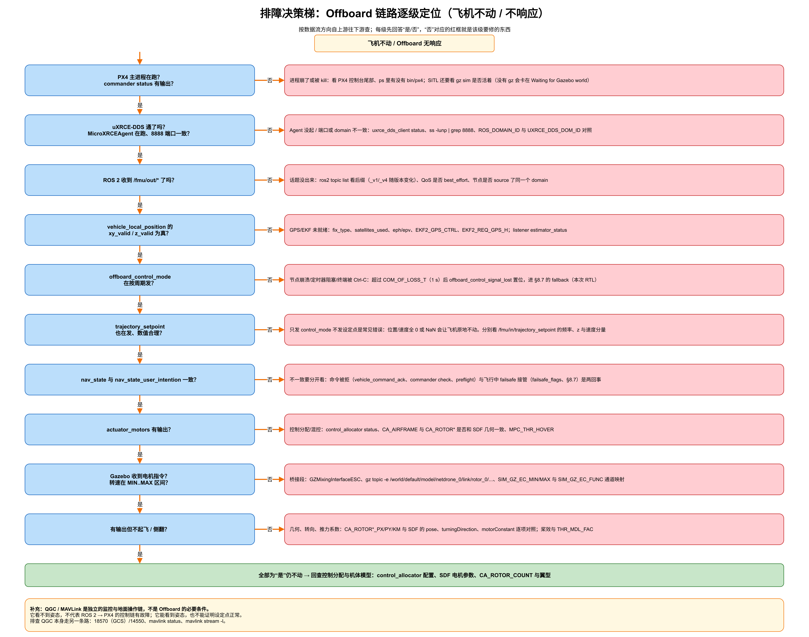

> 图 10-1　排障决策梯：按**数据流方向**自上游往下游十级定位——PX4 进程 → uXRCE-DDS → ROS 2 话题 → EKF 位置有效 → `offboard_control_mode` → `trajectory_setpoint` → 模式是否被接管 → `actuator_motors` → Gazebo 电机指令 → 机体几何。每一级“否”都给出该查什么。源文件：[10_排障决策树.drawio](diagrams/10_排障决策树.drawio)。

**为什么第一级不是 QGC**：QGC/MAVLink 与 ROS 2/XRCE-DDS 是两条**并行**链路（§6.4）。QGC 看不到姿态，只说明 MAVLink 那条有问题；它看不到姿态**不能**推出 Offboard 控制链有故障，反过来它能看到姿态也**不能**证明设定点正常。本次实验的飞行指令全部来自 ROS 2，所以排查必须从 PX4 进程和 XRCE-DDS 这一侧开始；QGC 只作为“补充检查”，放在图的最下方。

**为什么 `offboard_control_mode` 和 `trajectory_setpoint` 要分成两级**：前者只是“我还在发 Offboard 心跳”，后者才是“我要去哪”。`offboard_control_signal_lost` 只看 `offboard_control_mode` 的新鲜度、控制位和对应估计是否有效，**不看** `trajectory_setpoint` 是否更新（`offboardCheck.cpp:40-95`）。所以单独停发设定点不会置位该标志，模式也不会掉。但三种情况不能混为一谈：

- **停发新设定点**：控制器继续用订阅对象里最后一条设定点，飞机保持在最后一个目标点；
- **全 0 位置设定点**：0 是有限值，`_inputValid()` 判为有效，它表示 NED 原点——飞机会朝原点/地面去，不是“原地不动”；
- **全 NaN 设定点**：`_inputValid()` 要求每个轴至少有一个有限的位置/速度/加速度设定值（`src/modules/mc_pos_control/PositionControl/PositionControl.cpp:227-234`），NaN 过不了；`MulticopterPositionControl` 会先回退到 200 ms 内的最后有效设定点，仍失败则用内部 failsafe 设定点刹车（`MulticopterPositionControl.cpp:571-596`）。

三种情况都不会让 `nav_state` 离开 OFFBOARD，但机体行为完全不同；排障时要把 `/fmu/in/trajectory_setpoint` 的频率、数值和控制器输出一起看。两级合并会漏掉这一类故障。

> 这张树只用于定位“卡在哪一段”，**不能**从 `offboard_control_mode` 停发直接推出最终动作。按本机参数（`COM_OBL_RC_ACT=0`、`manual_control_signal_lost=true`、`NAV_RCL_ACT=2`），断流后的链路是：Offboard 丢失 → `FallbackPosCtrl` → 被 RC 丢失标志替换为 RTL → 经全局 action 聚合/`COM_FAIL_ACT_T`/`modeCanRun` 才决定最终动作（实测 14→5，C.4）。`nav_state != 14` 也可能是 failsafe 或用户接管，不一定是解锁被拒。

### 10.3 常用 PX4 控制台命令

```bash
# 在 px4 的 NSH/MAVLink shell 中
commander status
commander check
listener vehicle_status
listener vehicle_local_position
listener sensor_gps
listener actuator_motors
listener actuator_outputs
mavlink status
uxrce_dds_client status
gz_bridge status
```

---

## 11. 真机映射：SITL 的每一段换成什么

| SITL 链路 | 真机替换 | 关键代码/参数 |
|---|---|---|
| Gazebo IMU | SPI/I2C IMU 驱动 → `sensor_accel/gyro` | `src/drivers/imu/`、`CAL_*` |
| Gazebo NavSat | 串口 GNSS → `gps` 驱动 → `sensor_gps` | `gps.cpp`、`GPS_1_CONFIG`、`GPS_1_PROTOCOL`、`SER_GPS1_BAUD` |
| Gazebo Mag | I2C/SPI 磁力计 → `sensor_mag` | `src/drivers/magnetometer/`、`CAL_MAG*` |
| Gazebo Baro | I2C/SPI 气压计 → `sensor_baro` | `src/drivers/barometer/` |
| `gz_bridge` 电机输出 | PWM/DShot/CAN → 电调 | `pwm_out`、`dshot`、`uavcan`、`control_allocator` |
| MAVLink UDP 18570 | 串口数传/4G/WiFi → `mavlink start -d /dev/ttyS* -b 57600` | `mavlink_main.cpp`、`MAV_*` |
| uXRCE UDP 8888 | 伴飞计算机以太网/串口 → `uxrce_dds_client start -t serial -d ... -b 921600` | `uxrce_dds_client.cpp`、`UXRCE_DDS_CFG` |
| QGC | 同一 QGC，走数传/WiFi | 14550/18570 或串口 |
| RC | SBUS/CRSF/DSM/PPM → `rc_input` | `RCInput.cpp`、`RC_MAP_*`、`COM_RC_IN_MODE` |
| Offboard ROS 2 | 伴飞计算机上的 ROS 2 + Agent | 同 SITL，只是传输换以太网/串口 |

真机上还要注意：

- **RC 校准**：SITL 通常用 `COM_RC_IN_MODE=1` 绕过 RC 校准（以实际参数为准）；真机必须做 `RC_MAP_*`、`RC*_MIN/MAX/TRIM`，否则 `rc_update` 的输出不可用。
- **GPS 天线偏移**：`SENS_GPS0_OFFX/Y/Z` 必须按实际安装位置填，否则高速飞行时位置有系统偏差。
- **控制分配几何**：`CA_ROTOR*` 必须与真实机架一致；`CA_ROTOR*_KM` 的正负决定反扭矩方向。
- **电调协议**：`SIM_GZ_EC_*` 只是仿真；真机是 `PWM_MAIN_*`/`DSHOT_*`/`UAVCAN_*`。
- **失效保护**：真机必须配置 `COM_OF_LOSS_T`、`COM_OBL_RC_ACT`、`COM_RC_LOSS_T`、`COM_DL_LOSS_T`、`COM_LOW_BAT_ACT`。

---

## 12. 代码索引（按链路）

### 12.1 启动与仿真

| 主题 | 文件:行 |
|---|---|
| gz target 生成 | `src/modules/simulation/gz_bridge/CMakeLists.txt:108-121` |
| SITL 工作目录 | `platforms/posix/CMakeLists.txt:157-158` |
| rcS 模型匹配 | `ROMFS/px4fmu_common/init.d-posix/rcS:55-63` |
| rcS 启动模块 | `ROMFS/px4fmu_common/init.d-posix/rcS:240-326` |
| gz 启动 | `ROMFS/px4fmu_common/init.d-posix/px4-rc.gzsim:50-55` |
| 模型生成 + gz_bridge | `ROMFS/px4fmu_common/init.d-posix/px4-rc.gzsim:145-156` |
| GZBridge 初始化 | `src/modules/simulation/gz_bridge/GZBridge.cpp:64-171` |
| clock 同步 | `src/modules/simulation/gz_bridge/GZBridge.cpp:341-357` |
| IMU 回调 | `src/modules/simulation/gz_bridge/GZBridge.cpp:432-452` |
| NavSat 回调 | `src/modules/simulation/gz_bridge/GZBridge.cpp:668-755` |
| ESC 输出 | `src/modules/simulation/gz_bridge/GZMixingInterfaceESC.cpp:36-95` |
| 电机模型 | `Tools/simulation/gz/models/netdrone/model.sdf:214-229` |
| airframe 参数 | `ROMFS/px4fmu_common/init.d-posix/airframes/4050_gz_netdrone:11-53` |

### 12.2 GPS

| 主题 | 文件:行 |
|---|---|
| `sensor_gps` 发布（SITL） | `GZBridge.cpp:754` |
| `VehicleGPSPosition` 发布 | `src/modules/sensors/vehicle_gps_position/VehicleGPSPosition.cpp:215` |
| `SensorGps` topic 别名 | `msg/SensorGps.msg:94` |
| EKF2 GPS 融合 | `src/modules/ekf2/EKF2.cpp:2617-2685` |
| 真实 GPS 发布 | `src/drivers/gps/gps.cpp:1427` |
| RTCM 注入 | `src/drivers/gps/gps.cpp:671` |
| `GPS_RAW_INT` | `src/modules/mavlink/streams/GPS_RAW_INT.hpp` |
| `GLOBAL_POSITION_INT` | `src/modules/mavlink/streams/GLOBAL_POSITION_INT.hpp` |
| RTCM 接收 | `src/modules/mavlink/mavlink_receiver.cpp:2903` |

### 12.3 RC / 手动控制

| 主题 | 文件:行 |
|---|---|
| RCInput 解析/发布 | `src/drivers/rc_input/RCInput.cpp:848` |
| `input_rc` 入口 | `src/modules/rc_update/rc_update.cpp:363` |
| `rc_channels` 发布 | `src/modules/rc_update/rc_update.cpp:474` |
| `manual_control_input` 发布 | `src/modules/rc_update/rc_update.cpp:687` |
| `manual_control_switches` 发布 | `src/modules/rc_update/rc_update.cpp:658` |
| 选源 | `src/modules/manual_control/ManualControlSelector.cpp:63-105` |
| `manual_control_setpoint` 发布 | `src/modules/manual_control/ManualControl.cpp:156` |
| QGC 摇杆 | `src/modules/mavlink/mavlink_receiver.cpp:2318` |
| QGC RC override | `src/modules/mavlink/mavlink_receiver.cpp:2231` |

### 12.4 MAVLink / QGC

| 主题 | 文件:行 |
|---|---|
| UDP 初始化 | `src/modules/mavlink/mavlink_main.cpp:1136` |
| UDP 发送 | `src/modules/mavlink/mavlink_main.cpp:904-945` |
| UDP 接收/源地址学习 | `src/modules/mavlink/mavlink_receiver.cpp:3799-3825` |
| 消息分发 | `src/modules/mavlink/mavlink_receiver.cpp:142-260` |
| `COMMAND_LONG` | `src/modules/mavlink/mavlink_receiver.cpp:494` |
| `SET_MODE` | `src/modules/mavlink/mavlink_receiver.cpp:1061` |
| `SET_POSITION_TARGET_LOCAL_NED` | `src/modules/mavlink/mavlink_receiver.cpp:1177` |
| `GPS_RTCM_DATA` | `src/modules/mavlink/mavlink_receiver.cpp:2903` |
| GCS 端口 | `ROMFS/px4fmu_common/init.d-posix/px4-rc.mavlink:11,20` |
| 遥测流 | `ROMFS/px4fmu_common/init.d-posix/px4-rc.mavlink:21-29` |

### 12.5 ROS 2 / uXRCE-DDS

| 主题 | 文件:行 |
|---|---|
| UDP transport | `src/modules/uxrce_dds_client/uxrce_dds_client.cpp:175` |
| 会话建立 | `src/modules/uxrce_dds_client/uxrce_dds_client.cpp:218-390` |
| 主循环 | `src/modules/uxrce_dds_client/uxrce_dds_client.cpp:635-780` |
| 话题命名/版本 | `src/modules/uxrce_dds_client/utilities.hpp:26-50` |
| datawriter QoS | `src/modules/uxrce_dds_client/utilities.hpp:52-102` |
| datareader QoS | `src/modules/uxrce_dds_client/utilities.hpp:104-159` |
| 话题映射 | `src/modules/uxrce_dds_client/dds_topics.yaml` |
| ROS 2 节点 | `~/ros2_ws/src/ax_circular_flight/src/ax_circular_flight.cpp` |
| 版本模板 | 节点 `:48-72` |
| 订阅/发布 | 节点 `:114-135` |
| 状态机 | 节点 `:163-352` |

### 12.6 控制链

| 主题 | 文件:行 |
|---|---|
| commander 命令入口 | `src/modules/commander/Commander.cpp:2082` |
| `handle_command` | `src/modules/commander/Commander.cpp:854` |
| `DO_SET_MODE` | `src/modules/commander/Commander.cpp:925` |
| `ARM_DISARM` | `src/modules/commander/Commander.cpp:1089` |
| `updateControlMode` | `src/modules/commander/Commander.cpp:2761` |
| OFFBOARD 控制模式 | `src/modules/commander/ModeUtil/control_mode.cpp:111` |
| offboard 丢失判定 | `src/modules/commander/HealthAndArmingChecks/checks/offboardCheck.cpp:38-110` |
| `mc_pos_control` | `src/modules/mc_pos_control/MulticopterPositionControl.cpp:374-609` |
| `mc_att_control` | `src/modules/mc_att_control/mc_att_control_main.cpp:376` |
| `mc_rate_control` | `src/modules/mc_rate_control/MulticopterRateControl.cpp:260-264` |
| `control_allocator` | `src/modules/control_allocator/ControlAllocator.cpp:378-744` |
| `FunctionMotors` | `src/lib/mixer_module/functions/FunctionMotors.hpp:52-65` |
| `GZMixingInterfaceESC` | `src/modules/simulation/gz_bridge/GZMixingInterfaceESC.cpp:65-95` |

---

## 13. 图表清单

| 文件 | 内容 |
|---|---|
| [00_总体链路.png](diagrams/hires/00_总体链路.png) | 进程/端口/协议总体拓扑 |
| [01_启动时序.png](diagrams/hires/01_启动时序.png) | `make` → `rcS` → `gz` → `gz_bridge` |
| [02_GPS链路.png](diagrams/hires/02_GPS链路.png) | NavSat → sensor_gps → EKF2 → QGC/ROS 2 |
| [03_RC链路.png](diagrams/hires/03_RC链路.png) | RC/QGC 手动输入 → manual_control_setpoint |
| [04_MAVLink链路.png](diagrams/hires/04_MAVLink链路.png) | MAVLink 入站/出站消息表 |
| [05_ROS2链路.png](diagrams/hires/05_ROS2链路.png) | XRCE/DDS、话题版本、QoS |
| [06_控制闭环.png](diagrams/hires/06_控制闭环.png) | trajectory_setpoint → 电机转速 |
| [07_失效保护全链.png](diagrams/hires/07_失效保护全链.png) | 检测 → 决策 → 动作七阶段（§8.7） |
| [08_电机指令链.png](diagrams/hires/08_电机指令链.png) | control_allocator → FunctionMotors → MixingOutput → Gazebo |
| [09_节点状态机.png](diagrams/hires/09_节点状态机.png) | `ax_circular_flight` 八状态（含 1 s 预热的 `PreStream`） |
| [10_排障决策树.png](diagrams/hires/10_排障决策树.png) | §10.2 按 Offboard 数据流十级排查（QGC 只作补充） |
| [11_失效保护时序.png](diagrams/hires/11_失效保护时序.png) | §8.7.2 `Failsafe::update()` 一帧之内的八个步骤（含两次计时器更新） |

drawio 源文件：[PX4_1.18_数据链路图.drawio](diagrams/PX4_1.18_数据链路图.drawio)。  
导出命令（本机 drawio snap）：

```bash
xvfb-run -a /snap/bin/drawio --no-sandbox --export --format png \
  --scale 1 --size page --page-index 1 \
  --output diagrams/hires/00_总体链路.png \
  "diagrams/PX4_1.18_数据链路图.drawio"
```

---

## 14. 链路时延：本地 SITL 测试（非实机）

前面 13 章回答"数据走哪条路"，这一章回答"走完要多久"。全部数字来自**本地 SITL**
（PX4 v1.18.0-rc1 + Gazebo Harmonic 8.15 + 同一台机器上的 ROS 2 / MAVLink 端点），
**不是实机，也不是真实串口或真实网络**。锁步调度和 UDP loopback 会让时延明显小于真机，
不能直接外推。四个实验的原始数据、脚本和逐项推导在 `实验/2026-11-14_latency/`。

### 14.1 先分清两种时间：仿真时间与墙钟

这套 SITL 构建启用了锁步调度器（`build/px4_sitl_default/build.ninja` 的 `DEFINES` 含
`-DENABLE_LOCKSTEP_SCHEDULER`），所以 `hrt_absolute_time()` 不读主机时钟：

```c
// platforms/posix/src/px4/common/drv_hrt.cpp:112-118
hrt_abstime hrt_absolute_time()
{
#if defined(ENABLE_LOCKSTEP_SCHEDULER)
	return lockstep_scheduler.get_absolute_time();
#else
	px4_clock_gettime(CLOCK_MONOTONIC, &ts);
```

| 时间 | 来源 | 用在哪 |
|---|---|---|
| **仿真时间** | gz `/clock` → `lockstep_scheduler` → `hrt_absolute_time()` | PX4 全部 uORB `timestamp`；gz 消息 `header.stamp` |
| **墙钟** | 主机 `CLOCK_MONOTONIC` | ROS 2 回调、pymavlink 收发、gz 订阅回调 |

PX4 内部时间戳相减得到的就是仿真时间口径的时延，不需要换算；一旦跨到主机侧（ROS 2、
MAVLink、gz 订阅），必须先用 `/clock` 建立映射 `sim_us = a + b·host_us`。两次实验拟合的
实时因子分别是 **b = 0.9999988**（E1，35 s 窗口，残差 RMS 32.5 µs）和 **b = 1.0000095**
（E2，61 s 窗口，残差 p95 424 µs）——偏离 1.0 都在 1e-5 量级，说明锁步下仿真时间与墙钟基本
同速，但**不能假设严格相等**。E2 还发现：`/clock` 在锁步停顿时会出现 ~100 ms 的离群点，
用全局线性拟合会把尾部时延算大（p95 从 895 µs 抬到 3912 µs），所以跨域折算应优先用
**相邻两条 `/clock` 逐点插值**，全局拟合只作对照。

仿真时间还是**离散的**：gz 物理步长 4 ms（`Tools/simulation/gz/worlds/default.sdf:5`，
`max_step_size=0.004`），锁步时钟只在 `/clock` 回调里推进，所以 PX4 内部时间戳落在 4 ms
栅格上。这决定了后面所有"逐级时延"的分辨率上限：**要么 0，要么 4000 µs，中间没有别的值**。

> 口径：本章表格除注明"墙钟"外，单位都是**仿真时间 µs**；统计量给 n / p50 / p95 / max。

### 14.2 传感器上行：Gazebo → gz_bridge → uORB

**方法**：gz 侧用 Python 探针（`gz.transport13`）订阅 IMU/气压计/磁力计/NavSat 与 `/clock`，
每条消息记录 `(header.stamp, host_mono)`；PX4 侧从 ULog 取 `sensor_combined` 等 topic 的
`timestamp`；按"sim_stamp ≤ uORB.timestamp 的最近一条"配对。

**采样栅格**（实测，35 s 窗口）：

| 传感器 | 标称 | 实测周期中位 | 抖动 p95 | 说明 |
|---|---|---|---|---|
| IMU | 250 Hz | 4000 µs | 0 | 正好等于物理步长 |
| 气压计 | 50 Hz | 20000 µs | 0 | 5 步 |
| 磁力计 | 100 Hz | 8000 µs | 4000 | 2 步/3 步交替，平均 100 Hz |
| GPS | 10 Hz | 100000 µs | 0 | 25 步 |

**上行时延**：

| 通道 | uORB topic | n | p50 | p95 | max |
|---|---|---|---|---|---|
| IMU | `sensor_combined` | 8756 | 0 | 0 | 0 |
| 气压计 | `sensor_baro` | 35 | 0 | 0 | 0 |
| 磁力计 | `sensor_mag` | 35 | 0 | 0 | 0 |
| GPS | `sensor_gps` | 35 | 0 | 0 | 0 |

8758 条 gz IMU 对 8756 条 uORB，配对成功率 100%，丢失 2 条（0.02%）。

**为什么全是 0**：不是探针坏了，是锁步的构造性质。gz_bridge 的四个回调都用
`hrt_absolute_time()` 重新打戳（`GZBridge.cpp:434`/`:444`、`:395`/`:402`、`:408`、`:670`/`:729-730`），
gz 的 `header.stamp` 根本不进 uORB；而锁步下 PX4 处理这条消息期间仿真时钟冻结，
回调读到的 hrt 恰好等于该步的 gz 时刻。所以**仿真时间口径的上行时延结构性地为 0**，
真正的成本是 4 ms 采样栅格：gz 每 4 ms 才产生一个 IMU 样本，传感器再快也没有用。

**墙钟侧只剩一个上界**：gz 传感器消息到达主机 → 下一条 `/clock` 到达主机，这段时间就是
"PX4 必须在这之前处理完"的预算。实测 n=8758，p50 **3868 µs**、p95 **3955 µs**
（max 102696 µs 是探针被 Python 调度打断的离群点）。也就是说，每 4 ms 一步里，gz_bridge
的回调与发布只占这 3.9 ms 预算中的一小段，但这一小段无法从 PX4 侧单独测出来。

**EKF 段**：`vehicle_attitude.timestamp − sensor_combined.timestamp`，n=32361，
p50/p95 = 0/0，max 4000 µs（32361 条里只有 2 条晚一个 tick）。EKF2 由 IMU 回调触发，
在同一仿真步内完成并发布。

> **测量陷阱**：默认 `SDLOG_PROFILE` 把原始传感器限到 1 Hz（`logged_topics.cpp:220-225`，
> 第二参数单位是 ms），`sensor_accel` 整份日志只有 129 条。IMU 必须用 `sensor_combined`
> （`:123`，全速率）。另外 `sensor_accel.timestamp_sample` 与 `sensor_combined.timestamp`
> 129/129 逐条相等，可以反证前者就是 gz_bridge 的回调时刻。

### 14.3 控制链：姿态 → 角速率 → 执行器 → Gazebo

**方法**：用 high-rate profile（`SDLOG_PROFILE=17`，bit 4）让控制 topic 全速率记录，
飞一段自动起飞 + 悬停（29.2 s 飞行窗口），从 ULog 逐级配对。

**实际速率**（飞行窗口内，证明 high-rate 生效）：

| topic | 实测 | 默认档 |
|---|---|---|
| `vehicle_attitude` | 250 Hz | 20 Hz |
| `vehicle_attitude_setpoint` | 125 Hz | 20 Hz |
| `vehicle_rates_setpoint` | 250 Hz | 50 Hz |
| `vehicle_torque_setpoint` / `vehicle_thrust_setpoint` | 250 Hz | 50 Hz |
| `actuator_motors` | 250 Hz | 10 Hz |
| `vehicle_local_position` | 125 Hz | 10 Hz |

**逐级时延**：

| 上游 → 下游 | n | p50 | p95 | max | 分布 |
|---|---|---|---|---|---|
| `vehicle_attitude` → `vehicle_attitude_setpoint` | 3656 | 0 | 0 | 0 | 0 µs ×3656 |
| `vehicle_attitude_setpoint` → `vehicle_rates_setpoint` | 7311 | 0 | 4000 | 4000 | 0 µs ×3656、4000 µs ×3655 |
| `vehicle_rates_setpoint` → `vehicle_torque_setpoint` | 7310 | 0 | 0 | 0 | 0 µs ×7310 |
| `vehicle_torque_setpoint` → `actuator_motors` | 7311 | 0 | 0 | 4000 | 0 µs ×7310、4000 µs ×1 |
| `vehicle_attitude` → `actuator_motors` | 7311 | 0 | 0 | 0 | 0 µs ×7311 |

第二行那个 50/50 的 {0, 4000} 不是"姿态环慢半拍"，是**配对混叠**：位置环 125 Hz、角速率环
250 Hz，每个 `vehicle_attitude_setpoint` 对应两个 `vehicle_rates_setpoint`，第二个只能配到上一条。
同理 `vehicle_local_position` → `actuator_motors` 也是 50/50。真实的单拍时延是 0——整条链在
**同一个 4 ms tick 内**跑完。

这和源码一致：四个模块都由 uORB 回调触发（`mc_att_control` 订阅 `vehicle_attitude`
`mc_att_control_main.cpp:83`、`mc_rate_control` 订阅 `vehicle_angular_velocity`
`MulticopterRateControl.cpp:69`、`control_allocator` 订阅 `vehicle_torque_setpoint`
`ControlAllocator.cpp:95-101`），且 `control_allocator` 的 50 ms 兜底调度在锁步下被
`#ifndef ENABLE_LOCKSTEP_SCHEDULER` 编译掉（`ControlAllocator.cpp:100-102`、`:306-308`），
不会引入额外延迟。

**为什么位置环是 125 Hz 而不是 250 Hz**：EKF2 的预测更新经过 IMU 降采样器
（`imu_down_sampler.hpp:75` 的半周期门限、`imu_down_sampler.cpp:44-45` 的触发判据，
目标间隔由 `EKF2_PREDICT_US` 默认 10000 µs 决定，`module.yaml:15-27`），并不是每个
IMU 样本都触发；`PublishLocalPosition` 只在预测更新时调用（`EKF2.cpp:829`），而
`PublishAttitude` 每个 IMU 样本都发（`EKF2.cpp:881`）。实测 local_position : attitude
= 3656 : 7311 = 1 : 2。
**执行器 → Gazebo**：`actuator_motors.timestamp` 与 gz `/netdrone_0/command/motor_speed`
到达主机时刻（经 `/clock` 逐点插值折算回仿真时间）之差，n=7311，p50 **495 µs**、
p95 **895 µs**、max 4198 µs；**99.9% 落在 1.5 ms 以内**，只有 1 条跨到下一个 4 ms 步。
墙钟到达间隔 p50 3996 µs、p95 4346 µs，说明 gz 侧按 250 Hz 稳定接收、没有突发。
注意探针是 gz-transport 的独立订阅者，测的是"PX4 发布 → 外部订阅者收到"，不是 gz 物理引擎
应用命令的时刻；后者最多再晚一个物理步（+4 ms），只能由源码推。

### 14.4 ROS 2 ↔ PX4：uXRCE-DDS 双向

**方法**：ROS 2 节点以 20 Hz 发 `offboard_control_mode` 与 `trajectory_setpoint`，订阅
`vehicle_attitude`、`vehicle_status_v4`、`timesync_status`、`vehicle_command_ack_v1`，
每条回调记录主机 `CLOCK_REALTIME`；同时用 `/clock` 逐点插值做交叉核对。窗口 30 s，
解锁并进入 OFFBOARD。

**下行**（回调时刻 − 消息时间戳）：

| topic | 实测发布率 | n | p50 | p95 | max |
|---|---|---|---|---|---|
| `vehicle_status_v4` | 5 Hz | 60 | 692 | 1224 | 1529 |
| `vehicle_command_ack_v1` | 事件 | 15 | 660 | 1017 | 1051 |
| `timesync_status` | 1 Hz | 30 | 753 | 1215 | 1811 |
| `vehicle_attitude` | 50 Hz | 1502 | 4626 | 4979 | 5454 |

前三条都在 **0.7–0.8 ms**，这才是 DDS 链路本身。`vehicle_attitude` 的 4.6 ms 不是链路慢：
`dds_topics.yaml:65-67` 给它设了 `rate_limit: 50.`，writer 每 20 ms 才发一次"当前最新样本"，
消息里的 `timestamp` 是 uORB 的发布时刻，所以测到的是"采样栅格 + 传输"；拿同类事件的
ack（660 µs）当基准，链路部分仍是亚毫秒。

**时间戳为什么能直接比**：PX4 在序列化时用 `time_offset_us` 把 uORB 的仿真时间戳换算成
Agent/ROS 的时间域（`dds_topics.h.em` 的 `ucdr_serialize_method(..., time_offset_us)`），
所以 ROS 侧收到的 `msg.timestamp` 已经是 epoch µs，直接和回调的 `CLOCK_REALTIME` 相减即可，
不需要自己拟合 `/clock`。话题名还会按 `MESSAGE_VERSION` 加后缀（`utilities.hpp:27-48`），
所以实际是 `_v4` / `_v1`，不是 yaml 里写的裸名。

**上行**：发 `vehicle_command`（`DO_SET_MODE`，param1=1、param2=6）→ `vehicle_command_ack`，
n=15，min 546 / p50 **8577** / p95 12836 / max 13194 µs，全部 ACCEPTED。这个数**不能**当
链路时延：commander 空闲时每 10 ms（仿真时间）轮询一次（`Commander.hpp:222`、
`Commander.cpp:2162`），锁步下表现为 0/4/8/12 ms 四档，实测 p50 档约 8 ms，占 RTT 的 93%。
扣掉轮询后，纯链路（上行 + ack 下行）只有 **0.7–1.3 ms**，上行本身 **≲0.5 ms**。

**timesync 的 RTT 全是 0**：`Timesync.cpp:54` 用 `hrt`（仿真时间）算 RTT，而
`uxr_sync_session` 阻塞期间锁步时钟不推进，往返被量化成 0。它不能当链路 RTT 用；能用的
旁证是 `observed_offset − estimated_offset` 的 p50 = −144 µs，37 s 内估计值只漂了 16 µs。

### 14.5 MAVLink / QGC 链路

**方法**：pymavlink（v2 common + 原生 UDP socket）绑定 14550，向 PX4 的 18570 发，
采集 25 s。PING 必须用 `target_system=0`、`target_component=0`——PX4 只把广播 PING 当请求
（`mavlink_receiver.cpp:1912-1917`），带 1/1 的不会回包。

| 指标（墙钟 µs） | n | p50 | p95 | max |
|---|---|---|---|---|
| PING RTT | 249 | 251 | 527 | 5377607531\* |
| `PARAM_REQUEST_READ` → `PARAM_VALUE` RTT | 25 | 456 | 1876 | 1916 |
| HEARTBEAT 到达间隔 | 24 | 1000021 | 1000143 | 1000276 |
| `LOCAL_POSITION_NED` 单向（相对最小值） | 1250 | 3995 | 4306 | 4529 |

\* 2 个坏样本：`time_usec` 是 64 位，MAVLink v1 编码会截断；剔除后 p50/p95 不变。

- **PING 0.25 ms**：回包在接收线程内直接完成（`mavlink_receiver.cpp:1912-1924`），
  不经过 1.5 ms 主循环，所以比参数快一个量级。
- **PARAM 0.46 ms / p95 1.88 ms**：参数请求走主循环，`mavlink_main.cpp:2552` 的
  `_main_loop_delay` 被钳到 1500 µs（`:90`、`:2555-2561`、`mavlink_main.h:546`），
  命中周期边沿时多付一个周期——实测正好呈 0.13–0.5 ms 与约 1.9 ms 两簇。
- **心跳间隔 1.000021 s**，主循环的 1.5 ms 节拍没有让 1 Hz 心跳产生可见抖动。
- **`LOCAL_POSITION_NED` 只能给相对值**：`time_boot_ms` 是 PX4 的 hrt（仿真时间），与主机
  墙钟没有公共原点。这里用"减去观测到的最小偏移"做基线（假设最快一条≈0），得到
  p50 +4.0 ms、max +4.5 ms；这个 4 ms 与仿真栅格同量级，**不能当绝对链路时延**。
- QGC 没有接入，测的是 pymavlink 端点；真机 MAVLink 时延由波特率、射频和 QGC 解析决定，
  不能外推。

### 14.6 实测与源码预算对照

| 链路 | 源码预算（EXPECTED.md） | 实测 p50 | 实测 p95 | 差异解释 |
|---|---|---|---|---|
| 传感器上行 | 0–4 ms（4 ms 栅格） | 0（sim） | 0 | 锁步同一步内发布；墙钟上界 3868/3955 µs |
| 控制链（PX4 内） | 4–8 ms | 0（同一 tick） | 0 | 五级都在一个 4 ms tick 内 |
| 执行器 → Gazebo | ≤ 4.5 ms | 495 | 895 | gz 订阅者口径；物理应用最多再晚一步 |
| ROS 2 下行 | 0–1 ms | 692（status） | 1224 | 与预算一致；attitude 4.6 ms 是 50 Hz 限速 |
| ROS 2 上行 | 0–1 ms | ≲500 | — | 命令 RTT 8577 µs 里 93% 是 commander 10 ms 轮询 |
| MAVLink PING | 200–600 µs | 251 | 527 | 与预算一致（接收线程直回） |
| MAVLink 参数 | 主循环 1.5 ms 量化 | 456 | 1876 | 双峰，命中主循环边沿时 +1.5 ms |

预算与实测的偏差只有两处需要解释：**位置环 125 Hz 而不是 250 Hz**（EKF2 降采样器，
见 14.3），以及 **ROS 2 命令 RTT 8.6 ms**（commander 轮询，不是链路）。其余各链路的
p50 都落在预算区间内，说明"时延 ≈ 调度周期"这个判断成立。

### 14.7 这些数字不能说明什么

1. **不能外推到实机**。本章全部是本地 SITL：gz transport 是同机进程间通信，DDS 是 UDP
   loopback，MAVLink 也是 loopback。真机上多出串口/网卡/无线链路的物理时延、驱动缓冲和
   丢包重传，量级完全不同。
2. **"0 µs"是锁步的构造性质，不是"PX4 处理得无限快"**。仿真时间口径下，回调与发布发生在
   同一个 4 ms 步内，所以时间戳相等；真实的处理时间只能从墙钟侧看到，而墙钟又混入主机调度。
3. **逐级时延的分辨率只有 4 ms**。本章所有 PX4 内部 Δ 只能取 {0, 4000}，无法分辨 µs 级差异；
   想测更细只能改仿真步长或给 PX4 加探针，那已经超出"文档级复现"的范围。
4. **单次运行、单模型**。每个实验只飞了一次（29–30 s 窗口），n 是样本数不是重复次数；
   没有做多轮重复性统计，也没有换机型、换负载。
5. **QGC 没有真正接入**。MAVLink 部分用的是 pymavlink 端点，不是 QGC 应用层；QGC 的
   渲染/解析延迟不在测量范围内。
6. **日志会骗人**。默认 `SDLOG_PROFILE` 把 `actuator_motors` 限到 10 Hz、原始传感器限到
   1 Hz；不换成 high-rate profile 或不看 `logger` 的 interval 语义，很容易把"记录频率"
   当成"控制频率"。
7. **时间戳换算有误差**。PX4 在 DDS 出口用 `time_offset_us` 把仿真时间换算成 ROS 时间，
   换算精度受 timesync 影响；本章的 timesync RTT 在锁步下量化为 0，所以下行数字里含
   一个亚毫秒级的偏移不确定度。

### 14.8 小结

四条链路的时延几乎都由**节拍和栅格**决定，而不是协议栈的处理速度：

- 传感器上行：4 ms 采样栅格；回调到 uORB 发布在同一仿真步内（Δ=0）；
- 控制链：位置环 125 Hz、姿态/角速率/分配 250 Hz，五级在同一个 4 ms tick 内跑完；
  执行器命令到 Gazebo 订阅者 p50 0.5 ms、p95 0.9 ms；
- ROS 2 ↔ PX4：DDS 链路本身 0.7–0.8 ms；`vehicle_attitude` 的 4.6 ms 是 50 Hz 限速栅格；
  命令 RTT 8.6 ms 里 93% 是 commander 的 10 ms 轮询；
- MAVLink：主循环 1.5 ms，PING 在接收线程内直接回包（见 14.5）。

**一句话**：在 SITL 里，你能测到的"链路时延"主要是各环节的调度周期；协议栈本身的处理
在亚毫秒量级。换成真机，这个结论不成立——所以本章所有数字都只标"本地测试"。

## 附录 A：一页纸因果链

```text
make px4_sitl gz_netdrone
  → PX4_SIM_MODEL=gz_netdrone
  → rcS 找 4050_gz_netdrone
  → SIM_GZ_EN=1 / CA_* / SIM_GZ_EC_*
  → px4-rc.gzsim 启动 gz sim + 生成 netdrone_0 + gz_bridge
  → gz_bridge 订阅 IMU/NavSat/Mag/Baro/clock
  → sensor_accel / sensor_gyro / sensor_gps / sensor_mag / sensor_baro
  → IMU：VotedSensorsUpdate → sensor_combined
  → 磁力计：sensors → vehicle_magnetometer
  → 气压计：sensors → vehicle_air_data
  → GPS：VehicleGPSPosition → vehicle_gps_position
  → EKF2 → vehicle_local_position / vehicle_global_position
  → uxrce_dds_client → /fmu/out/vehicle_status_v4、/fmu/out/vehicle_local_position_v1
  → MicroXRCEAgent → ROS 2 节点
  → 节点 50 Hz 发 /fmu/in/offboard_control_mode + /fmu/in/trajectory_setpoint
  → 节点发 ARM + DO_SET_MODE(OFFBOARD)
  → commander → vehicle_control_mode
  → mc_pos_control → vehicle_attitude_setpoint
  → mc_att_control → vehicle_rates_setpoint
  → mc_rate_control → vehicle_thrust/torque_setpoint
  → control_allocator → actuator_motors
  → FunctionMotors → SIM_GZ_EC_MIN..MAX
  → GZMixingInterfaceESC → /netdrone_0/command/motor_speed
  → Gazebo MulticopterMotorModel → 推力/反扭矩
  → 机体运动 → IMU/NavSat 再反馈
```

---

## 附录 B：本文没有展开的部分

- EKF2 内部的 24 状态/协方差推导、GPS 创新门限、磁力计校准算法；
- `control_allocator` 的矩阵求解/优先级/失效模式；
- MAVLink 参数/任务/日志/FTP 的完整协议；
- QGC 源码（本文只从 PX4 侧解释 QGC 消息）；
- Gazebo 的物理参数（本机 world 用 ODE；gz-sim 默认是 DART）、桨叶气动模型；
- ROS 2 `px4_ros2_cpp` 的高层 Mode/Executor 框架（本次节点是手写 Offboard，不依赖它）。

这些都可以在现有代码索引的基础上继续向下追；本文的目标是把“哪条链路、哪个函数、哪个话题”先钉死，避免在几十万行代码里迷路。

---

## 附录 C：证据与复现

### C.0 行号基线与第三方复核（2026-11-13）

有审查意见称本文行号“系统性错误”，依据是 tag 的 `GZBridge.cpp` 应为 919 行、`framework.cpp` 应为 693 行、`rcS` 应为 353 行等。**这组数字不是 `v1.18.0-rc1` 的内容**。本文的行号来自 `git show v1.18.0-rc1:<path>`，并与 GitHub raw 同 ref 做了逐字节比对（sha256 相同）：

| 文件 | tag 行数 | GitHub raw 行数 | sha256 前 16（两侧相同） |
|---|---:|---:|---|
| `src/modules/commander/failsafe/framework.cpp` | **748** | 748 | `2c1655917444e703` |
| `src/modules/simulation/gz_bridge/GZBridge.cpp` | **991** | 991 | `fb43f7159abdaf94` |
| `ROMFS/px4fmu_common/init.d-posix/rcS` | **377** | 377 | `124da15a45de3d68` |

为排除“本地 ref 被改写”的可能，又按审查方给出的**完整 commit** `fca3df865af36124a28c9d607e850f111dbaaea9` 重新核对了 9 个文件：本地 `git show` 与 GitHub raw（直接用 commit，不用 tag 名）**逐字节一致**，sha256 相同：

| 文件 | 行数 | sha256 前 16（本地 = raw@commit） |
|---|---:|---|
| `src/modules/commander/failsafe/framework.cpp` | **748** | `2c1655917444e703` |
| `src/modules/commander/failsafe/failsafe.cpp` | **785** | `69da06ecae3beab0` |
| `src/modules/commander/failsafe/framework.h` | **294** | `5d18f8c58dcd80b6` |
| `src/modules/ekf2/EKF2.cpp` | **3323** | `c5603f522f5b3098` |
| `src/modules/simulation/gz_bridge/GZBridge.cpp` | **991** | `fb43f7159abdaf94` |
| `src/modules/simulation/gz_bridge/GZMixingInterfaceESC.cpp` | **139** | `253e927cbd190a6d` |
| `src/modules/sensors/vehicle_gps_position/VehicleGPSPosition.cpp` | **229** | `836ec8959707ba88` |
| `msg/SensorGps.msg` | **94** | `83506ec89f3bbedb` |
| `ROMFS/px4fmu_common/init.d-posix/rcS` | **377** | `124da15a45de3d68` |

复现（四条的 sha256/行数应两两相同）：

```bash
git -C ~/PX4-1.18 replace -l                                   # 空：没有 replace ref
git -C ~/PX4-1.18 rev-parse 'v1.18.0-rc1^{commit}'             # fca3df865af36124a28c9d607e850f111dbaaea9
GIT_NO_REPLACE_OBJECTS=1 git -C ~/PX4-1.18 \
  show v1.18.0-rc1:src/modules/commander/failsafe/framework.cpp | sha256sum
curl -s https://raw.githubusercontent.com/PX4/PX4-Autopilot/fca3df865af36124a28c9d607e850f111dbaaea9/src/modules/commander/failsafe/framework.cpp | sha256sum
```

审查意见给出的 693 / 919 / 3067 / 718 / 273 / 131 / 213 / 82 / 353 在该 commit 下**无法复现**；`main`（759）、v1.16（724）、v1.15（700）、v1.14（681）也都不是 693。因此不能用这组数字改本文行号；若审查方仍认为不一致，请给出其抓取 URL 的响应 sha256，与本表逐字节对比。

> 结论：基线未变，仍是 `v1.18.0-rc1` / `fca3df865a`；`tools/audit_citations.py` 当前统计为 **309 处引用：305 处解析到 tag 文件且行号未越界，4 处为本机工作区文件（tag 无法定位：`netdrone/model.sdf` 3 处、`ax_circular_flight.cpp` 1 处），0 处越界、0 处歧义**。口径与 C.2 相同。

### C.1 版本与一致性

- 源码：`~/PX4-1.18`，tag `v1.18.0-rc1`，commit `fca3df865af36124a28c9d607e850f111dbaaea9`（`git rev-parse v1.18.0-rc1^{commit}` 与 HEAD 一致）。本文所有行号均为该 tag 的行号，用 `git show v1.18.0-rc1:<path>` 读取。
- 与 GitHub 发布一致性：经代理下载 `raw.githubusercontent.com/.../v1.18.0-rc1/<path>`，与本地 tag 逐字节 `diff` 一致（`GZBridge.cpp` 991 行、`GZMixingInterfaceESC.cpp` 139 行、`SensorGps.msg` 94 行、`rcS` 377 行、`VehicleGPSPosition.cpp` 229 行、`EKF2.cpp` 3323 行）。因此“本地 tag = 官方 v1.18.0-rc1”，不是工作区私改。
- 本地未跟踪文件（`4050_gz_netdrone`、`Tools/simulation/gz/models/netdrone/model.sdf`、`~/ros2_ws/src/ax_circular_flight`）单独标注“本地”，行号不与 tag 混用。

### C.2 行号自检

`tools/audit_citations.py` 会抽取本文全部 `文件:行号` 引用，按 tag 解析路径并检查是否越界、附近是否出现正文提到的标识符。当前结果：**309 处引用，305 处**解析到 tag 文件且起始/结束行均未越界。剩下 4 处全部是本地未跟踪文件：

- `Tools/simulation/gz/models/netdrone/model.sdf` 两处（§3.5、§12.1）、`netdrone/model.sdf` 一处（§3.2 磁力计）、`ax_circular_flight.cpp` 一处（§7.6）——tag 里没有这些文件，行号按本地工作区基线另核（C.1）；
- **0 处越界、0 处歧义**。v1.26 之前 §9 T+0 行用的是 `CMakeLists.txt` 简写，脚本按 basename 匹配到 `src/lib/CMakeLists.txt`（92 行）而记了一次 `EXCEEDS`；v1.27 改成 `src/modules/simulation/gz_bridge/CMakeLists.txt` 后按后缀唯一解析，这一项消失。同理，两处 `PositionControl.cpp` 已写成完整路径——tag 里多旋翼与航天器各有一个同名文件，只写 basename 会被记成 `AMBIGUOUS`。

  这条历史也说明一个口径问题：C.2 早期在正文里又写了一遍那个简写，被脚本当成第二条引用，统计一度虚高；**自检脚本会把描述自检的文字也数进去**，所以这里的数字只对应当前文本。


**这个数字只代表路径与行号范围检查，不代表 305 个引用的语义都通过**——脚本只额外检查引用行附近是否出现正文提到的标识符，不做语义证明。语义核对另见 §8.7 与 C.4–C.10 的实测对照。统计口径：全文所有 `文件:行号` 引用，输入为当前版本文档、tag `v1.18.0-rc1`；越界判定按 tag 物理行数。重建文档时该脚本会自动跑一遍（见 C.11）。

### C.3 `param show` 实测（本次 SITL）

用已编译的 `build/px4_sitl_default/bin/px4` 直接启动（`PX4_SIM_MODEL=gz_netdrone`、`HEADLESS=1`、无 `PX4_SIM_SPEED_FACTOR`），`gz sim 8.15.0 -r -s` 加载 `default.sdf`，经 stdin 注入 `param show`，两次独立启动结果一致：

```text
NAV_DLL_ACT        0          COM_DLL_EXCEPT     0
COM_DL_LOSS_T      10         COM_RC_LOSS_T      0.5
COM_OF_LOSS_T      1.0        COM_OBL_RC_ACT     0
NAV_RCL_ACT        2          COM_RCL_EXCEPT     0
COM_LOW_BAT_ACT    3          COM_RC_IN_MODE     1
MAN_OVERRIDE_SPD   1.0        THR_MDL_FAC        0
SYS_HAS_NUM_GNSS   0          COM_GNSSLOSS_ACT   0
COM_POS_FS_EPH     5.0        COM_POS_LOW_EPH    -1
COM_POS_LOW_ACT    3          COM_DISARM_LAND    2.0
EKF2_NOAID_TOUT    5000000    EKF2_REQ_GPS_H     0.5
```

`param status` 显示 storage array 42 项、custom defaults 29 项（2026-11-13 21:27 复测，与 C.3 同一次启动）。两个对照很能说明分层：

- `COM_LOW_BAT_ACT`/`COM_RC_IN_MODE`/`EKF2_REQ_GPS_H` 的符号列是**空白**——它们是 `set-default`，不在用户层、也不在 `parameters.bson` 里；
- `SIM_GZ_EC_MAX1..4` 显示 `+` 且在 bson 里，而 `SIM_GZ_EC_MIN1..4` 空白且不在 bson——同一个 airframe 文件里 `param set` 与 `param set-default` 的区别就体现在这里。

### C.4 Offboard 丢失实验（2026-11-13，实测）

目的：验证 §8.7 的“mode-fallback 得到 RTL、是否经过 `COM_FAIL_ACT_T` 的 Hold”这条链。做法不是推导，而是把链路跑起来再断流：

1. `build/px4_sitl_default/bin/px4 -s etc/init.d-posix/rcS`，`PX4_SIM_MODEL=gz_netdrone`、`PX4_GZ_WORLD=default`、`HEADLESS=1`；先 `source rootfs/gz_env.sh`，否则 gz 不会加载 `gz-sim-sensors-system`（表现为“No valid data from Accel 0”）；
2. `MicroXRCEAgent udp4 -p 8888` + 一个最小 ROS 2 发布节点（`OffboardControlMode.position=true` + `TrajectorySetpoint.z=-1`，20 Hz）；
3. `commander arm` → `commander mode offboard`，悬停 6 s；
4. 杀掉发布节点（等价于 `ros2 run` 终端 Ctrl-C），同时用 pxh `listener` 轮询 `vehicle_status`/`failsafe_flags`/`rtl_time_estimate`/`battery_status`（四个 topic 各取一次算一轮，`vehicle_status` 的实测间隔是 1.83 s）。

结果（`t0` = 杀节点时刻）：

| 相对 t0 | nav_state | arming_state | failsafe |
|---|---|---|---|
| −4.01 s / −2.18 s / −0.35 s | 14 OFFBOARD | 2 armed | False |
| +1.48 s | 5 AUTO_RTL | 2 armed | True |
| +3.32 s / +5.16 s | 5 AUTO_RTL | 2 armed | True |
| +6.99 s 起 | 14（上锁后显示） | 1 disarmed | False |

- **采样点里没有** `nav_state=4`（AUTO_LOITER）：断流前的样本是 14，第一个失效后样本（t0+1.48 s）已经是 5。从断流到 RTL 约 1.5 s，与 `COM_OF_LOSS_T=1 s` 一致；
  - 证据强度：`vehicle_status` 的采样间隔实测 **1.83 s**（`samples.txt` 11 个样本、跨度 18.35 s）。5 s 的 Hold 至少会落进两个样本，所以“没采到 `nav_state=4`”足以排除**5 s 量级**的 Hold；再结合 commander 日志无 `entering Hold` 行，可以判定本次没有发生预期的 `COM_FAIL_ACT_T` Hold。但 1.8 s 以内的瞬态 Hold 仍不能排除——要排除得用连续订阅或 ULog 时间序列。
- commander 日志：`WARN [failsafe] Failsafe activated` → `[navigator] RTL: start return at 2 m (2 m above destination)` → `RTL: land at destination`；
- `failsafe_flags` 全字段快照：为真的有 `offboard_control_signal_lost`、`manual_control_signal_lost`、`gcs_connection_lost`，以及 `auto_mission_missing`（本机没加载任务，9 次快照里一直为真；`mode_req_mission` 只对 AUTO_MISSION 置位，所以不影响本次 OFFBOARD→RTL）；`navigator_failure`、`geofence_breached`、`battery_warning`（=0）、`gnss_lost`、`position_accuracy_low`、`fd_*` 全为假；`remote_id_unhealthy=true` 但被 `COM_ARM_ODID=0` 挡在入队之外（`failsafe.cpp:645`）；
- `rtl_time_estimate` 在 OFFBOARD 期间 `valid=True`、`safe_time_estimate≈100.7 s`——因为 RTL 任务在非激活态也每 2 s 发布（`rtl.cpp:180-187`）；
- `battery_status.time_remaining_s=nan`，所以 `battery_low_remaining_time` 不可能置位（`batteryCheck.cpp:313` 要求有限值）。

原始日志、采样脚本与复现命令在 `实验/2026-11-13_offboard_loss/`（`px4.log`、`samples.txt`、`run.sh`、`offboard_pub.py`、`status_sub.py`）。**反例的反面**见 C.7：同样在 OFFBOARD 中，由 `flight_time_limit_exceeded` 触发的 RTL 会先 Hold 5.004 s——差别只在动作来源与 `takeover`。

### C.5 Failsafe 单元测试（2026-11-13，实测）

目的：把两条只能靠读代码的结论变成可执行断言。做法是在 `failsafe_test.cpp` 里加三个用例（复用 `FailsafeTester` 桩，另加 `fd_alt_loss → ActionOptions(Action::None)` 的默认 `Auto` 映射），跑 `make tests TESTFILTER=failsafe_test`，最终 **19/19 PASSED**。

```text
NoneActionStartsGlobalDelay                          PASSED
StartDelayDrainsToZeroWhileDelayStillActive          PASSED
AutoActionEnqueuedAtZeroStartDelayDoesNotHold        PASSED
```

10 ms 更新周期、`COM_FAIL_ACT_T=5 s` 下的逐拍实测：

| 时点 | `_current_delay` | `_current_start_delay` | 选中动作 |
|---|---:|---:|---|
| 入队更新结束 | 5,000,000 us | 4,990,000 us | Hold |
| 之后每 10 ms | 各减 10,000 | 各减 10,000 | Hold |
| **第 499 拍结束** | **10,000 us** | **0** | **Hold（延迟仍生效）** |
| **第 500 拍（到期）** | **0** | **2,500 us** | **RTL** |
| 到期后 1 s | 0 | 252,500 us | RTL |
| 到期后 19.99 s | 0 | 5,000,000 us（封顶） | RTL |

由此得到三条精确结论：

1. `Action::None` 的 `Auto` 动作确实启动全局延迟：`selectedAction()` 仍是 `None`（聚合时被跳过），但 `_current_delay` 从 5,000,000 逐拍降到 4,990,000…
2. `_current_start_delay` 会在**延迟仍生效的最后一拍**被扣到 0（此时 `_current_delay` 还剩一个 `dt`）；延迟到期那一拍已经按 `dt/4` 回升为 2,500 us，之后每拍 +2,500 us，约 20 s 回到 5 s 封顶。因此“延迟结束后准备值为 0”是错的。
3. 反例成立：在准备值为 0 的那一拍新入队一个 `Auto` 动作，`checkFailsafe()` 执行 `_current_delay = 0`，**不产生 Hold**，动作立即执行——所以“入队时准备值一定为正”不成立。

> 早期用“`time += 5_s`”单步写的版本实测拿到 `5,000,000`（`updateDelay()` 一次把 `_current_delay` 减到 0，动作当拍结束，`updateStartDelay(dt=5 s, false)` 走回升分支并被封顶），跨过了观测窗口；失败输出留档为 `test_output_literal_5s_failure.txt`。
>
> 测试补丁用 `#define private public` 包住 `failsafe.h` 才读到 `_current_delay`/`_current_start_delay`（`framework.h:279-280` 是 `private`），属诊断手段；长期应在 `framework.h` 加只读 getter。补丁与原始输出见 `实验/2026-11-13_failsafe_unit_tests/`。

### C.6 GNSS 冗余/丢失实验（2026-11-13，实测）

目的：验证 `gnss_lost` 的置位来源、解锁前拦截、解锁后的动作。做法是单接收机 SITL 上把 `SYS_HAS_NUM_GNSS` 从 0 调到 2 制造 `below_required`，`COM_GNSSLOSS_ACT` 取 1（Return）。

- **参数取值要先查表**：本 tag 的 `COM_GNSSLOSS_ACT` 是 0=Warning、1=Return、2=Land、3=Terminate（`commander_params.yaml:132-147`），不是“1=Warning、3=Return”；若用 3 会直接 Terminate（`clear_condition=Never`），不适合做可逆实验。
- **置位来源是数量不足，不是散度**：SITL GPS `device_id=11469068`（非 0）、`fix_type=3`、`eph=0.9 m`；`fixed_count` 实测为 1（`SYS_HAS_NUM_GNSS=1` 时 `gnss_lost=False`，改成 2 后立即 `True`）。散度分支要求 `fixed_count>=2`，本次从未参与，`divergence_m` 恒 0。
- **解锁前被拦**：`can_arm_mode_flags` 由 8338096 变为 0、`health_error_flags=8`（GPS 位）、`commander check` 由 OK 变 `FAILED`、`commander arm` 返回 `Arming denied: Resolve system health failures first`，`arming_state` 保持 1。对应 `gnssRedundancyCheck.cpp:97-108` 的 `block_arming` 与 `:122-136` 的 `NavModes::All` 报告。
- **解锁后 5 s Hold → RTL**：写入 `SYS_HAS_NUM_GNSS=2` 后 0.5 s 内 `gnss_lost=True`、`nav_state` 14→4（Hold），日志 `entering Hold for 5 seconds`；t0+5.13 s 转 5（RTL），日志 `RTL: start return at 2 m`。首条 Hold 样本 uORB 时间 110.364 s、首条 RTL 115.368 s，差 **5.004 s**；此后 20 s 采样保持 RTL。这 5 s 来自 `COM_FAIL_ACT_T=5.0`（`framework.cpp:354-365`、`:496-508`），不是 GNSS 专用常量。

> 原始日志、采样与复现脚本：`实验/2026-11-13_gnss_loss/`（`run.sh`、`px4.log`、`samples.txt`、`timeline.md`、`REPORT.md`）。实验结束已把 `SYS_HAS_NUM_GNSS`/`COM_GNSSLOSS_ACT` 恢复为 0/0。

### C.7 `COM_FAIL_ACT_T` Hold 正例（flight_time_limit_exceeded，实测）

目的：C.4 只证明了“某类动作不经过 Hold”，还需要一个**正例**证明 `COM_FAIL_ACT_T` 真的会在飞行中生效。做法是在 OFFBOARD 悬停时把 `COM_FLT_TIME_MAX` 设为 5（单位 s，`commander_params.yaml:638-654`），触发 `flight_time_limit_exceeded` → `Action::RTL`（`takeover` 默认 `Auto`），再用 `nav_state_timestamp` 取跳变时刻。

| 轮次 | `COM_FAIL_ACT_T` | 14→4 | 4→5 | Hold 时长 |
|---|---:|---:|---:|---:|
| Round 1 | 5 s（默认） | t0+0.024 s | t0+5.028 s | **5.004 s** |
| Round 2 | 2 s（对照） | t0+0.024 s | t0+2.028 s | **2.004 s** |

- commander 日志分别为 `Failsafe activated: entering Hold for 5 seconds` / `entering Hold for 2 seconds`，随后 `Failsafe activated` + `RTL: start return at 2 m`；
- `flight_time_limit_exceeded` 在 t0+0.012 s 置位（参数生效 + 10 Hz 健康检查），这 0.012 s 不属于 Hold；
- 全程 `nav_state_user_intention` 保持 14（OFFBOARD），说明是 failsafe 接管而不是用户切模式；
- Hold 期间 `_selected_action == Hold`（不 > `Hold`）、`AUTO_LOITER` 可运行，`clearDelayIfNeeded()` 未触发；触发前 `param set COM_FLT_TIME_MAX` 会让 `updateParams()` 把 `_current_start_delay` 重置为配置值。

> 源码链：`flightTimeCheck.cpp:38-40` → `failsafe.cpp:608` → `framework.cpp:354-364`（`_current_delay = _current_start_delay`）→ `:496-508`（Hold + delayed RTL）→ `:152-160`（扣到 0 后执行 RTL）。原始日志与两轮脚本：`实验/2026-11-13_flighttime_hold/`（`px4.log`、`px4_t2.log`、`samples*.txt`、`timeline.md`、`REPORT.md`）。实验结束已恢复 `COM_FLT_TIME_MAX=-1`、`COM_FAIL_ACT_T=5.0`。

### C.8 队列容量与字段保留（单元测试，实测）

目的：验证两处“读代码容易漏”的语义——8 槽队列 `_actions`（下标 0～7）满时怎么替换、同一 `caller_id` 降级时字段是否保留。用例数量要对得上：tag 自带 **16** 个用例，C.5 加了 3 个到 **19**，本轮再加 3 个到 **22**（复用 `FailsafeTester`，新增 `testCheck()` 转发与 `_actions` 访问器），跑出 **22/22 PASSED**。

**本轮新增的 3 个（19 → 22）**

| 用例 | 实测 |
|---|---|
| `QueueFullReplacesBySeverity` | 8×`None` 占满（valid=8）后入队 `RTL`：valid 仍 8、`None` **8→7**、`RTL`=1 且落在 **index 7**；8×`Disarm` 占满后入队 `RTL`：`RTL` 计数 **0**、新 caller `indexOf()==-1`、选中仍 `Disarm`，先打印 `ERROR No free failsafe action idx`，再按严重度尝试替换；8×`Disarm` 时无可替换槽，最终丢弃（`checkFailsafe()` 仍返回 true） |
| `ExistingCallerIdKeepsTakeoverAndDeferFields` | id=1 先 `Disarm + Never + cannotBeDeferred`，同 id 降级 `Warn` 后 action=Warn，但 takeover 仍 **Never**、`can_be_deferred` 仍 **false**、valid=1；随后开启 defer 并加入可延迟的 `RTL`，`failsafeDeferred()=false`、选中 `RTL`——旧条目的 `cannotBeDeferred` 否决整组 defer |
| `DeferPausesDelayCountdown` | 先开 defer 再触发 `battery_low_remaining_time`：入队拍 `_current_delay=5,000,000 us`、动作暂挂 `None`；1 s（100×10 ms）后仍精确 **5,000,000（零漂移）**；关闭 defer 不清零（`_failsafe_defer_started != 0`），第 1 拍仍 5,000,000，第 2 拍 **4,990,000**、第 3 拍 **4,980,000** |

**另一轮的 2 个补充断言（22 → 24，不属于本轮）**

下面两个用例来自 `实验/2026-11-13_failsafe_always/`，是在 22 个用例之上再加 2 个后的 **24/24 PASSED**。它们验证的是 `Always`/`Never` 与全局 Hold 的关系（§8.7 引用），**不是本轮 C.8 的产物**，列在这里只是便于对照：

| 用例 | 实测 |
|---|---|
| `AlwaysActionCanBeDelayedByGlobalTimer` | `None` 启动 5,000,000 us 后入队显式 `Always` 的 RTL：当拍 `selectedAction()==Hold`、`delayed_action==RTL`；499 拍后 `_current_delay=10,000` 仍 Hold，第 500 拍转 RTL |
| `NeverActionBlocksHold` | 同一场景换成 `Never` 的 RTL：当拍直接 `RTL`、`delayed_action=None`，计时器虽为 5,000,000 但不产生 Hold；下一拍被 `clearDelayIfNeeded()` 清零 |

这两条的负向对照：把 A 的 `delayed_action==RTL` 改成 `None`、B 的 `selectedAction==RTL` 改成 `Hold`，两用例都会 FAILED（gtest 打出实际值 `06`=RTL），说明断言不是空转、`delayedAction()` 也不是恒 `None` 的桩。

两点纠正：

- **defer 不能在已经 Hold 时开启**：`deferFailsafes()` 在 `_selected_action > Warn` 时直接返回 false（`framework.cpp:728-730`），所以任务最初给的“先 Hold 再 defer”顺序不成立，实测返回 false 并已留档；
- **替换循环没有 `break`**：槽满时总是替换“最后一个严格更低严重度”的槽，而不是第一个；新动作不比任何槽更严重时不会入队，也不会报错给调用方，只写 `PX4_ERR`。

> 产物：`实验/2026-11-13_failsafe_queue/`（`queue_test.patch`、`queue_test_only.patch`、`test_output.txt`、`test_output_failed_defer_premise.txt`、`REPORT.md`）。测试补丁同样用 `#define private public` 访问 private 成员，属诊断手段。

### C.9 着陆后自动上锁（COM_DISARM_LAND，实测）

目的：验证 `COM_DISARM_LAND` 是否真的按参数延时上锁。先明确它不是 `FailsafeBase` 的普通 action：由 `Commander::handleAutoDisarm()` 独立处理，要求参数>0、无 mission in progress、未通过 `_config_overrides.disable_auto_disarm` 禁用、本次解锁后起飞过，并对 `vehicle_land_detected.landed` 做参数时长的滞回。滞回状态成立后还有一道门控：`_multicopter_throw_launch.isThrowLaunchInProgress()` 必须为 false（`Commander.cpp:2476`）——手抛起飞进行中时，即使计时到期也不会执行 `disarm()`。做法的关键是**着陆前必须停掉 Offboard 发布节点**：否则 20 Hz 的 `TrajectorySetpoint(z=-1)` 会与 `FlightTaskDescend` 的下降设定点打架，机体在 z≈0～-0.12 m 反复弹跳，`ground_contact`/`landed` 一直为 false，60 s 也不会上锁（这是本次第一轮失败的原因）。

步骤：`commander arm` → `commander mode offboard` 悬停 → `param set COM_DISARM_LAND 5` → `commander mode auto:land`（注意：写成 `auto_land` 会被拒，源码只认 `auto:land`）→ 立即 `kill -INT` 发布节点 → 以 uORB 时间戳记录 `vehicle_land_detected.landed` 首次为真与 `vehicle_status.arming_state` 首次变 1 的间隔。

结果（每轮独立 px4 进程，避免 auto-disarm 后同会话 re-arm 被 preflight 拒）：参数 2 s → `landed 41.592 s`、`disarmed 43.608 s`，差 **2.016 s**；参数 5 s → `41.400 s` → `46.408 s`，差 **5.008 s**。两轮差值 2.992 s（标称差 3 s），偏差分别为 **+16 ms 和 +8 ms**。

这两个偏差**不能**说成“都在一个 10 ms 周期内”——+16 ms 已经超过一个 `COMMANDER_MONITORING_INTERVAL`（`Commander.hpp:222`）。真正的量化网格在 SITL 锁步侧：uORB 时间戳落在约 **8 ms** 的离散网格上，两个偏差正好是 **2 个和 1 个 8 ms 时间量化单位**。重复性：2 s 轮独立跑两次都是 **2.016 s**，5 s 轮三次为 **5.008 / 5.016 / 5.008 s**，重复性 ±8 ms。所以这里能说的是“延时与参数一一对应、重复性在 8 ms 网格内”，**不是**“飞控具备 ms 级硬实时精度保证”。检测滞后单独量：`dist_bottom→0` 34.968 s → `ground_contact` 35.616 → `maybe_landed` 35.952 → `landed` 36.288，即两级消抖 0.672 s、触地到 `landed` 1.320 s；这段是检测滞后，不计入 `COM_DISARM_LAND`。

与源码对应：`Commander::handleAutoDisarm()`（`Commander.cpp:2455` 起）用 `set_hysteresis_time_from(false, COM_DISARM_LAND * 1_s)` 设消抖（`:2467`），真正 `disarm(landing)` 在 `:2478`，执行前还要求 `_multicopter_throw_launch.isThrowLaunchInProgress()` 为 false（`:2476`），且要求 `_have_taken_off_since_arming`（`:2477`；该标志起飞时置位 `:2316`、在地面复位 `:778`，所以从未起飞的会话不会触发着陆上锁）。

**证据强度**：早期尝试曾在同一会话里 re-arm：先出现 `Disarmed by auto preflight disarming`，随后 `Arming denied: Resolve system health failures first`（`pre_flight_checks_pass: False`、`arming_state: 1`、`latest_disarming_reason: 6`）；当时用 `commander arm -f` 强行 arm 只是掩盖了 preflight 失败，所以那一轮无效，归档在 `failed_run_1811/`。改成**每轮重启 px4 进程**后，2 s 与 5 s 两轮都拿到干净的 `landed→disarmed` 边沿，因此“2 s 默认值”现在也是实测。

> 产物：`实验/2026-11-13_land_disarm_2s/`（`round_A` 2 s、`round_B` 5 s、`replicate_run1/` 重复性、`samples.tsv`、`ts_A/B.tsv`、`result.txt`、`REPORT.md`）与 `实验/2026-11-13_land_disarm/` 的 `probe_5s/` 是 5.008 s 那轮的完整证据（`probe.sh`、`px4.log` 3.4 MB、`samples.txt` 1836 条 ≈15 Hz、`ts.tsv`、`parse_probe.py`、`result.json`/`result.txt`、`REPORT.md`）；复现：`cd 实验/2026-11-13_land_disarm/probe_5s && python3 parse_probe.py`。失败轮在 `failed_run_1811/`。实验结束已恢复 `COM_DISARM_LAND=2.0`（`parameters.bson` 无覆盖项）。

### C.10 传感器 topic 实测（2026-11-13，SITL）

目的：核对 §0.3/§4.1 三条只能从 msg/代码推断的断言。只读：启动 pxh，不 arm、不启 ROS/agent。

| 断言 | 实测 |
|---|---|
| `sensor_combined` 不含磁力计/气压计 | **成立**：`listener` 输出 10 个字段（`timestamp`、`gyro_rad`、`gyro_integral_dt`、`accelerometer_timestamp_relative`、`accelerometer_m_s2`、`accelerometer_integral_dt`、两个 clipping、两个 calibration count），与 `msg/SensorCombined.msg` 一致 |
| 磁力计/气压计有独立 topic | **成立**：`vehicle_magnetometer`（`magnetometer_ga`）与 `vehicle_air_data`（`baro_alt_meter`）均存在，上游 `sensor_mag`/`sensor_baro` 也在 |
| `timestamp_sample` 由 110 ms 反推 | **成立且精确**：20/20 对 `vehicle_gps_position.timestamp − timestamp_sample = 110,000 µs`（`SENS_GPS0_DELAY=110`） |

一个容易误读的点：跨 topic 对拍 `sensor_gps.timestamp` 与 `vehicle_gps_position.timestamp_sample` 会看到 90,000/190,000 µs 的差，那是两条 `listener` 命令之间的采集时延（0.25–0.35 s）叠加在 10 Hz GPS 节拍上，**不是**同步误差；只有同一消息内部的 `timestamp − timestamp_sample` 才是 110 ms。

> 产物：`实验/2026-11-13_sensor_topics/`（`listeners.txt`、`gps_pairs.txt`、`checks.txt`、`px4.log`、`REPORT.md`）。

### C.11 重建文档

```bash
tools/build_docs.sh v1.4     # 审计 → HTML → 打 DOCX 补丁 → 刷新目录域 → 导出 PDF → 归档到 迭代/
```

- HTML：`.tools/pandoc/bin/pandoc --standalone --embed-resources --css .build/style_v13.css`（pandoc 3.13；2.9 的输出结构不同）。
- DOCX：在 v1.3 排版基线（`.build/base_v1.3.docx`，含封面/目录域/页眉页脚）上运行 `tools/patch_vX.Y.py`，文字内容从 Markdown 源文解析，不手抄。
- PDF：LibreOffice 7.3 + UNO，先 `update()` 目录域再以 `ReduceImageResolution=False`、无损导出。
